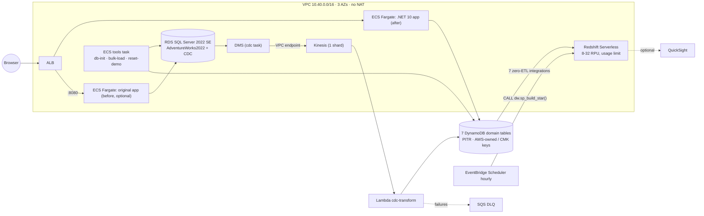

# AWS setup runbook (Phase 7)

How John deploys the AdventureWorks modernization to AWS from any computer, runs the demo, and tears it all down.
Everything here is **code that has not been applied** from this repository (no AWS calls were made while building it);
see "Verified only on AWS" for what the first real apply proves. Design decisions: ADR 0008 (IaC + hosting), ADR 0007 (warehouse).

## What gets deployed (`infra/live`)



| Module | Resources |
|---|---|
| `network` | VPC, 3 public + 3 private subnets, IGW, S3/DynamoDB gateway endpoints, Kinesis interface endpoint |
| `dynamodb` | 7 tables from `design/mapping/mapping.json` (PK/SK, GSIs, ALL projection, TTL `ttl`, streams, PITR, deletion protection); **W-1**: AWS-owned key on 5 tables, CMKs on `aw-customer`/`aw-hr` with Redshift zero-ETL key-policy grants |
| `source_db` | RDS SQL Server 2022 SE (license included, single-AZ, gp3, encrypted, private), option group `SQLSERVER_BACKUP_RESTORE`, backups bucket + restore role, master password in Secrets Manager |
| `cdc` | Kinesis stream, DMS subnet group / instance / SQL Server source + Kinesis target endpoints / `cdc` task (created stopped; `aws/dms/table-mappings.json`, `task-settings.json`), Lambda (`dist/aw-cdc-lambda.zip`), Kinesis event source mapping (partial batch failures, bisect, 5 retries, SQS DLQ), IAM |
| `app` | ECR repos (after, before, tools), ECS cluster, ALB (HTTP; HTTPS when `certificate_arn` set), after/before services, tools task definition, least-privilege task roles |
| `warehouse` | Phase 6: Redshift Serverless namespace/workgroup (case-sensitive identifiers), usage limit, resource policies, 7 zero-ETL integrations, static-data bucket, hourly scheduler (**W-2**), QuickSight data source/data set/refresh only when `enable_quicksight` (**W-4**) |

Environments: `infra/envs/demo.tfvars` (full CDC story) and `dev.tfvars` (`enable_source = false`: DynamoDB + .NET 10 app +
warehouse, no SQL Server/DMS). One environment per account+region (table names are fixed by the mapping).

## 0. Prerequisites (on the computer you deploy from)
- Git clone of `zander-zilla/AdventureWorks.Web`, **Terraform ≥ 1.11** (CI uses 1.11.4), **AWS CLI v2**, **Docker** (with
  buildx for `linux/amd64`), **Python 3.12** + `pip`, `zip`.
- Admin credentials for the target account for the one-time bootstrap (`aws sso login` / `aws configure sso`).
  Everything after the bootstrap can run from GitHub Actions with OIDC instead.
- Region: `us-east-1` (default; change `region` in `infra/envs/*.tfvars` and `*.s3.tfbackend` together).
- Your public IP: `curl -s https://checkip.amazonaws.com` → put `["<ip>/32"]` in `allowed_cidrs`.

## 1. Bootstrap (once per account)
```bash
terraform -chdir=infra/bootstrap init
terraform -chdir=infra/bootstrap apply            # add -var create_oidc_provider=false if the account already has the GitHub OIDC provider
terraform -chdir=infra/bootstrap output           # state_bucket, deploy_role_arn, plan_role_arn
```
Keep `infra/bootstrap/terraform.tfstate` safe (it is git-ignored) or move it into the new bucket afterwards.

## 2. Configure
- `infra/envs/demo.s3.tfbackend`: set `bucket` to `state_bucket` (or `export TF_STATE_BUCKET=<state_bucket>`; the scripts use it).
- `infra/envs/demo.tfvars`: `budget_alert_emails` (AWS Budgets alert, USD `budget_monthly_usd` = 50/month), `allowed_cidrs`, optionally `certificate_arn` (ACM, for HTTPS), `sql_instance_class`.
- GitHub (only if deploying from Actions): *Settings → Environments* → create `demo` (and `dev`). **Required for `demo`:** under
  *Deployment protection rules* tick *Required reviewers* and add John (decision 5, ADR 0008), so every
  plan/apply/destroy from Actions waits for approval; environment **variables** (not secrets): `AWS_DEPLOY_ROLE_ARN`, `TF_STATE_BUCKET`, `AWS_REGION`,
  `ALLOWED_CIDRS` (e.g. `["198.51.100.7/32"]`). Repository variables `AWS_PLAN_ROLE_ARN` + `TF_STATE_BUCKET` enable the
  real-plan CI job (read-only role). No access keys are stored anywhere.

## 3. Deploy the infrastructure + images
**From GitHub Actions**: *Actions → deploy (AWS, manual) → Run workflow* → environment `demo`, action `apply`.
It builds the Lambda package, plans + applies, builds/pushes the three images, and rolls ECS to the commit's tag.

**From the terminal**:
```bash
cdc/lambda/build.sh                                  # dist/aw-cdc-lambda.zip
scripts/aws/tf.sh demo init
scripts/aws/tf.sh demo apply -var app_desired_count=0   # ~25-40 min (RDS SQL Server and Redshift dominate)
scripts/aws/push-images.sh demo                      # build + push after/before/tools, apply with the new tag
scripts/aws/tf.sh demo apply                         # app_desired_count back to 1 (or edit the tfvars)
scripts/aws/push-showcase.sh demo                    # Phase 8 showcase site -> S3 + CloudFront (output showcase_url)
```

## 4. Load data and start CDC
```bash
scripts/aws/run-tool.sh demo db-init     # stages + restores AdventureWorks2022/LT, enables CDC on 68 tables, 7-day retention
#   -> prints CDC_START_TIME=2026-..Z  (note it)
scripts/aws/run-tool.sh demo bulk-load   # SQL Server -> 7 DynamoDB tables via the mapping (same loader as locally)
scripts/aws/start-cdc.sh demo <CDC_START_TIME>
aws dms describe-replication-tasks --query 'ReplicationTasks[].{id:ReplicationTaskIdentifier,status:Status}'
```
`db-init` and `bulk-load` are idempotent (existing DBs / CDC tables skipped; items overwritten with the same content).

## 5. Warehouse (Redshift query editor v2, as admin on `aw_dw`)
Follow docs/design/warehouse.md "Deploying on AWS" steps 3-6: `00_setup.sql` (integration ids =
`terraform -chdir=infra/live output redshift_integration_ids`), staging, star DDL, static data (`static_export.py` locally →
`aws s3 cp … s3://$(terraform -chdir=infra/live output -raw dw_static_bucket)/static/`), physical design, the build procedure
and `CALL dw.sp_build_star();`. The hourly schedule takes over. QuickSight (showcase only): subscribe to Enterprise, then
`enable_quicksight = true` + `quicksight_principal_arn`, apply, `aws/warehouse/quicksight/deploy.sh`.

## 6. Demo + smoke checks
- `terraform -chdir=infra/live output after_url before_url`
- Before app (`:8080`): log in as a demo customer, place an order → DMS → Kinesis → Lambda → `aw-sales` within seconds:
  `aws dynamodb query --table-name aw-sales --key-condition-expression 'PK = :p' --expression-attribute-values '{":p":{"S":"ORDER#<id>"}}'`
- After app (`/`): the same order under *My orders*; `/healthz` is the ALB health check.
- Lambda errors: CloudWatch `/aws/lambda/aw-demo-cdc-transform`; failed records land in the DLQ (`cdc_dlq_url` output).
- Redshift: ~15-30 min zero-ETL lag, then the next hourly build (or `CALL dw.sp_build_star()`).
- Reset the demo orders: `scripts/aws/run-tool.sh demo reset-demo` (CDC replicates the deletes as tombstones).

## 7. Teardown (after every demo)
```bash
scripts/aws/teardown.sh demo          # asks for the env name; or Actions → deploy → action destroy, confirm "demo"
```
Stops DMS, turns deletion protection off, `terraform destroy` (buckets/ECR force-deleted, no RDS final snapshot, KMS keys
scheduled for deletion in 7 days at no cost), then lists anything still tagged `Environment=demo`. The bootstrap (state
bucket, OIDC roles) stays — cents per month; `terraform -chdir=infra/bootstrap destroy` retires it (empty the versioned bucket first).

## Cost notes (us-east-1 on-demand list prices, rounded; verify with the AWS Pricing Calculator)
| Item | While deployed | Notes |
|---|---|---|
| RDS SQL Server 2022 **SE**, db.m6i.large, license included | **≈ $1.0/h** | Dominant cost (SQL licence). SE is the cheapest RDS edition with CDC. Stop/teardown after demos |
| DMS dms.t3.medium | ≈ $0.08/h | single-AZ, 20 GB |
| Kinesis 1 provisioned shard + KMS | ≈ $0.015/h | + tiny PUT payload units |
| Kinesis interface endpoint (3 AZs) | ≈ $0.03/h | cheaper than a NAT gateway (≈ $0.045/h + data) |
| ALB | ≈ $0.025/h | + LCUs (negligible at demo traffic) |
| Fargate: after + before (0.25 vCPU / 0.5 GB each) | ≈ $0.025/h | tools task (2 vCPU/4 GB) only while running (~$0.10/h) |
| Public IPv4 (ALB ×3, tasks ×2) | ≈ $0.025/h | $0.005/h per address |
| Redshift Serverless | $0.375 per RPU-hour **only while active** | 8 RPU base; each hourly build bills ≥ 60 s × 8 RPU ≈ $0.05 → ≈ $1.2/day; zero-ETL ingestion also uses compute. Monthly cap: `redshift_monthly_rpu_hours_limit` = 200 RPU-h (≈ $75) then queries are deactivated |
| DynamoDB on-demand + PITR + zero-ETL exports | cents/day | few hundred MB; PITR $0.20/GB-mo; exports $0.10/GB |
| KMS (2 table CMKs + warehouse key), Secrets Manager, CloudWatch Logs (14-day retention) | ≈ $4/month prorated | |
| QuickSight Enterprise (W-4, optional) | ≈ $24/author/month | showcase only; unsubscribing is a manual console step |

**Rule of thumb: the `demo` environment costs ≈ $1.2-1.3/hour (~$30/day) plus Redshift usage; a 3-hour demo including
setup ≈ $5-10. `dev` (no SQL Server/DMS) ≈ $0.1/hour plus Redshift.** Setting `app_desired_count = 0` saves little; the
SQL Server instance is what matters — tear down rather than leave it idle. A Budgets alert (e.g. $50/month) on the account is recommended.

## Verified only on AWS (first real apply)
- Provider-level: `aws_redshift_integration` + resource policies against CMK-encrypted tables (the key-policy grants for
  `aw-hr`/`aw-customer`), AWS-owned-key tables accepted by zero-ETL, Scheduler → Data API permissions (Phase 6 list in warehouse.md).
- RDS: `db.m6i.large` availability for SQL Server SE in the chosen region/version, native restore of the `.bak` files via
  the option group, `rds_cdc_enable_db` + 68 tables, DMS SQL Server source settings (`safeguardPolicy`, TLS `ssl_mode=require`).
- DMS Kinesis target `NoHexPrefix=true` passed as an extra connection attribute (the provider's `kinesis_settings` block does not
  expose it); if DMS ignores it, the transform still accepts `0x`-prefixed binary (check one binary column end-to-end).
- DMS start from `--cdc-start-time` with the bulk-load overlap; Lambda throughput / lookup retries at the full-load backlog.
- ECS: the original app's `/bin/sh` entry point override (connection string assembled from the secret), ALB health checks,
  the chiseled after image pulling from ECR without a NAT gateway (public IP).
- OIDC trust conditions (`environment:demo`) and that PowerUserAccess + scoped IAM covers every resource in the stack.
- Real costs (Cost Explorer, by the `Project`/`Environment` tags).

## Changes from initial design
Starting points: PLAN.md Phase 7 ("Terraform for all AWS resources, GitHub Actions pipelines"), docs/migration/cdc.md
("phase 7 Terraform runs the CDC setup before creating the DMS task", DMS `CdcStartPosition` = LSN), ADR 0004 P3-2, and the
standalone Phase 6 Terraform in `aws/warehouse/terraform`.

| # | Initial | As built | Why |
|---|---|---|---|
| 1 | Separate Terraform per phase (`aws/warehouse/terraform`) | One root `infra/live` composed of modules; the warehouse stack moved to `infra/modules/warehouse` (provider config removed, table ARNs passed in) | One plan/apply/destroy for the whole demo; teardown in one step |
| 2 | P3-2: AWS-managed key on 5 tables | AWS-owned key on 5 tables; CMKs on `aw-hr`/`aw-customer` with Redshift key-policy grants (W-1) | Zero-ETL rejects AWS-managed keys |
| 3 | CDC enablement as a Terraform `null_resource`/`sqlcmd` before the DMS task | One-off ECS tools task `db-init` (restore + CDC), DMS task created stopped and started by `start-cdc.sh` | RDS is private; no SQL client in Terraform runs; re-runnable |
| 4 | DMS `CdcStartPosition` = LSN captured before the bulk load | `--cdc-start-time` (UTC) captured by `db-init` | Simpler to capture and pass; idempotent position-conditional writes absorb the overlap |
| 5 | App hosting unspecified | ECS Fargate + ALB (ADR 0008) | App Runner closed to new customers (2026-04-30); Fargate runs the CI-tested image unchanged |
| 6 | – | No NAT gateway: public-subnet tasks, Kinesis interface endpoint, gateway endpoints | Cost |
| 7 | – | RDS SQL Server **Standard** edition | CDC on RDS needs SE/EE |
| 8 | DynamoDB Local endpoints in `appsettings.json` | Moved to `appsettings.Development.json`; production config has only the region | The container would otherwise point at localhost on AWS |
| 9 | Loader for DynamoDB Local only | `DDB_ENDPOINT=aws` uses real DynamoDB (tables owned by Terraform) | Bulk load on AWS with the same code |
| 10 | QuickSight created when a principal is set | Explicit `enable_quicksight` toggle (+ validation) | W-4 |
| 11 | `terraform validate` only in CI | fmt + validate + **offline plan tests** with mock providers; real plan only when the OIDC plan role exists | "plan in CI" without credentials or spend |

## Troubleshooting
- *DMS task fails to start*: `aws dms test-connection` (source) and check CDC is on (`SELECT is_cdc_enabled FROM sys.databases`).
- *Records in the DLQ*: usually `MissingParent` (child before parent during the initial backlog) — redrive the DLQ to the
  Lambda after the backlog drains; writes are idempotent.
- *Zero-ETL integration stuck in `needs_attention`*: check PITR, the table's key (must not be `aws/dynamodb`) and the
  resource policies (`terraform -chdir=infra/live state show 'module.warehouse.aws_redshift_resource_policy.namespace'`).
- *`terraform destroy` fails on DynamoDB*: deletion protection — use `scripts/aws/teardown.sh` (it disables it first).
