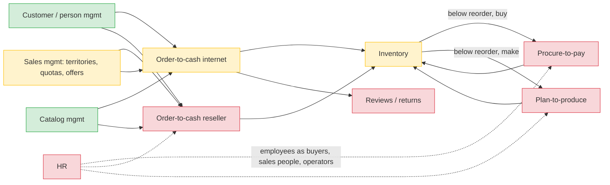

# Business processes in AdventureWorks2022 (Chapter 2 research)

> Generated by `scripts/business-processes/render.py`. Sources: `processes.py` (authored), [`evidence.json`](evidence.json) (from
> `scripts/business-processes/evidence.sql`, re-run in CI by the `before-stack` job after `reset-demo.sql`), `docs/design/access-patterns.json`.
> Machine-readable: [`business-processes.json`](business-processes.json) (for a future showcase tab).

The OLTP schema implies more business than the modernized app exposes. Phases 0-8 migrated **all** data and designed access
patterns for every domain, but the app only covers the shopper journey (browse → cart → checkout → my orders) plus catalog and
customer admin. This document infers the processes from FKs, status/date columns, triggers and the data itself.

**Evidenced vs inferred.** Each step is tagged **E** (visible in rows, FKs, triggers, procs) or *I* (implied but not provable).
Key caveat: the data is a *completed history* - every sales order is Shipped (status 5) and every work order is closed - so the
intermediate states in the state machines come from the status-text functions (`ufnGetSalesOrderStatusText`, ...) and are
inferred transitions. Purchase-order statuses are present but inconsistent with receipt quantities (synthetic data).

Strong cross-table invariants the triggers leave behind (evidenced):

- `TransactionHistory` type **S** rows (current + archive) = 121,317 = `SalesOrderDetail` rows: one stock-out per order line.
- type **W** rows = 72,591 = `WorkOrder` rows.
- type **P** rows = 8,788 vs 8,845 `PurchaseOrderDetail` lines.

## Processes

| Process | Steps (E/total) | App pages | Access patterns | Key gap |
|---|---|---|---|---|
| [Order-to-cash: internet (B2C)](o2c-internet.md) | 6/8 | 6 | 14 | No back-office order screen: orders stay at status 1 forever; SAL-05 (orders by status) and SAL-06 (ship/cancel/revise) are designed but no page uses them. |
| [Order-to-cash: reseller (B2B)](o2c-reseller.md) | 4/7 | 1 | 10 | No sales-person workspace: no screen to key a reseller order, look up a store (CUS-07), or find an order by PO number (SAL-13). |
| [Procure-to-pay](procure-to-pay.md) | 5/8 | 0 | 8 | Entire process has no UI: all 7 PUR patterns are designed and load-tested but unused by the app. |
| [Plan-to-produce (work orders, BOM, routing, scrap)](plan-to-produce.md) | 6/7 | 0 | 4 | No production UI: BOM explosion (INV-04), where-used (INV-05) and work-order/routing (INV-06) are designed but unused. |
| [Inventory management](inventory.md) | 3/4 | 1 | 4 | No stock-by-location page, no low-stock dashboard (INV-02 sparse index exists, unused). |
| [Sales management (territories, quotas, special offers)](sales-management.md) | 5/5 | 0 | 6 | Analytics exist (Redshift/QuickSight) but no operational UI: no quota entry, territory reassignment, or promotion maintenance. |
| [Customer / person management](customer-person.md) | 5/6 | 2 | 11 | No self-service profile: shopper cannot add an address, email, phone or card (CUS-09 designed, unused). |
| [Human resources (hire, department moves, pay, shifts)](hr.md) | 5/6 | 0 | 6 | No HR UI at all; org-chart (HR-03, materialised path) is designed but unused. |
| [Product catalog management](catalog.md) | 5/5 | 3 | 10 | Price edit in Products admin does not append a PRICE# history item (no PRICE#/ListPriceHistory write in src/), although CAT-07 requires it; the Redshift SCD2 dim_product will miss app price changes. |
| [Product reviews and returns](reviews-returns.md) | 1/3 | 0 | 1 | Reviews: CAT-11 is designed (REVIEW# items under the product) but product detail neither shows nor accepts reviews. |

## Process landscape



Green: app pages exist. Yellow: partly (shop only, or analytics only). Red: data migrated and patterns designed, no UI.

## Chapter 2 feature candidates (prioritized)

| # | Feature | Processes | Patterns | Effort | Demo value |
|---|---|---|---|---|---|
| 1 | Back-office order fulfilment (approve → pick → ship, cancel) | o2c-internet, o2c-reseller, inventory | SAL-05, SAL-06, INV-03, INV-01 | M | Closes the loop on orders placed in the new shop (they sit at status 1 today). Shows the sparse ORDERSTATUS GSI, a TransactWriteItems status change + stock decrement + S transaction, CDC to the before app and zero-ETL to Redshift in one click. |
| 2 | Real pricing at checkout: special offers, tax by state, ship-method freight | o2c-internet, sales-management | CAT-10, REF-02, REF-04 | S | Replaces demo 8%/2.5% with the real tables; a new promotion immediately changes shop prices; shows denormalised offer items on the product partition. |
| 3 | Procurement workspace: low-stock → suggested PO → approve → receive | procure-to-pay, inventory | INV-02, PUR-02, PUR-04, PUR-05, PUR-07 | L | A whole new domain (aw-purchasing) going live with no UI before; the reorder → vendor → PO → receipt chain is a story business stakeholders understand; status machine with partial receipts and rejects. |
| 4 | Product reviews on product detail | reviews-returns | CAT-11 | S | Cheap, visible shopper feature; one-partition read with the product; good warm-up for a write path through CDC. |
| 5 | Production floor: open work orders, routing timeline, BOM explorer, scrap | plan-to-produce | INV-04, INV-05, INV-06 | M | Shows the 'hard' patterns solved in DynamoDB (recursive BOM, where-used) and a visual routing Gantt; strong technical showcase. |
| 6 | Sales-person workspace: my stores, reseller order entry by PO number, quota attainment | o2c-reseller, sales-management | CUS-07, SAL-07, SAL-10, SAL-12, SAL-13, SAL-08 | M | Mixes DynamoDB operational reads with a Redshift attainment tile (D7 split in action). |
| 7 | Customer self-service profile (addresses, cards, email opt-in) | customer-person | CUS-09, CUS-03 | S | Lets a shopper add a ship-to address before checkout; small but completes the shopper journey. |
| 8 | Analytics additions: promotion effectiveness, vendor performance, production scrap/on-time | sales-management, procure-to-pay, plan-to-produce | DW-04 | M | New Redshift views over zero-ETL data that AdventureWorksDW never had: shows the warehouse is more than a DW rebuild. |
| 9 | HR: employee directory + org chart | hr | HR-01, HR-03, HR-04 | M | Hierarchy via materialised path is a nice pattern, but HR is far from the shop story. |
| 10 | Returns / RMA | reviews-returns | new | L | Net-new data model (no source data); only worth it to show green-field DynamoDB design after migration. |

Ranking rule: (1) finishes a story the demo already starts (orders placed but never shipped), (2) reuses designed-but-unused
access patterns, so the work is app code not data design, (3) shows something visible in the before/after/replication
showcase, (4) cost. Recommended Chapter 2 scope: #1 + #2 + #4 (complete order-to-cash for the shop), then #3 as the
headline new domain.

## Regenerate

```bash
scripts/before-up.sh && docker exec -i aw-before-sqlserver-1 /opt/mssql-tools18/bin/sqlcmd -C -S localhost -U sa -P 'AdvWorks!2026' -b < scripts/reset-demo.sql
scripts/business-processes/run.sh      # evidence.json (CI: before-stack job)
python3 scripts/business-processes/render.py   # md + business-processes.json (CI: generated-docs job)
```
