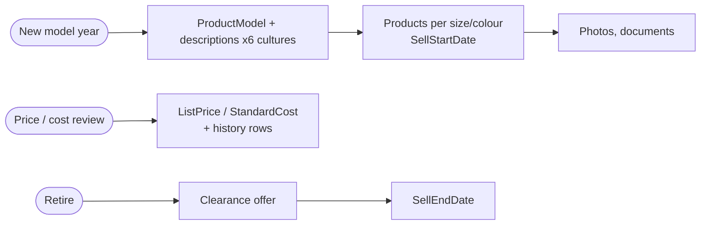
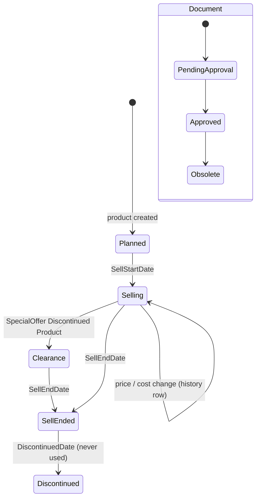

# Product catalog management

> Generated by `scripts/business-processes/render.py` from `processes.py` + [`evidence.json`](evidence.json). Do not edit by hand.

Product management introduces products (by model, with multilingual descriptions, photos, documents), maintains list price and standard cost history, and retires products via SellEndDate / DiscontinuedDate.

**Domain:** Production / Catalog  
**Actors:** Product manager / marketing, Engineering (documents, BOM), Cost accounting (standard cost)  
**Trigger:** New model year, price/cost review, product retirement.

Basis: **E** = evidenced in the data / schema, *I* = inferred.

## Process flow

## Steps

| # | Step | Actor | Reads | Writes | Basis | Notes |
|---|---|---|---|---|---|---|
| 1 | Create model + descriptions | Product manager | Production.Culture | Production.ProductModel Production.ProductDescription Production.ProductModelProductDescriptionCulture Production.Illustration | **E** | 128 models, 762 descriptions in 6 cultures. |
| 2 | Create product (SKU) | Product manager | Production.ProductSubcategory Production.UnitMeasure | Production.Product (MakeFlag, FinishedGoodsFlag, SellStartDate) Production.ProductProductPhoto | **E** | Products introduced in waves: 2008, 2011, 2012, 2013. 209 products have no subcategory (components). |
| 3 | Attach documents | Engineering | – | Production.Document (Status) Production.ProductDocument | **E** | Document status 1 Pending approval / 2 Approved / 3 Obsolete (ufnGetDocumentStatusText). |
| 4 | Change list price / standard cost | Product manager / cost accounting | – | Production.Product (ListPrice, StandardCost) Production.ProductListPriceHistory Production.ProductCostHistory | **E** | 52 products have 2 price versions, 25 have 3. |
| 5 | Retire | Product manager | – | Production.Product.SellEndDate / DiscontinuedDate Sales.SpecialOffer (clearance) | **E** | 98 products sell-ended; DiscontinuedDate never used. |

## State machine: `Production.Product (SellStartDate / SellEndDate / DiscontinuedDate)`

| Value | Meaning |
|---|---|
| planned | SellStartDate in future |
| selling | SellEndDate null |
| sell_ended | SellEndDate set |
| discontinued | DiscontinuedDate set (0 rows) |

## Evidence

| Metric | Values | Note |
|---|---|---|
| `product.lifecycle` | sell_ended: 98 selling: 406 |  |
| `product.sellstart_year` | 2008: 211 2011: 72 2012: 85 2013: 136 |  |
| `product.flags` | make=0 finished=0: 182 make=0 finished=1: 83 make=1 finished=0: 27 make=1 finished=1: 212 |  |
| `product.no_subcategory` | all: 209 |  |
| `pricehistory.versions` | 1: 216 2: 52 3: 25 |  |
| `costhistory.versions` | 1: 216 2: 52 3: 25 |  |
| `document.status` | 1: 2 2: 10 3: 1 |  |
| `photo.nonplaceholder_products` | all: 158 |  |

## Coverage in the modernized system

**DynamoDB access patterns (designed, loaded, tested):**

- `CAT-01` (dynamodb) What product categories (and their subcategories) can I shop?
- `CAT-02` (dynamodb) Show / create / edit / delete a category or subcategory
- `CAT-04` (dynamodb) Show me everything about this product
- `CAT-05` (dynamodb) Find a product by its product number (SKU)
- `CAT-06` (dynamodb) List all products (admin grid)
- `CAT-07` (dynamodb) Create / update / retire a product
- `CAT-08` (dynamodb) What products belong to this model, and what is the model's catalog description/instructions?
- `CAT-09` (dynamodb) What was this product's list price / standard cost on a given date?
- `CAT-12` (dynamodb) Search products by free text (name, description, color)
- `CAT-13` (dynamodb) Show the culture-specific description (en, fr, es, ...)

**App pages:** Products admin (list, details, create, edit, deactivate); Categories admin; Product detail with 6-culture descriptions

**Redshift:** dw.dim_product (SCD2 on price history); dw.dim_product_category / _subcategory

## Gaps

- Price edit in Products admin does not append a PRICE# history item (no PRICE#/ListPriceHistory write in src/), although CAT-07 requires it; the Redshift SCD2 dim_product will miss app price changes.
- No product model / description editor, no photo or document management, no document approval.
- Best-covered process today; Chapter 2 value is small.
