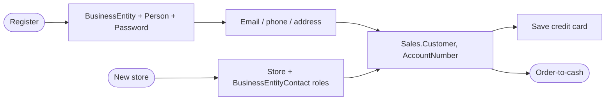
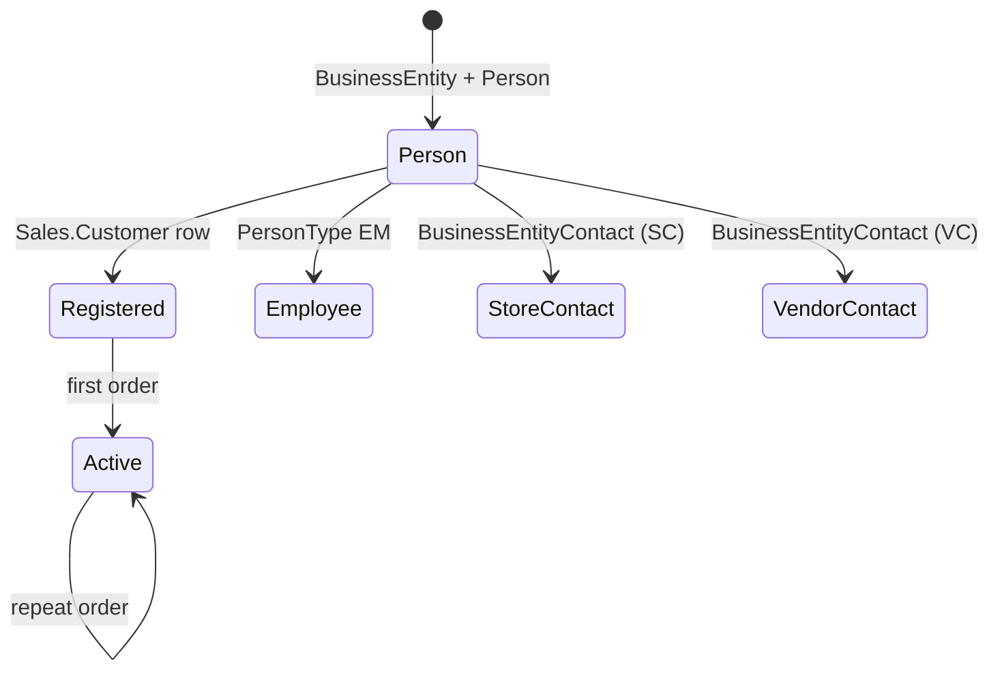

# Customer / person management

> Generated by `scripts/business-processes/render.py` from `processes.py` + [`evidence.json`](evidence.json). Do not edit by hand.

Every party (individual, store, vendor, employee, contact) is a BusinessEntity with addresses, emails, phones and contact roles; individuals register as customers, stores get contacts, cards are saved for checkout.

**Domain:** Person / Customer  
**Actors:** Shopper (self-service), Customer service / admin, Sales person (store contacts), Marketing (email promotion opt-in)  
**Trigger:** Registration, profile change, new store account, or a new vendor/employee contact.

Basis: **E** = evidenced in the data / schema, *I* = inferred.

## Process flow

## Steps

| # | Step | Actor | Reads | Writes | Basis | Notes |
|---|---|---|---|---|---|---|
| 1 | Create business entity + person | Shopper / admin | – | Person.BusinessEntity Person.Person (PersonType, EmailPromotion, Demographics) Person.Password | **E** | Trigger iuPerson maintains Demographics XML; all 19,972 people have it. |
| 2 | Add contact channels | Shopper | Person.PhoneNumberType Person.AddressType Person.StateProvince | Person.EmailAddress Person.PersonPhone Person.Address Person.BusinessEntityAddress | **E** | Addresses typed Home 18,774, Main Office 805, Shipping 35. |
| 3 | Become a customer | System | Sales.SalesTerritory | Sales.Customer (PersonID and/or StoreID, TerritoryID, AccountNumber) | **E** | 18,484 individuals, 701 stores, 635 store contacts as customers; 19,119 have ordered. |
| 4 | Save a card | Shopper | – | Sales.CreditCard Sales.PersonCreditCard | **E** | 19,118 cards across 4 card types. |
| 5 | Maintain store and its contacts | Sales person | Person.ContactType | Sales.Store (Demographics) Person.BusinessEntityContact | **E** | 909 contacts in 7 roles (Owner, Purchasing Agent/Manager...). |
| 6 | Marketing opt-in | Marketing | Person.Person.EmailPromotion | – | *I* | EmailPromotion 0/1/2 (none / AW / AW + partners) suggests campaign targeting; DW ProspectiveBuyer / vTargetMail support it. |

## State machine: `Sales.Customer (derived)`

| Value | Meaning |
|---|---|
| prospect | Person without Customer |
| registered | Customer, no orders |
| active | has orders |

## Evidence

| Metric | Values | Note |
|---|---|---|
| `person.type` | EM: 273 GC: 289 IN: 18,484 SC: 753 SP: 17 VC: 156 |  |
| `customer.kind` | person: 18,484 store: 701 store_contact: 635 |  |
| `customer.with_orders` | all: 19,119 |  |
| `address.type` | Home: 18,774 Main Office: 805 Shipping: 35 |  |
| `contact.type` | Assistant Sales Agent: 18 Owner: 266 Purchasing Agent: 242 Purchasing Manager: 245 Sales Agent: 54 Sales Associate: 44 Sales Manager: 40 |  |
| `creditcard.type` | ColonialVoice: 4,782 Distinguish: 4,832 SuperiorCard: 4,839 Vista: 4,665 |  |
| `person.email_promotion` | 0: 11,158 1: 5,044 2: 3,770 |  |
| `person.with_demographics` | all: 19,972 |  |

## Coverage in the modernized system

**DynamoDB access patterns (designed, loaded, tested):**

- `CUS-01` (dynamodb) Log me in with my email and password
- `CUS-02` (dynamodb) Show my profile: name, emails, phones, addresses, saved cards (masked)
- `CUS-03` (dynamodb) Which addresses / cards can I use at checkout?
- `CUS-04` (dynamodb) Register / update / delete a customer (unique account number and email)
- `CUS-05` (dynamodb) List customers (admin grid), paged
- `CUS-06` (dynamodb) Find a customer by account number
- `CUS-07` (dynamodb) Show a store with its contacts, addresses and demographics
- `CUS-08` (dynamodb) Show a person's demographics
- `CUS-09` (dynamodb) Add / update my address, email, phone or card
- `CUS-10` (redshift) Customers in a territory
- `CUS-11` (dynamodb) Contact info for any business entity (person, store, vendor contact, employee)

**App pages:** Login (demo); Customers admin: list, details, create, edit name

**Redshift:** dw.dim_customer; dw.dim_geography; dw.dim_reseller

## Gaps

- No self-service profile: shopper cannot add an address, email, phone or card (CUS-09 designed, unused).
- No store / contact management screen (CUS-07, CUS-11).
- Login accepts only 5 demo customers with a shared password; real registration + password hash not used.
- No customer 360 (orders + demographics + territory) in the app.
