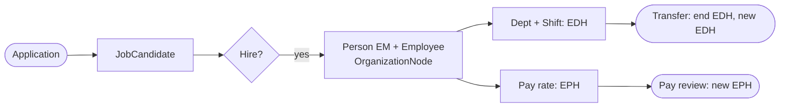
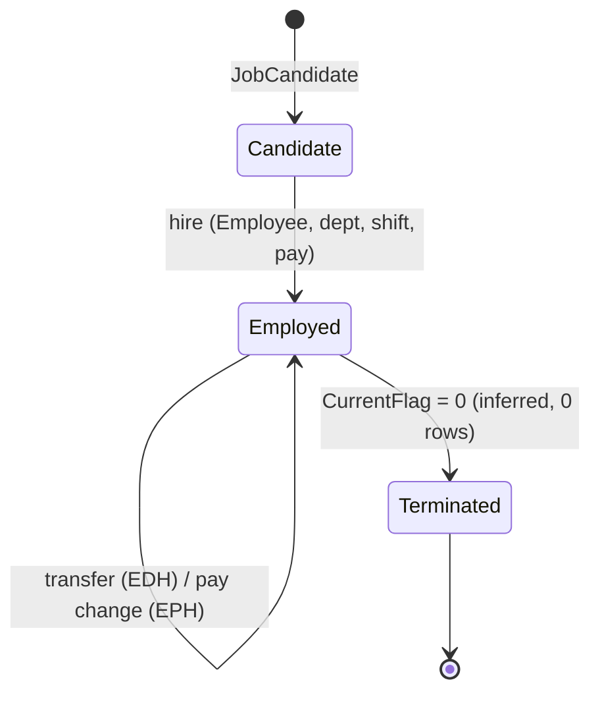

# Human resources (hire, department moves, pay, shifts)

> Generated by `scripts/business-processes/render.py` from `processes.py` + [`evidence.json`](evidence.json). Do not edit by hand.

Candidates apply, are hired into a department and shift with a pay rate; employees move departments/shifts and get pay changes; the org chart is a hierarchy.

**Domain:** HumanResources  
**Actors:** HR (Human Resources dept), Hiring manager, Employee, Job candidate  
**Trigger:** Vacancy / application, transfer, pay review.

Basis: **E** = evidenced in the data / schema, *I* = inferred.

## Process flow

## Steps

| # | Step | Actor | Reads | Writes | Basis | Notes |
|---|---|---|---|---|---|---|
| 1 | Receive application | Candidate | – | HumanResources.JobCandidate (Resume XML) | **E** | 13 candidates; uspSearchCandidateResumes. |
| 2 | Hire | HR | HumanResources.Department HumanResources.Shift | Person.BusinessEntity / Person.Person (EM) HumanResources.Employee (HireDate, JobTitle, OrganizationNode) EmployeeDepartmentHistory EmployeePayHistory JobCandidate.BusinessEntityID | **E** | 2 of 13 candidates are linked to an employee; hires peak 2008-2009. uspUpdateEmployeeHireInfo writes Employee + PayHistory together. |
| 3 | Transfer department / shift | HR | – | EmployeeDepartmentHistory (close EndDate, insert new) | **E** | 5 employees have moved (6 ended assignments). |
| 4 | Change pay | HR | – | EmployeePayHistory (RateChangeDate, Rate, PayFrequency) | **E** | 13 employees have 3 rates; others 1. |
| 5 | Update login / personal info | HR / employee | – | HumanResources.Employee | **E** | uspUpdateEmployeeLogin, uspUpdateEmployeePersonalInfo. |
| 6 | Terminate | HR | – | Employee.CurrentFlag = 0 | *I* | dEmployee blocks deletes; CurrentFlag is 1 for all 290, so no terminations recorded. |

## State machine: `HumanResources.Employee (CurrentFlag) + JobCandidate`

| Value | Meaning |
|---|---|
| candidate | JobCandidate, BusinessEntityID null |
| employed | CurrentFlag = 1 |
| terminated | CurrentFlag = 0 (never seen) |

## Evidence

| Metric | Values | Note |
|---|---|---|
| `emp.flags` | current=1 salaried=0: 238 current=1 salaried=1: 52 |  |
| `emp.org_level` | 1: 6 2: 27 3: 66 4: 190 null: 1 |  |
| `emp.hires_by_year` | 2006: 1 2007: 6 2008: 74 2009: 148 2010: 38 2011: 16 2012: 4 2013: 3 |  |
| `edh.assignments_per_emp` | 1: 285 2: 4 3: 1 |  |
| `edh.ended` | EndDate not null: 6 |  |
| `edh.current_by_shift` | Day: 176 Evening: 62 Night: 52 |  |
| `edh.current_by_group` | Executive General and Administration: 35 Inventory Management: 18 Manufacturing: 185 Quality Assurance: 11 Research and Development: 14 Sales and Marketing: 27 |  |
| `eph.rates_per_emp` | 1: 277 3: 13 |  |
| `eph.frequency` | 1: 180 2: 136 |  |
| `jobcandidate.hired` | applicant: 11 linked_to_employee: 2 |  |

## Coverage in the modernized system

**DynamoDB access patterns (designed, loaded, tested):**

- `HR-01` (dynamodb) Show an employee with current department, shift, job title and pay
- `HR-02` (dynamodb) Show an employee's department and pay history
- `HR-03` (dynamodb) Who reports to this manager (all levels) / what is this employee's management chain?
- `HR-04` (dynamodb) Who is currently in this department?
- `HR-05` (dynamodb) Update hire info, login, personal info
- `HR-06` (out-of-scope) List job candidates; search résumés by text

**App pages:** none

**Redshift:** dw.dim_employee (SCD2 per department assignment)

## Gaps

- No HR UI at all; org-chart (HR-03, materialised path) is designed but unused.
- Recruiting (JobCandidate résumé search) explicitly out of scope (HR-06).
- Hire is a multi-table transaction (Person + Employee + EDH + EPH) that the DynamoDB design has no write pattern for beyond HR-05.
