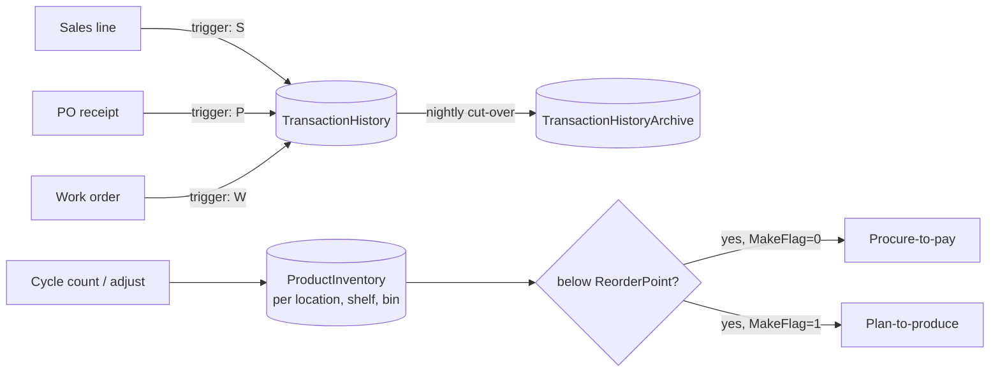

# Inventory management

> Generated by `scripts/business-processes/render.py` from `processes.py` + [`evidence.json`](evidence.json). Do not edit by hand.

Stock is held per product per location (14 locations, shelf/bin); every sale, purchase receipt and work order writes a stock transaction; old transactions are archived; reorder points and safety stock drive replenishment.

**Domain:** Production / Inventory  
**Actors:** Inventory controller (Inventory Management, 18 staff), Buyer, Planner, System triggers  
**Trigger:** Any stock movement (sale S, purchase P, work order W) or a periodic stock review.

Basis: **E** = evidenced in the data / schema, *I* = inferred.

## Process flow

## Steps

| # | Step | Actor | Reads | Writes | Basis | Notes |
|---|---|---|---|---|---|---|
| 1 | Record movement | System (triggers) | – | Production.TransactionHistory (S/P/W) | **E** | S = sales lines, W = work orders, P = PO receipts; written by triggers, not by users. |
| 2 | Adjust on-hand per location/bin | Inventory controller | Production.Location | Production.ProductInventory (Quantity, Shelf, Bin) | *I* | Nothing links transactions to ProductInventory quantities; they are maintained separately (cycle counts). |
| 3 | Review reorder / safety stock | Inventory controller | Production.Product (ReorderPoint, SafetyStockLevel) Production.ProductInventory dbo.ufnGetStock | – | **E** | 60 sellable products below reorder point, 122 below safety stock (current snapshot). |
| 4 | Archive old transactions | DBA / batch | Production.TransactionHistory | Production.TransactionHistoryArchive | **E** | Archive covers 2011-04-16..2013-07-30, current 2013-07-31..2014-08-03: a clean date cut-over. |

## State machine: `Production.Product stock level vs ReorderPoint / SafetyStockLevel (derived)`

| Value | Meaning |
|---|---|
| ok | on hand >= ReorderPoint |
| reorder | SafetyStockLevel <= on hand < ReorderPoint |
| below_safety | on hand < SafetyStockLevel |

```mermaid
stateDiagram-v2
    [*] --> OK
    OK --> Reorder: on hand < ReorderPoint
    Reorder --> BelowSafety: on hand < SafetyStockLevel
    Reorder --> OK: receipt (P) / work order (W)
    BelowSafety --> OK: receipt / work order
    note right of BelowSafety: derived; 122 sellable products today
```

## Evidence

| Metric | Values | Note |
|---|---|---|
| `th.type` | archive:P: 922 archive:S: 46,742 archive:W: 41,589 current:P: 7,866 current:S: 74,575 current:W: 31,002 |  |
| `th.daterange` | archive: 2011-04-16..2013-07-30 current: 2013-07-31..2014-08-03 |  |
| `inv.by_location` | Debur and Polish: 7 rows / 958 units Final Assembly: 141 rows / 20419 units Finished Goods Storage: 151 rows / 17319 units Frame Forming: 46 rows / 13584 units Frame Welding: 20 rows / 5165 units Metal Storage: 51 rows / 20295 units Miscellaneous Storage: 201 rows / 83173 units Paint: 9 rows / 508 units Paint Shop: 5 rows / 186 units Paint Storage: 5 rows / 110 units Sheet Metal Racks: 12 rows / 5549 units Specialized Paint: 3 rows / 332 units Subassembly: 251 rows / 95477 units Tool Crib: 167 rows / 72899 units |  |
| `inv.products_with_stock` | distinct: 432 |  |
| `inv.below_reorder` | products: 60 |  |
| `inv.below_safety` | products: 122 |  |
| `edh.current_by_group` | Inventory Management: 18 |  |

## Coverage in the modernized system

**DynamoDB access patterns (designed, loaded, tested):**

- `INV-01` (dynamodb) How many units of this product are on hand, per location and in total?
- `INV-02` (dynamodb) Which products are below their reorder point / safety stock?
- `INV-03` (dynamodb) Record a stock movement and list movements for a product over a date range
- `INV-07` (redshift) Daily inventory balance per product (history)

**App pages:** Products admin shows a stock copy (total on hand) only

**Redshift:** dw.fact_product_inventory (daily balance, INV-07)

## Gaps

- No stock-by-location page, no low-stock dashboard (INV-02 sparse index exists, unused).
- Checkout does not reserve or decrement stock and writes no S transaction, so DynamoDB-native orders break the S-rows = order-lines invariant.
- No stock adjustment / transfer between locations.
