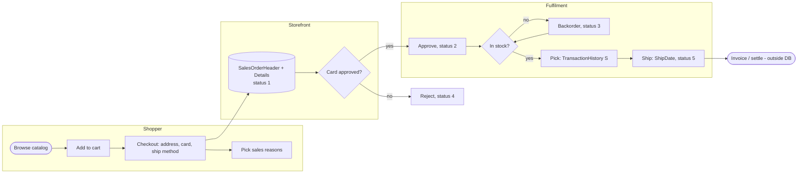
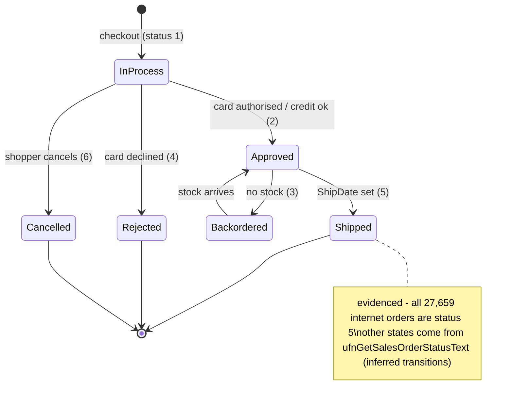

# Order-to-cash: internet (B2C)

> Generated by `scripts/business-processes/render.py` from `processes.py` + [`evidence.json`](evidence.json). Do not edit by hand.

An individual customer browses, fills a cart, checks out with a credit card; the order is approved, picked from finished-goods stock, shipped by truck ground and settled on the card.

**Domain:** Sales  
**Actors:** Shopper (Person.PersonType = IN), Web storefront, Fulfilment / warehouse, Payment processor (card approval code)  
**Trigger:** Shopper places an order on the web site (OnlineOrderFlag = 1).

Basis: **E** = evidenced in the data / schema, *I* = inferred.

## Process flow

## Steps

| # | Step | Actor | Reads | Writes | Basis | Notes |
|---|---|---|---|---|---|---|
| 1 | Browse catalog | Shopper | Production.ProductCategory Production.ProductSubcategory Production.Product Production.ProductModelProductDescriptionCulture Sales.SpecialOfferProduct | – | **E** | Only sellable products (SellEndDate null). |
| 2 | Add to cart | Shopper | Sales.ShoppingCartItem | Sales.ShoppingCartItem | **E** | Cart table exists but holds only 3 rows: carts are transient. |
| 3 | Check out (address, card, ship method) | Shopper | Person.BusinessEntityAddress Person.Address Sales.PersonCreditCard Sales.CreditCard Purchasing.ShipMethod Sales.SalesTaxRate Sales.CurrencyRate | Sales.SalesOrderHeader Sales.SalesOrderDetail Sales.SalesOrderHeaderSalesReason | **E** | Every internet order uses XRQ - TRUCK GROUND; DueDate = OrderDate + 12 days; ~46% carry a currency rate (foreign-currency web shop). |
| 4 | Ask why the shopper bought (sales reasons) | Shopper | Sales.SalesReason | Sales.SalesOrderHeaderSalesReason | **E** | Survey-style reasons (Price dominates). AdventureWorksDW models them as internet-only (FactInternetSalesReason). |
| 5 | Authorise card | Payment processor | – | Sales.SalesOrderHeader.CreditCardApprovalCode | *I* | Approval code column exists; there is no payment / settlement table, so capture and settlement are outside the DB. |
| 6 | Approve and pick | Fulfilment | Production.ProductInventory | Sales.SalesOrderHeader.Status (1→2) Production.TransactionHistory (type S) | **E** | Trigger iduSalesOrderDetail writes one TransactionHistory row of type S per order line: S rows (current+archive) = order lines exactly. It does NOT decrement ProductInventory. |
| 7 | Ship | Fulfilment | – | Sales.SalesOrderHeader.ShipDate Sales.SalesOrderHeader.Status (→5) | **E** | Every historical order is Shipped; ShipDate = OrderDate + 7 days for all internet orders; no carrier tracking on internet lines. |
| 8 | Invoice / collect | Finance | Sales.SalesOrderHeader (SubTotal, TaxAmt, Freight, TotalDue) | – | *I* | TotalDue is a computed column; there is no invoice, payment or AR table. Cash side lives only in DW FactFinance (static). |

## State machine: `Sales.SalesOrderHeader.Status`

| Value | Meaning |
|---|---|
| 1 | In process |
| 2 | Approved |
| 3 | Backordered |
| 4 | Rejected |
| 5 | Shipped |
| 6 | Cancelled |

## Evidence

| Metric | Values | Note |
|---|---|---|
| `soh.status_by_channel` | internet:5: 27,659 | every internet order is Shipped: the DB holds only completed history |
| `soh.ship_minus_order_days` | internet:7: 27,659 | constant 7-day ship lag (synthetic) |
| `soh.due_minus_order_days` | internet:12: 27,659 |  |
| `soh.with_creditcard` | internet: 26,535 | of 27,659; the rest have no card on file |
| `soh.with_currencyrate` | internet: 12,799 |  |
| `soh.shipmethod` | internet:XRQ - TRUCK GROUND: 27,659 |  |
| `sales_reason.orders` | Manufacturer: 1,746 On Promotion: 3,515 Other: 1,395 Price: 17,473 Quality: 1,551 Review: 1,245 Television  Advertisement: 722 |  |
| `sod.discounted_lines` | internet: 0 | internet lines are never discounted |
| `th.type` | current:S: 74,575 archive:S: 46,742 | S rows = 121,317 = SalesOrderDetail rows: one stock-out transaction per order line |
| `cart.items` | all: 3 |  |

## Coverage in the modernized system

**DynamoDB access patterns (designed, loaded, tested):**

- `CAT-01` (dynamodb) What product categories (and their subcategories) can I shop?
- `CAT-03` (dynamodb) Which products are in this subcategory that I can buy now?
- `CAT-04` (dynamodb) Show me everything about this product
- `SAL-01` (dynamodb) Add / change / remove an item in my cart, and show my cart
- `SAL-02` (dynamodb) Check out: turn my cart into an order (header + lines) with tax, freight, totals
- `SAL-03` (dynamodb) Show my order history, newest first
- `SAL-04` (dynamodb) Show one order with its lines (and sales reasons)
- `SAL-05` (dynamodb) Which orders are in status X (e.g. in process / to ship) by date?
- `SAL-06` (dynamodb) Ship / cancel / revise an order
- `SAL-13` (dynamodb) Find an order by purchase order number or card approval code
- `CUS-01` (dynamodb) Log me in with my email and password
- `CUS-03` (dynamodb) Which addresses / cards can I use at checkout?
- `REF-02` (dynamodb) What sales tax applies to a ship-to state?
- `REF-04` (dynamodb) Which ship methods are available and what do they cost?

**App pages:** Shop: browse; Product detail; Search; Cart; Checkout; My orders / order

**Redshift:** dw.fact_internet_sales; dw.fact_internet_sales_reason; dw.v_sales (QuickSight)

## Gaps

- No back-office order screen: orders stay at status 1 forever; SAL-05 (orders by status) and SAL-06 (ship/cancel/revise) are designed but no page uses them.
- Checkout uses flat demo tax (8%) and freight (2.5%) instead of Sales.SalesTaxRate (REF-02) and ShipMethod rates (REF-04).
- No special-offer pricing at checkout (CAT-10 designed, unused).
- Sales reasons are not captured at checkout (SalesOrderHeaderSalesReason only arrives via CDC for SQL orders).
- No stock check / stock movement on order: SQL wrote TransactionHistory type S per line; DynamoDB checkout writes nothing to aw-inventory (INV-03 unused).
- No multi-currency: CurrencyRate (REF-03) is loaded but the shop prices in USD only.
- Payment, invoice and cash receipt have no OLTP tables at all (gap in the source schema, not just the app).
