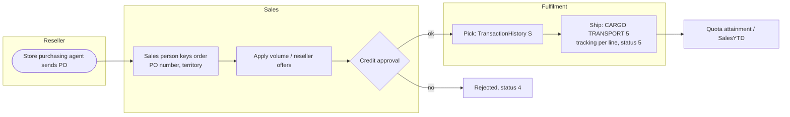
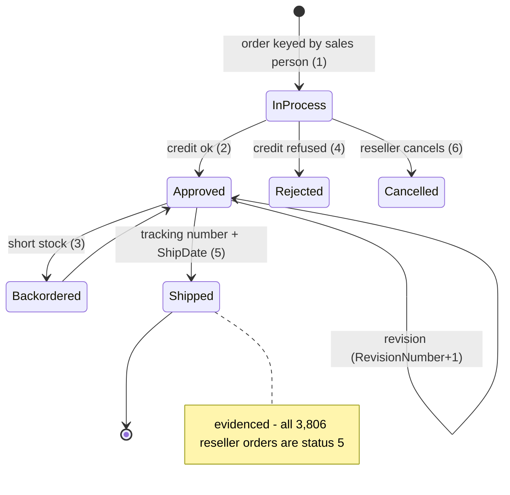

# Order-to-cash: reseller (B2B)

> Generated by `scripts/business-processes/render.py` from `processes.py` + [`evidence.json`](evidence.json). Do not edit by hand.

A sales person takes an order from a reseller store against the store's purchase order number; volume discounts apply; the order ships by cargo with carrier tracking per line and counts toward the sales person's quota.

**Domain:** Sales  
**Actors:** Sales person (Person.PersonType = SP), Store contact / purchasing agent (SC), Sales manager, Fulfilment / shipping  
**Trigger:** Reseller sends a purchase order to its assigned sales person (OnlineOrderFlag = 0, PurchaseOrderNumber set).

Basis: **E** = evidenced in the data / schema, *I* = inferred.

## Process flow

## Steps

| # | Step | Actor | Reads | Writes | Basis | Notes |
|---|---|---|---|---|---|---|
| 1 | Receive reseller PO | Sales person | Sales.Store Person.BusinessEntityContact Person.ContactType | – | *I* | Contacts typed Purchasing Agent / Purchasing Manager (487 of 909) are the store's buyers. |
| 2 | Enter order with PO number | Sales person | Sales.Customer (StoreID) Sales.SalesPerson Sales.SalesTerritory Person.Address (Main Office / Shipping) | Sales.SalesOrderHeader (SalesPersonID, TerritoryID, PurchaseOrderNumber) Sales.SalesOrderDetail | **E** | All 3,806 reseller orders have a sales person and a PO number; 0 internet orders do. |
| 3 | Apply volume / reseller promotions | Sales person | Sales.SpecialOffer Sales.SpecialOfferProduct | Sales.SalesOrderDetail (SpecialOfferID, UnitPriceDiscount) | **E** | 3,282 discounted reseller lines; Volume Discount 11-14 alone is on 3,428 lines. |
| 4 | Credit approval (card or terms) | Sales manager | Sales.CreditCard | Sales.SalesOrderHeader.Status (1→2 or 4) | *I* | 3,799 of 3,806 reseller orders carry a card id; terms/credit limit do not exist in the schema. |
| 5 | Pick and ship with tracking | Fulfilment | Production.ProductInventory | Production.TransactionHistory (S) Sales.SalesOrderDetail.CarrierTrackingNumber Sales.SalesOrderHeader (ShipDate, Status 5) | **E** | Every reseller line has a carrier tracking number; all ship by CARGO TRANSPORT 5. |
| 6 | Revise order | Sales person | – | Sales.SalesOrderHeader.RevisionNumber | **E** | Trigger uSalesOrderHeader bumps RevisionNumber; 30 orders are at revision 9 (one extra revision) vs 8 for the rest. |
| 7 | Credit sales person / territory YTD | System | – | Sales.SalesPerson (SalesYTD) Sales.SalesTerritory (SalesYTD) | *I* | Stored YTD aggregates exist; nothing in the DB maintains them (probably a batch). |

## State machine: `Sales.SalesOrderHeader.Status`

| Value | Meaning |
|---|---|
| 1 | In process |
| 2 | Approved |
| 3 | Backordered |
| 4 | Rejected |
| 5 | Shipped |
| 6 | Cancelled |

## Evidence

| Metric | Values | Note |
|---|---|---|
| `soh.status_by_channel` | reseller:5: 3,806 |  |
| `soh.with_salesperson` | internet: 0 reseller: 3,806 |  |
| `soh.with_purchaseorder` | internet: 0 reseller: 3,806 |  |
| `sod.with_tracking` | internet: 0 reseller: 60,919 |  |
| `sod.discounted_lines` | reseller: 3,282 |  |
| `sod.lines_by_offer` | 1:No Discount: 115,884 11:Sport Helmet Discount-2003: 84 13:Touring-3000 Promotion: 524 14:Touring-1000 Promotion: 244 16:Mountain-500 Silver Clearance Sale: 169 2:Volume Discount 11 to 14: 3,428 3:Volume Discount 15 to 24: 606 4:Volume Discount 25 to 40: 80 5:Volume Discount 41 to 60: 2 7:Mountain-100 Clearance Sale: 137 8:Sport Helmet Discount-2002: 98 9:Road-650 Overstock: 61 |  |
| `soh.revision` | 8: 31,435 9: 30 |  |
| `soh.shipmethod` | reseller:CARGO TRANSPORT 5: 3,806 |  |
| `store.with_orders` | all: 635 | of 701 stores |
| `contact.type` | Assistant Sales Agent: 18 Owner: 266 Purchasing Agent: 242 Purchasing Manager: 245 Sales Agent: 54 Sales Associate: 44 Sales Manager: 40 |  |

## Coverage in the modernized system

**DynamoDB access patterns (designed, loaded, tested):**

- `SAL-04` (dynamodb) Show one order with its lines (and sales reasons)
- `SAL-05` (dynamodb) Which orders are in status X (e.g. in process / to ship) by date?
- `SAL-06` (dynamodb) Ship / cancel / revise an order
- `SAL-07` (dynamodb) Orders for a store / reseller over a date range
- `SAL-08` (redshift) Orders taken by a sales person over a date range
- `SAL-09` (redshift) Orders in a territory over a date range
- `SAL-10` (dynamodb) Sales person profile with quota history and YTD/last-year sales
- `SAL-13` (dynamodb) Find an order by purchase order number or card approval code
- `CUS-07` (dynamodb) Show a store with its contacts, addresses and demographics
- `CAT-10` (dynamodb) Which special offers apply to this product today?

**App pages:** My orders shows SQL reseller orders only if a demo customer is a store contact (none are)

**Redshift:** dw.fact_reseller_sales; dw.dim_reseller; dw.dim_employee; dw.dim_promotion; dw.v_sales

## Gaps

- No sales-person workspace: no screen to key a reseller order, look up a store (CUS-07), or find an order by PO number (SAL-13).
- Volume-discount pricing (SpecialOfferProduct with Min/MaxQty) is not implemented anywhere in the app.
- No order revision / ship-with-tracking workflow (SAL-06).
- SalesYTD on SalesPerson/SalesTerritory is a stale copy; the design (SAL-10) says maintain counters on order write; not built.
