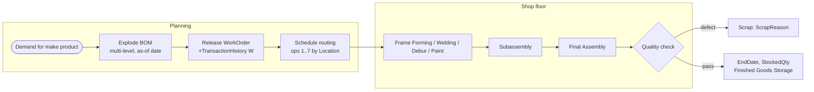

# Plan-to-produce (work orders, BOM, routing, scrap)

> Generated by `scripts/business-processes/render.py` from `processes.py` + [`evidence.json`](evidence.json). Do not edit by hand.

Production planning releases a work order for a manufactured product; it is routed through up to 7 work centres (frame forming → final assembly), consumes components per the bill of materials, and stocks finished units with some scrap.

**Domain:** Production  
**Actors:** Production planner (Production Control), Work-centre supervisors / technicians (Manufacturing, 185 current staff), Quality assurance  
**Trigger:** Demand or stock for a MakeFlag = 1 product (inferred: no link from sales orders to work orders).

Basis: **E** = evidenced in the data / schema, *I* = inferred.

## Process flow

## Steps

| # | Step | Actor | Reads | Writes | Basis | Notes |
|---|---|---|---|---|---|---|
| 1 | Explode bill of materials | Planner | Production.BillOfMaterials Production.Product Production.UnitMeasure | – | **E** | 238 assemblies, up to 5 levels (BOMLevel 0-4); 199 BOM edges end-dated (engineering changes). uspGetBillOfMaterials / uspGetWhereUsedProductID. |
| 2 | Release work order | Planner | Production.Product | Production.WorkOrder (OrderQty, StartDate, DueDate) Production.TransactionHistory (W) | **E** | Trigger iWorkOrder writes a type-W transaction: W rows (current+archive) = 72,591 = work orders exactly. |
| 3 | Schedule routing operations | Planner | Production.Location (CostRate, Availability) | Production.WorkOrderRouting (ScheduledStart/End, PlannedCost) | **E** | 42,625 work orders are routed; OperationSequence 1-7 maps to the 7 work-centre locations. |
| 4 | Execute operations | Supervisor | – | WorkOrderRouting (ActualStart/End, ActualResourceHrs, ActualCost) | **E** | 39,212 operations finished after ScheduledEndDate; ActualCost = PlannedCost in total (synthetic). |
| 5 | Issue components | Supervisor | Production.ProductInventory | Production.ProductInventory | *I* | No component-issue transaction type exists; consumption is not recorded. |
| 6 | Record scrap | QA | Production.ScrapReason | WorkOrder (ScrappedQty, ScrapReasonID) | **E** | 729 work orders with scrap, 10,651 units, 16 reasons fairly evenly used. |
| 7 | Complete and stock | Supervisor | – | WorkOrder (EndDate, StockedQty computed) Production.ProductInventory (Finished Goods Storage) TransactionHistory (W via uWorkOrder) | **E** | All 72,591 work orders are closed; 22,790 closed after DueDate. |

## State machine: `Production.WorkOrder (derived from StartDate / EndDate / DueDate; no status column)`

| Value | Meaning |
|---|---|
| open | EndDate null |
| closed_on_time | EndDate <= DueDate |
| closed_late | EndDate > DueDate |
| with_scrap | ScrappedQty > 0 |

```mermaid
stateDiagram-v2
    [*] --> Released: WorkOrder insert (+TransactionHistory W)
    Released --> InOperation: routing op 1 ActualStartDate
    InOperation --> InOperation: next OperationSequence
    InOperation --> Scrapped: ScrappedQty / ScrapReasonID
    Scrapped --> InOperation
    InOperation --> ClosedOnTime: EndDate <= DueDate
    InOperation --> ClosedLate: EndDate > DueDate
    ClosedOnTime --> [*]
    ClosedLate --> [*]
    note right of Released: derived states - no Status column; 0 open today
```

## Evidence

| Metric | Values | Note |
|---|---|---|
| `wo.state` | closed_late: 22,790 closed_on_time: 49,801 |  |
| `wo.qty` | ordered/stocked/scrapped: 4507721/4497070/10651 |  |
| `wo.with_scrap` | all: 729 |  |
| `wo.scrap_reason` | Brake assembly not as ordered: 44 Color incorrect: 44 Drill pattern incorrect: 45 Drill size too large: 42 Drill size too small: 44 Gouge in metal: 54 Handling damage: 32 Paint process failed: 37 Primer process failed: 47 Seat assembly not as ordered: 37 Stress test failed: 52 Thermoform temperature too high: 37 Thermoform temperature too low: 63 Trim length too long: 52 Trim length too short: 48 Wheel misaligned: 51 |  |
| `wo.with_routing` | all: 42,625 |  |
| `wo.products` | distinct: 238 |  |
| `wor.location` | 1:Frame Forming: 9,567 2:Frame Welding: 5,923 3:Debur and Polish: 1,490 4:Paint: 816 5:Specialized Paint: 674 6:Subassembly: 30,107 7:Final Assembly: 18,554 |  |
| `wor.late_ops` | ActualEndDate>ScheduledEndDate: 39,212 |  |
| `wor.cost` | planned/actual: 3487970/3487970 |  |
| `bom.level` | 0: 103 1: 1,548 2: 993 3: 31 4: 4 |  |
| `bom.assemblies` | distinct: 238 |  |
| `bom.ended` | EndDate not null: 199 |  |
| `th.type` | current:W: 31,002 archive:W: 41,589 |  |
| `location.costrate` | 1:Tool Crib: 0.00 / 0.00 10:Frame Forming: 22.50 / 96.00 2:Sheet Metal Racks: 0.00 / 0.00 20:Frame Welding: 25.00 / 108.00 3:Paint Shop: 0.00 / 0.00 30:Debur and Polish: 14.50 / 120.00 4:Paint Storage: 0.00 / 0.00 40:Paint: 15.75 / 120.00 45:Specialized Paint: 18.00 / 80.00 5:Metal Storage: 0.00 / 0.00 50:Subassembly: 12.25 / 120.00 6:Miscellaneous Storage: 0.00 / 0.00 60:Final Assembly: 12.25 / 120.00 7:Finished Goods Storage: 0.00 / 0.00 | CostRate / Availability (hours) for work centres |
| `edh.current_by_group` | Manufacturing: 185 Quality Assurance: 11 |  |

## Coverage in the modernized system

**DynamoDB access patterns (designed, loaded, tested):**

- `INV-04` (dynamodb) Explode the bill of materials for an assembly (all levels, as of a date)
- `INV-05` (dynamodb) Where is this component used?
- `INV-06` (dynamodb) Which work orders are open / due, and what are a work order's routing steps?
- `INV-03` (dynamodb) Record a stock movement and list movements for a product over a date range

**App pages:** none

**Redshift:** none: AdventureWorksDW has no manufacturing fact; WorkOrder items land in Redshift via zero-ETL only

## Gaps

- No production UI: BOM explosion (INV-04), where-used (INV-05) and work-order/routing (INV-06) are designed but unused.
- No work-order status column: open/late must be derived from dates (the design uses a sparse index on open WOs).
- No component consumption (backflush) and no link from sales demand to work orders in either system.
- No production KPIs (on-time rate, scrap rate by reason, planned vs actual cost) in Redshift.
