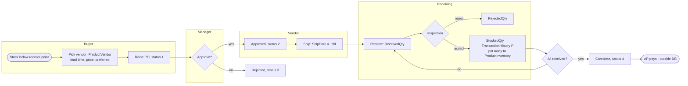
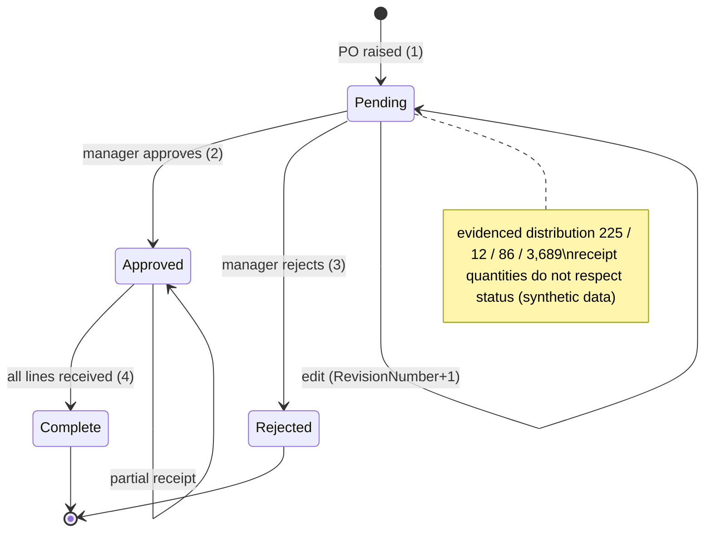

# Procure-to-pay

> Generated by `scripts/business-processes/render.py` from `processes.py` + [`evidence.json`](evidence.json). Do not edit by hand.

A buyer raises a purchase order to an approved vendor for a purchased component; the PO is approved, goods are received (with quality rejects) into stock, and the vendor is paid.

**Domain:** Purchasing  
**Actors:** Buyer (12 distinct employees: Buyer, Purchasing Assistant, Purchasing Manager), Purchasing manager (approver), Vendor, Receiving / inspection, Accounts payable  
**Trigger:** Stock of a purchased product (MakeFlag = 0) falls below ReorderPoint, or a work order needs components (inferred).

Basis: **E** = evidenced in the data / schema, *I* = inferred.

## Process flow

## Steps

| # | Step | Actor | Reads | Writes | Basis | Notes |
|---|---|---|---|---|---|---|
| 1 | Detect need (below reorder point) | Buyer | Production.Product (ReorderPoint, SafetyStockLevel) Production.ProductInventory | – | *I* | 60 sellable products are below reorder point today; nothing in the DB links a PO to that signal. |
| 2 | Choose vendor | Buyer | Purchasing.ProductVendor (AverageLeadTime, StandardPrice, Min/MaxOrderQty, OnOrderQty) Purchasing.Vendor (CreditRating, PreferredVendorStatus, ActiveFlag) | – | **E** | 460 product-vendor offers for 265 products; 93 of 104 vendors preferred. |
| 3 | Raise PO | Buyer | Purchasing.ShipMethod | Purchasing.PurchaseOrderHeader (Status 1, EmployeeID) Purchasing.PurchaseOrderDetail | **E** | Trigger iPurchaseOrderDetail recalculates SubTotal and writes TransactionHistory type P. |
| 4 | Approve / reject | Purchasing manager | – | Purchasing.PurchaseOrderHeader.Status (2 or 3) RevisionNumber | **E** | uPurchaseOrderHeader bumps RevisionNumber; revisions 4..20 show repeated edits. |
| 5 | Vendor ships | Vendor | – | Purchasing.PurchaseOrderHeader.ShipDate | **E** | ShipDate = OrderDate + 9 days on 4,000 of 4,012 POs. |
| 6 | Receive and inspect | Receiving | Purchasing.PurchaseOrderDetail | PurchaseOrderDetail (ReceivedQty, RejectedQty → StockedQty computed) Production.TransactionHistory (P) | **E** | 380 lines partially received; 563 lines with rejects; 72,700 units rejected of 2.33M received. |
| 7 | Put away | Receiving | – | Production.ProductInventory | *I* | No trigger moves stock into ProductInventory on receipt. |
| 8 | Close PO / pay vendor | Accounts payable | PurchaseOrderHeader (TotalDue) | Status 4 Complete | *I* | No invoice, 3-way-match or payment table. |

## State machine: `Purchasing.PurchaseOrderHeader.Status`

| Value | Meaning |
|---|---|
| 1 | Pending |
| 2 | Approved |
| 3 | Rejected |
| 4 | Complete |

## Evidence

| Metric | Values | Note |
|---|---|---|
| `poh.status` | 1: 225 2: 12 3: 86 4: 3,689 |  |
| `poh.revision` | 10: 1 12: 1 14: 1 20: 1 4: 3,813 5: 130 6: 43 7: 15 8: 3 9: 4 |  |
| `poh.ship_minus_order_days` | 25: 12 9: 4,000 |  |
| `poh.buyers` | distinct_employees: 12 |  |
| `poh.buyer_titles` | Buyer: 3,089 Purchasing Assistant: 763 Purchasing Manager: 160 |  |
| `pod.receipt` | full: 8,465 partial: 380 |  |
| `pod.receipt_by_status` | 1:full: 456 1:partial: 21 2:full: 54 2:partial: 3 3:full: 141 3:partial: 1 4:full: 7,814 4:partial: 355 | pending/rejected POs show receipts: status is not consistent with receipts, so the transitions are inferred |
| `pod.rejected_lines` | all: 563 |  |
| `pod.qty` | ordered/received/rejected/stocked: 2348637/2327299/72700/2254599 |  |
| `th.type` | current:P: 7,866 archive:P: 922 | 8,788 P transactions vs 8,845 PO lines |
| `vendor.flags` | active=0 preferred=0: 4 active=1 preferred=0: 7 active=1 preferred=1: 93 |  |
| `vendor.credit_rating` | 1: 84 2: 9 3: 7 4: 2 5: 2 |  |
| `vendor.with_pos` | all: 86 |  |
| `productvendor.products` | distinct: 265 |  |
| `inv.below_reorder` | products: 60 |  |

## Coverage in the modernized system

**DynamoDB access patterns (designed, loaded, tested):**

- `PUR-01` (dynamodb) Show a vendor with addresses and contacts
- `PUR-02` (dynamodb) Who can supply this product, at what price and lead time?
- `PUR-03` (dynamodb) What does this vendor supply?
- `PUR-04` (dynamodb) Create a purchase order and show it with its lines
- `PUR-05` (dynamodb) Purchase orders for a vendor, newest first, optionally by status
- `PUR-06` (dynamodb) Purchase orders raised by an employee
- `PUR-07` (dynamodb) Open purchase orders (pending/approved) to receive
- `INV-02` (dynamodb) Which products are below their reorder point / safety stock?

**App pages:** none

**Redshift:** landed in Redshift via zero-ETL but no purchasing fact or report (AdventureWorksDW has none)

## Gaps

- Entire process has no UI: all 7 PUR patterns are designed and load-tested but unused by the app.
- No approval workflow, receiving or inspection screen; StockedQty never reaches ProductInventory in either system.
- No purchasing analytics (spend by vendor, vendor on-time / reject rate) in Redshift.
- No reorder suggestion linking INV-02 (below reorder point) to PUR-02 (who can supply).
