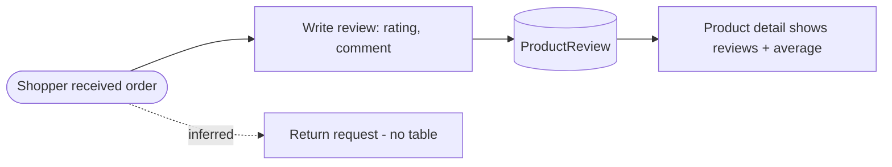
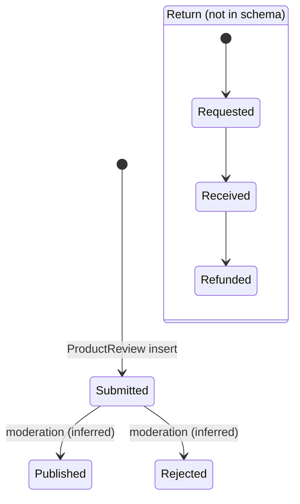

# Product reviews and returns

> Generated by `scripts/business-processes/render.py` from `processes.py` + [`evidence.json`](evidence.json). Do not edit by hand.

Reviews: customers rate and comment on products (evidenced but tiny). Returns: NOT evidenced in the OLTP schema - no RMA, credit memo or return-reason tables, no return transaction type.

**Domain:** Catalog / Sales  
**Actors:** Shopper (reviewer), Moderator (inferred), Customer service (returns, inferred)  
**Trigger:** Shopper submits a review after purchase; (returns: customer asks to return - inferred only).

Basis: **E** = evidenced in the data / schema, *I* = inferred.

## Process flow

## Steps

| # | Step | Actor | Reads | Writes | Basis | Notes |
|---|---|---|---|---|---|---|
| 1 | Submit review | Shopper | Production.Product | Production.ProductReview (Rating 1-5, Comments, ReviewerName, EmailAddress) | **E** | 4 reviews only (ratings 2, 4, 5, 5). |
| 2 | Moderate / publish | Moderator | – | – | *I* | No approval/status column on ProductReview. |
| 3 | Request return (RMA) | Customer service | Sales.SalesOrderHeader | – | *I* | No table; status 6 Cancelled and 4 Rejected exist only as status text; DW DimAccount has one 'returns' finance account (static). |

## State machine: `Production.ProductReview (no status column)`

| Value | Meaning |
|---|---|
| submitted | row exists |

## Evidence

| Metric | Values | Note |
|---|---|---|
| `review.rating` | 2: 1 4: 1 5: 2 |  |
| `returns.tables` | Sales/Production return or RMA tables: 0 | no Return/RMA/Refund/CreditMemo table in AdventureWorks2022 |
| `returns.dw_finance_accounts` | DimAccount like return: 1 |  |
| `soh.status_by_channel` | internet:5: 27,659 reseller:5: 3,806 | no order is Cancelled (6) or Rejected (4) |

## Coverage in the modernized system

**DynamoDB access patterns (designed, loaded, tested):**

- `CAT-11` (dynamodb) Show / add reviews for a product

**App pages:** none

**Redshift:** none

## Gaps

- Reviews: CAT-11 is designed (REVIEW# items under the product) but product detail neither shows nor accepts reviews.
- Returns: would be a net-new DynamoDB entity (RMA under ORDER#), not a migration of existing data.
