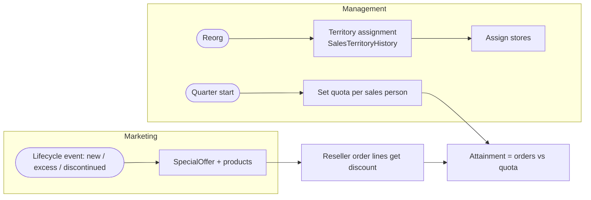
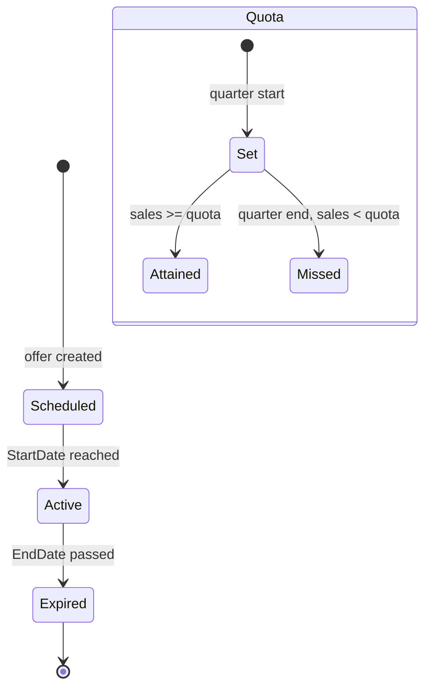

# Sales management (territories, quotas, special offers)

> Generated by `scripts/business-processes/render.py` from `processes.py` + [`evidence.json`](evidence.json). Do not edit by hand.

Sales management assigns sales people to territories, sets quarterly quotas, tracks attainment, and runs promotions (volume, seasonal, clearance, new-product) for resellers and customers.

**Domain:** Sales  
**Actors:** VP / sales managers, Sales people (17), Marketing (promotions)  
**Trigger:** Fiscal quarter start (quota), territory reorganisation, product lifecycle event (promotion).

Basis: **E** = evidenced in the data / schema, *I* = inferred.

## Process flow

## Steps

| # | Step | Actor | Reads | Writes | Basis | Notes |
|---|---|---|---|---|---|---|
| 1 | Assign territory | Sales manager | Sales.SalesTerritory | Sales.SalesTerritoryHistory (StartDate/EndDate) Sales.SalesPerson.TerritoryID | **E** | 4 territory assignments ended (re-assignments); 3 sales people have no territory (managers). |
| 2 | Assign stores to sales person | Sales manager | – | Sales.Store.SalesPersonID | **E** | All 701 stores have an account manager. |
| 3 | Set quarterly quota | Sales manager | – | Sales.SalesPersonQuotaHistory Sales.SalesPerson.SalesQuota | **E** | 163 quotas, quarterly 2011-05-31..2014-03-01 for 17 people. |
| 4 | Track attainment | Sales manager | Sales.SalesOrderHeader Sales.SalesPerson (SalesYTD, SalesLastYear, Bonus, CommissionPct) | – | **E** | DW FactSalesQuota + vSalesPersonSalesByFiscalYears view. |
| 5 | Create promotion | Marketing | – | Sales.SpecialOffer (Type, Category, DiscountPct, Min/MaxQty, dates) Sales.SpecialOfferProduct | **E** | 16 offers: 5 volume tiers, seasonal, clearance (discontinued product), excess inventory, new product. |

## State machine: `Sales.SpecialOffer (derived from StartDate/EndDate)`

| Value | Meaning |
|---|---|
| scheduled | today < StartDate |
| active | StartDate <= today <= EndDate |
| expired | today > EndDate |

## Evidence

| Metric | Values | Note |
|---|---|---|
| `quota.range` | all: 2011-05-31..2014-03-01 people=17 |  |
| `territoryhistory.ended` | all: 4 |  |
| `salesperson.no_territory` | all: 3 |  |
| `store.no_salesperson` | all: 0 |  |
| `specialoffer.type_category` | Discontinued Product:Reseller: 2 Excess Inventory:Customer: 1 Excess Inventory:Reseller: 2 New Product:Reseller: 2 No Discount:No Discount: 1 Seasonal Discount:Customer: 1 Seasonal Discount:Reseller: 2 Volume Discount:Reseller: 5 |  |
| `specialoffer.products` | 1:No Discount: 295 10:Mountain Tire Sale: 3 11:Sport Helmet Discount-2003: 3 12:LL Road Frame Sale: 12 13:Touring-3000 Promotion: 10 14:Touring-1000 Promotion: 4 15:Half-Price Pedal Sale: 7 16:Mountain-500 Silver Clearance Sale: 7 2:Volume Discount 11 to 14: 111 3:Volume Discount 15 to 24: 55 4:Volume Discount 25 to 40: 17 5:Volume Discount 41 to 60: 2 7:Mountain-100 Clearance Sale: 8 8:Sport Helmet Discount-2002: 3 9:Road-650 Overstock: 1 |  |
| `sod.lines_by_offer` | 1:No Discount: 115,884 11:Sport Helmet Discount-2003: 84 13:Touring-3000 Promotion: 524 14:Touring-1000 Promotion: 244 16:Mountain-500 Silver Clearance Sale: 169 2:Volume Discount 11 to 14: 3,428 3:Volume Discount 15 to 24: 606 4:Volume Discount 25 to 40: 80 5:Volume Discount 41 to 60: 2 7:Mountain-100 Clearance Sale: 137 8:Sport Helmet Discount-2002: 98 9:Road-650 Overstock: 61 |  |

## Coverage in the modernized system

**DynamoDB access patterns (designed, loaded, tested):**

- `SAL-08` (redshift) Orders taken by a sales person over a date range
- `SAL-09` (redshift) Orders in a territory over a date range
- `SAL-10` (dynamodb) Sales person profile with quota history and YTD/last-year sales
- `SAL-11` (redshift) Sales by sales person by fiscal year
- `SAL-12` (dynamodb) Which sales people cover a territory (now and historically)?
- `CAT-10` (dynamodb) Which special offers apply to this product today?

**App pages:** none

**Redshift:** dw.fact_sales_quota; dw.dim_sales_territory; dw.dim_promotion; dw.dim_employee (SCD2); QuickSight dashboard over dw.v_sales

## Gaps

- Analytics exist (Redshift/QuickSight) but no operational UI: no quota entry, territory reassignment, or promotion maintenance.
- Offers are never applied by the DynamoDB checkout (CAT-10 unused), so a new promotion has no effect on the shop.
- Promotion offers with zero sales (e.g. Mountain Tire Sale, LL Road Frame Sale, Half-Price Pedal Sale) are visible in the data: a promotion-effectiveness report is an easy add.
