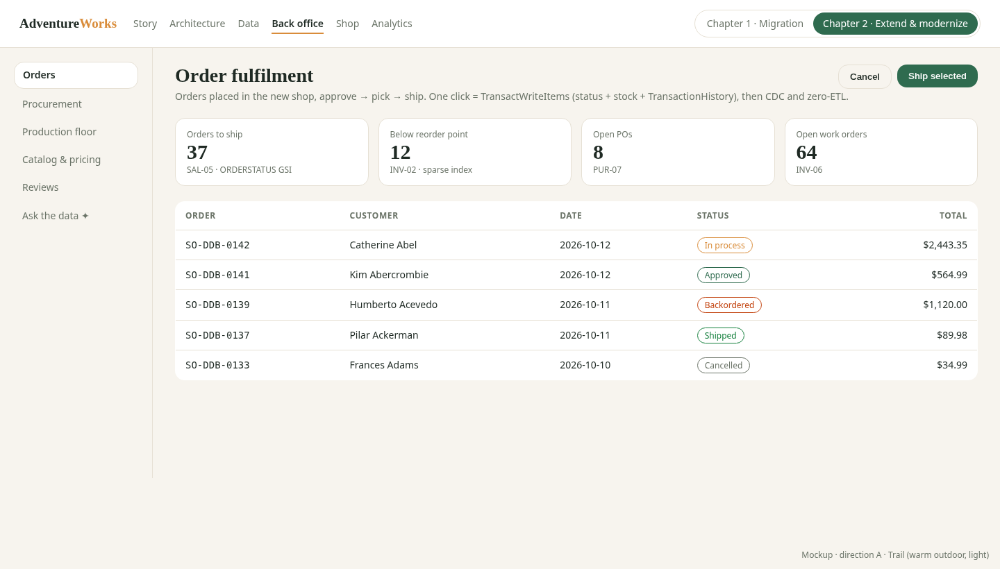
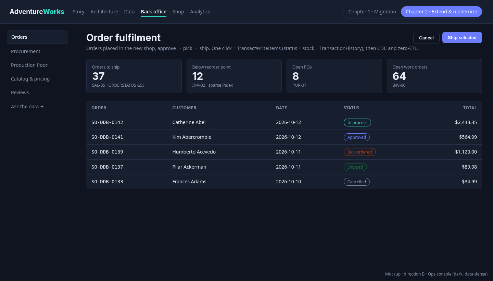
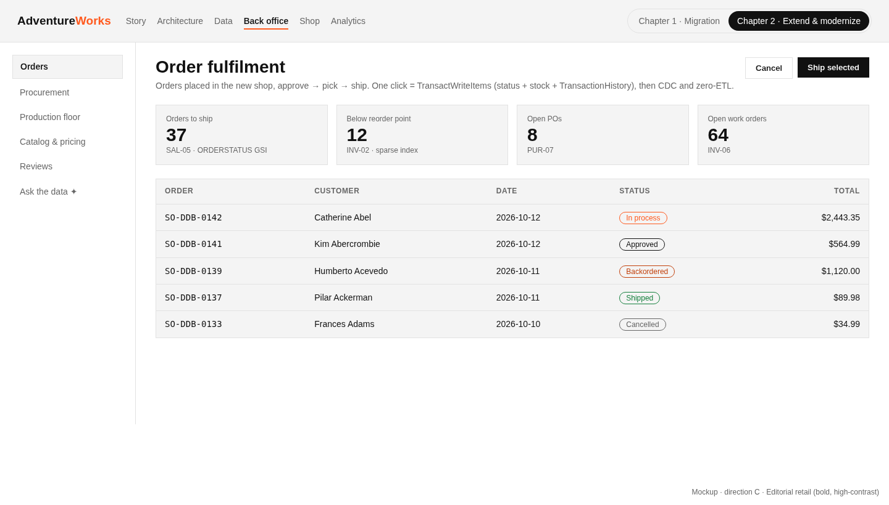

# Chapter 2 – Extend and modernize (plan, for John's sign-off)

Status: **Accepted** by John (2026-10-12, all 9 recommendations; decisions log in the root PLAN.md, ADR 0010). C2-0 built in PR #17. Builds on PR #15 (merged)
([docs/business-processes/](../business-processes/README.md)), which is the evidence base for every feature below.

Chapter 1 ("Migration", phases 0-8) is done and frozen at tag **`v1.0-migration`** (`45b8584`, GitHub release):
SQL Server → 7 DynamoDB domain tables, CDC, .NET 10 app, zero-ETL → Redshift, Terraform, showcase. See
[docs/modernization/PLAN.md](../modernization/PLAN.md).

Chapter 2 builds on the same repo and the same `master`. Goal: **a much nicer modern look and feel, plus new features
that light up the business processes Chapter 1 migrated but never gave a UI** (PR #15: 10 processes, ~40 designed access
patterns unused by the app). The story for the audience: *"migration was step one; now the platform pays off."*

## Principles
- **Reuse the Chapter 1 data model.** Prefer existing access patterns (`docs/design/access-patterns.json`); every new
  pattern gets an ID, a load test and a mapping/ADR entry exactly like Chapter 1.
- **Chapter 1 stays reproducible.** The frozen showcase is built from the tag, never from `master`.
- **Each phase is one PR**, CI green, docs + screenshots updated, demo talking points in the PR body.
- Same ground rules: PRs on the fork only (`-R zander-zilla/AdventureWorks.Web --base master`), John merges.

## Phases

| # | Phase | Outcome | Effort |
|---|---|---|---|
| C2-0 | Design system and UX direction | Chosen visual direction, React + Tailwind front end scaffold over the .NET 10 API, tokens/components, ADR 0010 | M (4-6 d) |
| C2-1 | Redesigned showcase + chapter switch | New showcase in the design system; Chapter 1 frozen from `v1.0-migration`, Chapter 2 live (**built, PR #18**) | M (4-5 d) |
| C2-2 | Order fulfilment + real pricing + reviews + CAT-07 fix | Back office closes the order loop; checkout uses real offers/tax/freight; reviews on PDP; price history written | L (7-9 d) |
| C2-3 | Procurement workspace | Low stock → suggested PO → approve → receive (partial/reject) | L (6-8 d) |
| C2-4 | Production floor | Open work orders, routing timeline, BOM explorer, where-used, scrap | M (5-6 d) |
| C2-5 | *Optional* Bedrock AI layer | Semantic product search, natural-language Q&A over Redshift | M (5-7 d) |

Total ≈ 26-34 working days without C2-5, 31-41 with it. Estimates are for one engineer plus agent help, incl. tests and docs.

---

## C2-0 Design system and UX direction

**Recommendation: React 19 + TypeScript + Vite + Tailwind CSS v4 SPA, served as static files, calling a JSON API
added to the existing .NET 10 app (`/api/v2/*`, minimal APIs).** Razor pages stay working until each screen is replaced.

Why, and the alternatives considered:
- *React + Tailwind (chosen)*: the audience expects a modern SaaS feel (tables, drawers, charts, Gantt); the component
  ecosystem (TanStack Table/Query, Recharts, Radix/shadcn-style primitives) gets there fastest; Tailwind tokens make the
  three directions below a theme swap; a static bundle hosts on the same S3 + CloudFront as the showcase (ADR 0009).
- *Blazor (.NET 10)*: one language, but smaller component ecosystem, heavier initial payload (WASM) or server
  circuits on Fargate (which scale to 0 between demos, ADR 0008), and less "modern front end" signal for customers.
- *Restyle Razor + HTMX + Tailwind*: cheapest, no API layer, but interactive back-office screens (multi-select ship,
  BOM tree, Gantt) become hand-rolled JS, and there is no clean API to show for Bedrock or mobile.
- *Next.js/SSR*: SSR adds a Node runtime to host; nothing here needs SEO. Rejected.

Steps
1. ADR 0010 (front-end stack, API style, auth: same cookie auth, SPA served from the app origin under `/app/` so the
   `SameSite=Lax` cookie works – this also removes the Chapter 1 "log in only in a new tab" limitation when framed).
2. `web/` workspace: Vite, TS strict, Tailwind v4, ESLint, Vitest, Playwright; `npm ci` pinned lockfile; CI job `web`.
3. Design tokens (colour, type scale, radius, spacing, dark mode) + 12 core components: AppShell, ChapterSwitch,
   NavRail, KpiCard, DataTable (sort/filter/select), StatusPill, Drawer, Form fields, Toast, EmptyState, Chart wrapper, Timeline.
4. `/api/v2` skeleton in the .NET app (OpenAPI document, generated TS client), first endpoint `GET /api/v2/products`.
5. Rebuild the shopper home + product list in the new UI as the proof (Razor remains at `/`).
6. Visual direction picked by John from the mockups below; Storybook-lite page (`/app/design`) for review.

**Visual direction options** (static HTML mockups, `docs/chapter-2/mockups/`, regenerate with `render.py`; same screen –
the back-office order fulfilment page with the chapter switch – in each direction):

| A · Trail (warm outdoor, light) | B · Ops console (dark, data-dense) | C · Editorial retail (bold, high-contrast) |
|---|---|---|
|  |  |  |
| Fits the outdoor/bike brand, friendly for shoppers and execs; less "enterprise". | Best for back-office density and the technical audience; looks like a modern ops tool; weaker for the shop. | Strong retail brand feel, great for the shop; tables feel stark. |

**Recommendation: B for back-office/showcase with A's palette as the light theme for the shop** (one token set, light/dark
modes), i.e. tokens support both, default dark in back office, light in shop.

DynamoDB: no new access patterns. Risks: front-end stack is new to the repo (supply chain: pinned lockfile, `npm audit` in CI,
Dependabot); two UIs coexist during migration (mitigation: per-screen cut-over, Razor removed only in C2-2+ when replaced).
Demo talking points: "same data, same API, new face"; theme switch live; Lighthouse scores before/after.

### C2-0 as built (PR #17)
- `src/web`: React 19, TS strict, Vite, Tailwind v4, ESLint, Vitest, Playwright; tokens for both themes; the 12 components;
  app shell (nav rail with later phases shown disabled, chapter switch, theme toggle, sign-in); gallery at `/app/design`;
  product list over `/api/v2/products`.
- `.NET`: `Api/V2.cs` (`/api/v2` me, login/logout, products, categories, cart; OpenAPI at `/api/v2/openapi.json`; 401/problem+json;
  CSRF header guard); SPA served at `/app/`; framed-cookie fix; Docker `web` build stage; Terraform output `spa_url`.
- CI: new `web.yml` (lint, typecheck, Vitest, build, audit, Playwright with screenshots; `/api/v2` in-process tests);
  `after.yml` runs the same Playwright suite against the real image.
- Screenshots: [docs/showcase-screenshots/chapter-2/](../showcase-screenshots/chapter-2/).
- **Changes from initial design**: see [ADR 0010](../adr/0010-chapter-2-front-end.md#changes-from-initial-design-c2-0-as-built)
  (`src/web` instead of `web/`; hand-written typed client instead of a generated one; SVG chart wrapper instead of Recharts;
  product list as the proof screen, shop home with C2-2; framed login fixed by `SameSite=None; Secure` over HTTPS).

## C2-1 Redesigned showcase with a chapter switch

Steps
1. Rebuild the showcase shell in the design system (React, same static S3 + CloudFront hosting, still data-driven from the
   repo's sources of truth; `showcase/build.py` keeps producing `data/`).
2. Chapter switch in the header: **Chapter 1 · Migration** and **Chapter 2 · Extend & modernize**.
3. **Chapter 1 is served frozen** from the `v1.0-migration` build (see *Hosting the frozen Chapter 1* below), unchanged
   8 tabs, so the migration story is exactly what was signed off.
4. Chapter 2 tabs: Story (slides: findings → features → architecture delta), Business processes (PR #15
   `business-processes.json`: landscape, coverage before/after Chapter 2), Back office (embeds/links `/app/`), What changed
   (new access patterns, new Redshift views, ADRs), Ask the data (C2-5, hidden if disabled).
5. Coverage tile: "processes with UI: 2 → 6" computed from `business-processes.json` + a `chapter2` flag per page.
6. Tests: extend `tests/showcase` (both chapters, switch, deep links `/#/c1/...`, `/#/c2/...`).

**Hosting the frozen Chapter 1** (recommended):
- Same bucket and distribution, prefix **`/c1/`**. A one-off workflow `showcase-freeze.yml` checks out tag
  `v1.0-migration`, runs that tag's `showcase/build.py` (with the then-current `config.json` values injected at upload) and
  syncs to `s3://<bucket>/c1/`. Rebuilt only when manually dispatched (immutable otherwise); Chapter 2 lives at `/` and
  `/c2/` and never writes `/c1/`.
- CloudFront: an additional cache behaviour `/c1/*` (long TTL, except `c1/config.json`), the same OAC; `/api/*` unchanged so
  Chapter 1's Live Replication keeps working.
- Also attach `showcase-v1.0-migration.zip` (the built `dist/`) to the GitHub release, so it can be served anywhere offline.
- Alternative: a second distribution / subdomain `c1.` – cleaner isolation, but another cert/DNS and cost. Not needed.
- The Chapter 1 *apps* (Before/After) are live services, not frozen: the frozen site points to the current `after_url`;
  Chapter 2 app changes are additive, so Chapter 1's shopper flows still work (asserted by the existing `tests/after`).

DynamoDB: none. Effort M. Risks: the tag's build script relies on paths that later move (mitigation: build from the tag's
own checkout, never mixed); cache invalidation of `/c1/*` (versioned paths). Demo talking points: one URL, two chapters;
"chapter 1 is literally the signed-off build".

### C2-1 as built (PR #18)
- **Chapter 2 showcase** = a second Vite entry in `src/web` (`showcase.html`, `src/showcase/*`, `npm run build:showcase`
  → `dist-showcase/`), reusing the C2-0 components and tokens (style B dark by default, light toggle persists). Hash
  routes: `#/c2/story`, `#/c2/processes[/<id>]`, `#/c2/back-office`, `#/c2/changes`, `#/c2/ask`.
- **Data-driven**: `showcase/build.py` (now `build_site`) still produces `data/`: the Chapter 1 files plus
  `business-processes.json` (PR #15), `chapter2.json` (new source of truth: phases, the pages each adds and the
  processes they cover, `/api/v2`, access patterns, Redshift views, architecture delta) and `adrs.json` (parsed from
  `docs/adr`). Update `docs/chapter-2/chapter2.json` in every phase PR; the coverage tile and *coming soon* marks follow.
- **Views**: Story (3 slides, ←/→), Business processes (landscape table, coverage tile, gap/evidence charts, drawer with
  steps/gaps/patterns, deep link per process), Back office (placeholder + link to `/app/`, planned screens), What changed
  (`/api/v2`, access patterns, Redshift views, ADRs), Ask the data (placeholder). Everything from a later phase carries a
  **Coming soon · C2-x** pill.
- **Chapter 1 frozen at `/c1/`**: `showcase-v1.0-migration.zip` is attached to the `v1.0-migration` release (built from
  the tag's own checkout; byte-identical to the local `/c1/` build). `.github/workflows/showcase-freeze.yml` (manual)
  rebuilds the zip, re-attaches it, and with `environment` ≠ `none` publishes it via `scripts/aws/push-showcase-c1.sh`
  (rewrites only `c1/config.json` with the current stack URLs). `push-showcase.sh` syncs `/` with `--exclude 'c1/*'` and
  seeds `/c1/` from the release asset once if it is empty. Locally `build.py` builds `/c1/` from the in-repo
  `showcase/site` (CI asserts it is unchanged since the tag). `#/c1/<tab>` deep links redirect to `/c1/#<tab>`.
- **Terraform** (`modules/showcase`): CloudFront Function `paths` (viewer request: `/c1/` → `c1/index.html`, `/c1` → 301,
  `/c2[/]` → `/#/c2/story`), behaviours `c1/config.json` (no cache) and `c1/*` (cache policy `frozen`, 30 d / 1 y), output
  `showcase_chapter1_url`. `/api/*` unchanged, so Chapter 1's Live Replication still uses the monitor API.
- **`VITE_SHOWCASE_URL`**: `docker/after/Dockerfile` build arg, set by `scripts/aws/push-images.sh` from output
  `showcase_url`; the SPA's *Chapter 1* button goes to `<showcase>/c1/` (`src/showcaseUrl.ts`, local default `:8088`).
- **Tests**: `src/web/e2e-showcase` (Playwright on the full static build: every view, coverage numbers computed
  independently from the JSON, chapter switch to the frozen site with its 8 tabs, deep links, theme), SPA e2e for the
  Chapter 1 link, Vitest for the URL helper, `tests/showcase/test_paths_function.py`, Terraform run
  `showcase_chapter1_frozen_prefix`. The Chapter 1 pytest suite runs unchanged against the Chapter 1 build.
- **Lighthouse** (`scripts/showcase-lighthouse.sh`, CI artifact `showcase-lighthouse`, desktop preset, local static server):

  | Category | Before (Chapter 1, `/c1/`) | After (Chapter 2, `/`) |
  |---|---|---|
  | Performance | 100 | 100 |
  | Accessibility | 96 | **100** (dark `accent-ink` contrast fix, below) |
  | Best practices | 96 | **100** (favicon; Chapter 1's 404 on `/favicon.ico` stays, it is frozen) |
  | SEO | 90 | 100 |

#### Changes from initial design (C2-1)
| Plan | As built | Why |
|---|---|---|
| New showcase "in React" (separate app implied) | Second Vite entry of `src/web` | Reuses components/tokens with no package split; one lockfile, one audit. |
| Chapter 2 at `/` **and** `/c2/` | SPA at `/` with hash routes `#/c2/...`; `/c2` redirects there | Plain S3 has no SPA fallback; hash routes need none and keep CloudFront simple. |
| Freeze workflow syncs to S3 | Workflow builds + attaches the zip with no AWS by default; publishing is an opt-in second job (OIDC) | Lets the frozen build exist (and be reviewed) without AWS; the zip was attached in this PR. |
| — | CloudFront Function for directory index | S3 REST origin (OAC) has no index documents below `/`. |
| Coverage tile "processes with UI: 2 → 6" | Computed: **5 → 9** of 10 | `business-processes.json` counts 5 processes with at least one Chapter 1 app page; C2-2…C2-4 pages add 4 (HR stays deferred, decision 6). |
| Ask the data hidden if disabled | Shown with *Coming soon · C2-5* | John asked for later items to be visible and clearly marked. |
| — | Dark `accent-ink` `#ffffff` → `#0f1420` | Lighthouse contrast: white on `#6c7cff` is 3.5:1 (AA needs 4.5). |

## C2-2 Order fulfilment back office + real checkout pricing + reviews + CAT-07 fix

Steps
1. **Back office orders** (`/app/back-office/orders`): list by status and date (SAL-05, sparse ORDERSTATUS GSI), detail,
   bulk *approve*, *ship* (assign ship method, tracking no.), *cancel*, *backorder* (SAL-06). Ship = one
   `TransactWriteItems`: order status + `ShipDate`, `INV#` quantity decrement per line (INV-01, condition: on hand ≥ qty,
   otherwise backorder), `TransactionHistory` type S item per line (INV-03). Status machine 1-6 from
   `ufnGetSalesOrderStatusText`, transitions enforced server-side, with optimistic concurrency (`Version` attribute).
2. **Real pricing at checkout**: special offers applied per product (CAT-10, denormalised offer items on the product
   partition), tax by ship-to state/province (REF-02), freight by ship method (REF-04); replaces the demo 8%/2.5%.
   Shopper picks a ship method; totals recomputed server-side. Golden-value tests against SQL Server for sample orders.
3. **Reviews** on product detail (CAT-11): show existing `REVIEW#` items, logged-in shopper adds rating + text
   (length/profanity limits, one per customer per product via conditional put).
4. **CAT-07 fix** (PR #15 catalog finding): Products admin price edit writes the product *and* a `PRICE#<start date>` history
   item (closing the previous one's `EndDate`) in one transaction; test asserts Redshift `dim_product` gets a new SCD2 row
   via zero-ETL in the warehouse CI job. Back-fill: none needed (app-made changes only since Chapter 1; script reports any gap).
5. Customer profile self-service (CUS-09) is **out of scope** unless John adds it (decision 6).
6. Tests: unit (status machine, pricing), DynamoDB Local integration (transactions, conditional failures), Playwright
   (shop order → back office ship → My orders shows Shipped).

DynamoDB access patterns: existing SAL-05, SAL-06, INV-01, INV-03, CAT-07, CAT-10, CAT-11, REF-02, REF-04 suffice.
**One addition likely: `SAL-14` "orders by status for one customer/territory"** only if the back office needs a
territory filter (else filter in memory over SAL-05 results); confirm in C2-2 design.
Effort L. Risks: transaction conflicts on hot stock items (condition + retry, idempotency token per click); CDC loop – app
writes to DynamoDB must not be re-applied from SQL (Chapter 1 handles `SO-DDB-` ids; stock/TH items need the same origin
marker); pricing parity with SQL rounding (money as decimal, golden tests).
Demo talking points: place an order in the new shop, ship it in the back office, watch stock drop and the order show up in
Redshift; change a price, show the history in `dim_product`; "the bug the process analysis found is fixed".

### C2-2 as built (PR #19)
- **Back office** `/app/back-office/orders` (roles `Fulfilment`): status tabs with counts (SAL-05 on the sparse
  `ORDERSTATUS#` GSI2, sort key `<iso date>#<order id>`), territory filter, search, bulk approve, order drawer with
  stock per line (INV-01), ship form (ship method + tracking number), *approve / reject / backorder / ship / cancel*
  (SAL-06). Transitions (`OrderStatus.Actions`): approve 1→2, reject 1→4, backorder 1|2→3, ship 2|3→5, cancel 1|2|3→6;
  every write is conditioned on `ver` (optimistic concurrency, 409 on conflict) and accepts an `Idempotency-Key`.
- **Ship** = one `TransactWriteItems` (`FulfilmentRepository.ShipPlan`): order header (status 5, ship date, method,
  tracking, revision+1, GSI2 moved), tracking on each line, per line `INV#` location decrement (condition
  `quantity >= q`) + product stock summary + `TXN#` TransactionHistory type `S` (INV-03, ids from 10,000,000), the
  catalog's stock copy, an `OrderEvent` and a change-feed item. Shortage → the ship is refused and the order goes to
  *Backordered* (from Approved). Max 19 lines per ship (DynamoDB 100-item transaction limit).
- **Replication monitor** `/app/back-office/replication`: every app write also puts a `ChangeFeed` item
  (`FEED#<day>` in aw-sales, TTL 7 days) listing the tables/keys it touched, refreshed every 3 s.
- **Checkout pricing** (`Pricing`, `PricingRepository`): best special offer per line (CAT-10, highest discount,
  inclusive dates and min/max quantity, offer 1 "No discount" excluded), tax = state/province retail rate (REF-02,
  type 1, else type 3), freight = ship-method base + rate × weight in lb (REF-04; grams converted, 1 lb default).
  Money is decimal, 4 dp, away-from-zero. Shopper picks the ship method; quote and order are computed server-side
  (`POST /checkout/quote`, `POST /checkout`). Header tax/freight are stored once; Redshift allocates them to lines by
  line share exactly as before, so app orders and SQL-era orders land in `fact_internet_sales` the same way.
- **Reviews** (CAT-11) on the product page: list + add (rating 1-5, 10-3,850 chars, small blocklist), one per customer
  per product via a conditional `REVIEWER#` marker item in the same transaction.
- **CAT-07 fixed**: a price change writes the product and closes the open `PRICE#` item (end date = day before) and adds
  `PRICE#<today>` in one transaction; `PUT /back-office/products/{id}/price` (role `CatalogAdmin`) and the Razor admin
  edit both used it (Razor removed in C2-3). Warehouse test: `dim_product` gets a new SCD2 version.
- **Generated API client**: `src/web/openapi/v2.json` (written by the API tests, `AW_OPENAPI_OUT`) →
  `openapi-typescript` → `src/api/schema.d.ts`, used through `openapi-fetch`. CI fails if either is stale.
- **Shop home** redesigned in React; **`/` now redirects to `/app/`**. Razor stays reachable at `/Shop` and `/classic`
  (`Ui:Root=razor` restores the old root). The frozen Chapter 1 *App* tab points at `/classic`.
- **CDC / Redshift**: all app writes carry `src_lsn = "~app"` so CDC never overwrites them (ADR 0003). The star build
  extends `dim_date` to the latest order's year and adds inventory rows only for days with app stock movements
  (no daily grid across the 2014→2026 gap). Warehouse test `test_c2_2_app_writes_reach_the_star` checks tax
  allocation, promotion, tracking, inventory, SCD2 and reviews.
- Demo staff logins (password `Demo!2026`): `fulfilment@adventure-works.com` (Fulfilment),
  `ops@adventure-works.com` (Fulfilment + CatalogAdmin).

#### Changes from initial design (C2-2)
| Plan | As built | Why |
|---|---|---|
| Optional new access pattern SAL-14 (by status per territory) | **Not added**; territory is a `FilterExpression` on SAL-05 (`territory_id` set at checkout) | A few hundred open orders per status; an extra GSI isn't worth the write cost. Revisit if the queue grows. |
| Ship = one transaction | One transaction **per DynamoDB endpoint locally** (local runs one DynamoDB Local per table); one transaction on AWS | DynamoDB Local instances can't share a transaction. Order: inventory first (conditions), then sales. |
| Offers by order date | Offers evaluated on a **demo pricing date** (`Pricing:OfferDate`, default 2014-05-01; `today` = real date) | The sample offers end in 2014; with today's date no discount would ever apply. |
| — | **Reseller volume discounts apply to web shoppers** too | They are the offers with quantity bands; makes CAT-10 visible. Confirmed by John after C2-2. |
| Golden tests against SQL Server | Unit tests on the pricing rules + warehouse allocation test | No SQL Server in the C2 CI path; parity is tax/freight allocation in Redshift. |
| Razor kept in the tag only (decision 7) | Razor still served at `/Shop` and `/classic` in C2-2 | **Superseded:** John asked to remove it now; removed in C2-3 (see *C2-3 as built*). |
| — | Change-feed outbox + order event timeline items | Gives the replication monitor and My orders timeline without reading DynamoDB Streams. |

## C2-3 Procurement workspace

Steps
1. **Low stock** dashboard (INV-02 sparse index: items below reorder point/safety stock) with on hand by location (INV-01).
2. **Suggested PO**: per product, vendors that supply it with price and lead time (PUR-02); group suggestions by vendor;
   buyer edits quantities.
3. **Create PO** (PUR-04) with lines; status Pending → Approved (approval by a "manager" role) → Received/Rejected/Complete.
4. **Receive** (PUR-07 open POs): partial receipts, rejected quantity; receipt transaction = PO line received/rejected qty
   + stock increment (INV-01) + `TransactionHistory` type P (INV-03).
5. Vendor page (PUR-01, PUR-03, PUR-05 PO history); "my POs" for the logged-in buyer (PUR-06).
6. Roles: add `Buyer` and `PurchasingManager` demo logins (employees from HR, no new auth system).
7. Optional Redshift view `dw.vendor_performance` (on-time, reject rate) as a tile – decision 5.

DynamoDB: existing INV-01/02/03, PUR-01..07 suffice (all designed and load-tested in Chapter 1). Effort L.
Risks: synthetic PO data is inconsistent (PR #15: statuses vs receipt quantities) – new POs follow the clean state machine,
historical ones are shown read-only; role model creep (keep to 2 demo roles).
Demo talking points: a whole domain (`aw-purchasing`) that had no UI goes live with zero schema change – "the Phase 3
design anticipated it"; reorder → PO → receipt chain business people recognise.

### John's decisions after C2-2 (recorded 2026-10-12)
1. Special offers are priced as of **2014-05-01** (`Pricing:OfferDate`) – kept as the default.
2. Volume discounts **also apply to web shoppers** – kept.
3. **Remove the Razor shop now** – done in C2-3: `/classic`, `/Shop`, `/Cart`, `/Account/*`, `/Products` are gone
   (404), links/tests/docs fixed; `/c1/` (frozen Chapter 1) is untouched and its *App* tab now opens `/app/`.
4. A shipment (and now a receipt) is **one transaction per DynamoDB Local endpoint locally, one transaction on AWS** –
   kept and documented (`DynamoTables.TransactAsync`).

### C2-3 as built (PR #20)
- **Screen** `/app/back-office/procurement` (roles `Buyer`, `PurchasingManager`), three tabs:
  - *Reorder suggestions* (INV-02): products on the sparse `GSI1 = REORDER` index of `aw-inventory` (stock at or below
    reorder point / safety stock), quantity = top up to `max(safety stock, reorder point)` − already on order, rounded into
    the vendor's min/max order quantity. Best vendor per product (PUR-02: active, preferred first, then lowest
    standard price, then shortest lead time). Grouped by vendor; the buyer edits quantities, picks a ship method and creates one PO per vendor.
  - *Purchase orders*: Pending / Approved counts and lists (PUR-07 `POSTATUS#` markers), *My POs* (PUR-06, GSI2
    `EMPLOYEE#`), PO drawer with lines, history timeline and actions. SQL-era POs (ids < 100,000) are read-only.
  - *Vendors*: list, vendor drawer (PUR-01 contacts/addresses/products, PUR-05 PO history) with **vendor performance**
    (on-time rate, reject rate, average lead time, spend) computed from the vendor's POs.
- **State machine** (`PoStatus`): create → 1 Pending; approve 1→2 and reject 1→3 (role `PurchasingManager`); receive
  (role `Buyer`) on 2 Approved, partial receipts allowed, rejected quantity recorded; the PO becomes 4 Complete when
  every line is received + rejected in full. All writes conditioned on `ver` (409 on conflict), `Idempotency-Key`
  accepted.
- **Create** = one transaction: PO header (`PO-DDB-n`, ids from 100,000 via a `COUNTER/PO` item), lines, vendor-product
  `on_order_qty` += qty, `POSTATUS#1` marker, a `PurchaseOrderEvent` and a change-feed item. Tax 8 % and freight 2.5 % of
  subtotal (the ratios of the SQL-era data: tax on all 4,012 headers, freight on 4,000; verified by a warehouse test). Max 15 lines per PO.
- **Receive** = one transaction (`ProcurementRepository.ReceivePlan`): header (status/ship date/revision), POSTATUS
  marker move, each line's received/rejected qty (conditioned on the previous received qty), vendor-product
  `on_order_qty` −= received and last receipt cost/date, `INV#<location>` upsert (INV-01), the product stock summary
  incl. REORDER index maintenance, `TXN#` TransactionHistory type `P` (INV-03), the catalog stock copy, event, feed.
  Locally split per endpoint like ship (decision 4).
- **Demo staff**: `mikael0@adventure-works.com` (Mikael Sandberg, employee 251, Buyer) and `sheela0@adventure-works.com`
  (Sheela Word, 250, Buyer + PurchasingManager), password `Demo!2026`; staff logins carry an `employee_id` claim.
- **Razor removed** (decision 3 above); `/` → `/app/`, login at `/app/login`.
- **CDC**: new app items carry `src_lsn = "~app"`; a CDC test checks a SQL change to a vendor product the app has written
  is skipped while untouched rows still replicate.
- **Redshift**: `dw.dim_vendor`, `dw.fact_purchase_order_line` (grain PO line; order/due/ship dates, on-time flag,
  lead time days, received/rejected/stocked qty, line total, origin sql/ddb) and view `dw.v_vendor_performance`. Reconcile tests against
  the OLTP evidence (8,845 lines, quantity sums, status mix, 104 vendors, lead-time distribution), tax/freight ratio,
  and an app-created PO reaching the star.
- **Showcase**: Back office lists Procurement and Vendors as *Live · C2-3*; chapter2.json updated.
- **Tests**: unit (`C23Tests.cs`: suggestion maths, vendor choice, transitions, transaction plans, 100-item limit,
  performance), integration on DynamoDB Local (suggest → create → approve → partial + final receipt), Playwright
  `e2e/c2-3.spec.ts` (mocked and real image), SPA smoke tests in `tests/after` replacing the Razor ones.

#### Changes from initial design (C2-3)
| Plan | As built | Why |
|---|---|---|
| Separate low-stock dashboard + suggested PO | One *Reorder suggestions* tab grouped by vendor | Fewer clicks; the low-stock list is the suggestion list. |
| Statuses Pending → Approved → Received/Rejected/Complete | AdventureWorks codes only: 1 Pending, 2 Approved, 3 Rejected, 4 Complete; "received" is partial receipts on an Approved PO | Keeps the SQL-era codes so Redshift reports both the same way. |
| Route `/app/procurement` | `/app/back-office/procurement` | Same back-office shell and nav as fulfilment. |
| Vendor list via existing patterns | **Scan** of the vendor items, cached 10 minutes (no PUR-08 added) | 104 vendors; no access pattern lists all vendors and a GSI is not worth it. |
| Optional view `dw.vendor_performance` | `dw.v_vendor_performance` on new `dim_vendor` + `fact_purchase_order_line` | Decision 5; a fact table makes the reconcile tests possible. |
| — | Approval by the creator allowed (Sheela can approve her own PO) | Two demo roles only; separation of duties is a decision for John. |
| — | `PurchaseOrderEvent` items and a `COUNTER/PO` item in `aw-purchasing` | History timeline and id allocation without a SQL sequence. |
| — | Razor UI removed | John's decision after C2-2. |

### C2-3 recommendations accepted (2026-10-12, *accepted overnight by Grok Bot under John's delegation, pending John's review*)
All 8 C2-3 recommendations were accepted: 1. Razor admin CRUD stays removed; 2. the creator may approve their own PO;
3. tax 8 % / freight 2.5 % on new POs; 4. vendor list is a cached Scan; 5. max 15 lines per PO, suggestions capped at the
vendor's maximum order quantity; 6. `on_order` baseline taken from SQL; 7. CDC skips app-written rows (`src_lsn` `~app`);
8. demo employee ids 250/251 (verified by CI).

## C2-4 Production floor

Steps
1. **Open work orders** (INV-06): due date, status, scrap; filters by product and date.
2. **Routing timeline**: Gantt of a work order's operations by location (scheduled vs actual), from `WorkOrderRouting` items.
3. **BOM explorer**: multi-level tree for an assembly as of a date (INV-04), **where-used** (INV-05) reverse lookup, links
   between them.
4. **Complete a work order / record scrap**: stock in for the product, out for components (INV-01), `TransactionHistory` W
   (INV-03), scrap reason.
5. Tile from Redshift: scrap rate and on-time production (decision 5).

DynamoDB: existing INV-01, INV-03, INV-04, INV-05, INV-06 suffice. Effort M. Risks: deep BOM explosion latency (cap levels,
cache per assembly, parallel queries – measured in the Chapter 1 load test); work-order completion consuming components is
*inferred* (PR #15 marks it I), so we label it a simplification. Demo talking points: recursive BOM and where-used – the
"hard" relational patterns – answered from DynamoDB; visual Gantt.

### C2-4 as built (PR #21)
- **Route** `/app/back-office/production` (lazy-loaded chunk with Recharts), three tabs: *Scrap & on-time*, *Work orders*,
  *BOM explorer*. Role `ProductionSupervisor`, demo login `production@adventure-works.com` (synthetic); every staff role
  can view, only the supervisor creates, records operations and completes.
- **API** `/api/v2/back-office/production/*`: work orders by due month (INV-06, GSI2 `WODUE#yyyy-MM`), open work orders,
  detail with routing and events, create (plan: level-1 components allocated with the C2-2 stock logic, feasibility, standard
  routing), record operation (actual hours × work-centre cost rate, optimistic `ver`), complete (one DynamoDB transaction:
  header, remaining steps, product in at location 7 + `TransactionHistory` W +, components out with `quantity >= need`
  conditions + W −, catalog stock copies, event, feed), BOM explosion as of a date (INV-04, parallel per level, depth 4),
  where-used (INV-05, GSI1), assemblies, scrap reasons and monthly scrap / on-time KPIs.
- **Redshift**: `dim_scrap_reason`, `dim_location`, `fact_work_order`, `fact_work_order_routing` and
  `dw.v_production_scrap_on_time`; reconcile tests against AdventureWorks2022 (72,591 WOs, 67,131 routing steps) plus an
  app-written WO reaching the star.
- **Tests**: unit (`C24Tests.cs`), integration on DynamoDB Local (BOM → create → operate → complete), Playwright
  `e2e/c2-4.spec.ts` (mocked and real image), warehouse `test_c2_4_*`, showcase spec. Screenshots `c2-4-*` in
  `docs/showcase-screenshots/chapter-2/`.

#### Changes from initial design (C2-4)
| Plan | As built | Why |
|---|---|---|
| Route `/app/production` | `/app/back-office/production` | Same back-office shell as fulfilment and procurement. |
| Work-order status | Derived: Open / Closed on time / Closed late (end vs due, by day) | AdventureWorks has no status column. |
| Routing from data | Standard routing templates inferred (frames 10-20-30-40, assemblies 50-60, else 50; 4 h, one day per step) | No routing master in AdventureWorks. |
| Component consumption (inferred) | Level-1 components for the full order quantity incl. scrap; shortage refuses completion (409); TXN W with negative quantity | Labelled a simplification, as planned. |
| — | Remaining steps auto-closed at planned hours on completion; finished goods to location 7 | Keeps routing complete for the Redshift fact. |
| — | New WO ids from 100,000 (`WO-DDB-n`); SQL-era WOs read-only; new WOs only for top-level assemblies | No clash with SQL ids; history stays as migrated. |
| — | KPI range max 24 months, SQL-era months cached 10 min; BOM depth max 4 | Latency risk from the plan. |
| Tile from a view | New facts + view, not only a view | Facts make the reconcile tests possible (same as C2-3). |
| Chart library "in C2-4" | Recharts, lazy-loaded; the dependency-free SVG `Chart` stays for small charts | Smallest change to C2-0 pages. |

#### C2-4 decisions (*accepted overnight by Grok Bot under John's delegation, pending John's review*)
All the defaults in the table above were taken with the recommendation shown in *Why*.

## C2-5 Optional: Bedrock AI layer

Steps
1. **Semantic product search**: embeddings (Amazon Titan Text Embeddings v2) of product name/description/model/category,
   generated by a Lambda on product change (CDC/DynamoDB stream) and at load; stored in **S3 Vectors** (or OpenSearch
   Serverless – decision 4); `/api/v2/search?q=` blends vector + existing keyword search.
2. **Ask the data**: natural language → SQL over the Redshift `dw` schema with a Bedrock model (Claude/Nova via Bedrock,
   region per data residency), guarded: read-only Redshift user on `dw.*` views only, statement allow-list (SELECT only),
   row limit, timeout, shows the generated SQL and chart; or Bedrock Knowledge Bases structured-data (NL2SQL) if it fits.
3. Guardrails (Bedrock Guardrails: topic deny, PII filter), per-session budget, prompt/response logging to CloudWatch,
   feature flag `enable_ai` (Terraform, default off).
4. Eval set: 30 questions with expected SQL results in CI (mocked model) and a manual live run.

DynamoDB: no new table patterns (search index lives outside DynamoDB). Effort M. Risks: cost and quotas (on-demand,
flag off by default, tear-down); wrong SQL answers (show SQL, eval set, narrow semantic layer of views); data leaving the
account (none: Bedrock in-region, no training on data). Demo talking points: "ask a question, get a chart from the
warehouse migrated in Chapter 1"; vector search finds "lightweight bike for climbing" without keyword match.

### C2-5 as built (PR #22)
- **Flag**: Terraform `enable_ai` (default `false`) creates `infra/modules/ai` – S3 Vectors bucket + cosine index `products`
  (512 dims), Bedrock guardrail (denied topics: personal data, HR pay, prompt injection; PII BLOCK; prompt-attack filter) with
  a version, the `ai_reader` secret – and passes `Ai__*` settings and an IAM policy (InvokeModel on the two models only,
  ApplyGuardrail, S3 Vectors put/query, Redshift Data API) to the app. Off = no resources, endpoints answer 404.
- **Semantic search** `GET /api/v2/ai/search?q=` (public) and page `/app/shop/search`: product name, model, category,
  subcategory, colour and English model description embedded with Titan Text Embeddings v2 into S3 Vectors; score =
  0.7 × cosine similarity + 0.3 × keyword overlap. Index built on first search and by `POST /api/v2/ai/reindex` (catalog admin).
- **Ask the data** `POST /api/v2/ai/ask` (staff) and page `/app/back-office/ask`: Bedrock Converse (default Amazon Nova Pro,
  temperature 0) with a semantic-layer prompt over `dw.v_sales`, `dw.v_vendor_performance`, `dw.v_production_scrap_on_time`;
  `SqlGuard` (one SELECT/WITH, no comments, no second statement, no quoted identifiers, deny-list of write / admin keywords,
  FROM/JOIN only on `dw.v_*` or CTEs) wraps the SQL as `SELECT * FROM (…) AS q LIMIT 200`; Redshift Data API as the read-only
  `ai_reader` user (`warehouse/sql/redshift/50_ai_reader.sql`), cancelled after 15 s. The SQL is always shown; two-column results
  get a Recharts bar or line chart.
- **Budget and logging**: 20 questions and 40,000 model tokens per session per day (signed-in user or `aw_ai` cookie);
  every question is logged (`ai.ask` with user, SQL, rows, tokens, latency, block reason) to CloudWatch via the task's log driver.
- **Mock mode** (CI, local, the real-image e2e): hash embeddings + in-memory vectors, and a mocked model that replays the
  30-question eval set (`src/AdventureWorks.Web/Ai/eval.json`); a local guardrail stand-in mirrors the Bedrock topics and PII.
- **Tests**: `C25Tests.cs` (guard allow / 15 refusals, all 30 eval answers pass the guard, guardrail, budget, ask pipeline, chart
  hints, flag off / on over HTTP); warehouse-e2e `test_c2_5_*` runs all 30 mocked answers as a role that sees only the three views
  (read-only, statement timeout) and compares them with reference queries over facts and dimensions, and proves that role cannot
  read facts, landing or write; Terraform plan tests (off by default, on creates module + policy); Playwright `e2e/c2-5.spec.ts`.
  No AWS calls anywhere; the live run of the eval set is a manual step once `enable_ai` is applied.

#### Changes from initial design (C2-5)
| Plan | As built | Why |
|---|---|---|
| Embeddings by a Lambda on product change (CDC stream) | Built in the app on first search + `POST /ai/reindex` (catalog admin) | ~500 products; no extra Lambda / stream consumer while the flag is off. Price edits don't change the text. |
| "Claude/Nova via Bedrock" | Amazon Nova Pro by default (`chat_model_id` variable) | In-region, no Marketplace subscription step; switchable. |
| Bedrock Knowledge Bases NL2SQL "if it fits" | Own Converse prompt + `SqlGuard` | Full control of guards and the shown SQL; testable offline with a mocked model. |
| Prompt/response logging to CloudWatch | Structured `ai.ask` log lines through the app's awslogs driver | Same log group as the app; no extra resources. |
| Eval set with expected results | 30 questions, mocked answers vs reference queries on the Postgres stand-in | Expected results are computed, not hard-coded, so they follow the data. |
| — | Search public, ask-the-data staff only | Warehouse figures are internal. |
| — | Guard refuses `EXTRACT(… FROM …)` and comma joins to non-views | Known limitation of the regex guard; the read-only role is the backstop. |

#### C2-5 decisions (*accepted overnight by Grok Bot under John's delegation, pending John's review*)
Nova Pro default; 512-dimension Titan v2 + cosine; on-demand indexing instead of a stream Lambda; mocked model = eval replay and
hash embeddings (lexical, labelled as such); search public, ask staff-only; budget 20 questions / 40k tokens per session per day
(in memory per task); row limit 200, timeout 15 s; semantic layer = the three `dw.v_*` views; guardrail PII action BLOCK; logging via
app logs; the real-image e2e runs with the AI layer on in mock mode.

**Left for John**: whether and when to apply `enable_ai = true` (Bedrock per-request cost + S3 Vectors storage), setting the
`ai_reader` password (run `50_ai_reader.sql`, store it in the secret), confirming the model, and the manual live eval run.

---

## Cross-cutting
- **API**: `/api/v2` minimal APIs, OpenAPI, generated TS client; problem+json errors; authorization policies per role.
- **CDC and analytics**: every new write path keeps the Chapter 1 contracts (origin marker so CDC doesn't loop, zero-ETL
  picks up new items automatically; new `stg`/`dw` views where useful).
- **Infra**: SPA bundle built in CI, uploaded with the showcase (`/app/` served by the app container or S3 – ADR 0010);
  `showcase-freeze.yml`; Bedrock IAM only when `enable_ai`.
- **Tests/CI**: new `web` job (lint, unit, build), Playwright journeys per phase, existing jobs unchanged.
- **Docs**: per-phase ADR, screenshots in `docs/showcase-screenshots/chapter-2/`, PR #15 coverage table updated per phase.

## Decisions for John (with recommendations)

| # | Decision | Recommendation |
|---|---|---|
| 1 | Front-end stack | **React + TypeScript + Vite + Tailwind** over a `/api/v2` on the existing .NET 10 app (alternatives above). |
| 2 | Visual direction | **B (ops console) for back office + showcase, A (trail) palette as the light shop theme.** |
| 3 | Frozen Chapter 1 hosting | **Same bucket/distribution, `/c1/` prefix built from tag `v1.0-migration` by a manual workflow, plus a zip on the release.** |
| 4 | C2-5 in scope? Vector store | **Yes, as the last, flag-off-by-default phase; S3 Vectors** (lowest idle cost) over OpenSearch Serverless. |
| 5 | New Redshift views (promotion effectiveness, vendor performance, scrap/on-time) | **Include vendor performance (C2-3) and scrap/on-time (C2-4) as tiles; defer promotion effectiveness.** |
| 6 | Extra candidates from PR #15 (sales-person workspace, customer self-service profile, HR org chart, RMA) | **Defer; customer profile (S) is the first add if time allows.** |
| 7 | Razor UI retirement | **Keep Razor shop until C2-2 is done, then switch `/` to the SPA; Razor kept in the tag only.** |
| 8 | Release tagging | **Tag `v2.0-extend` at the end; optional `v2.0-rcN` after C2-2.** |
| 9 | Order of C2-3 vs C2-4 | **Procurement first** (stronger business story, links to C2-2 stock). |

## Changes to this plan
Tracked in the decisions log of the root [PLAN.md](../../PLAN.md).
