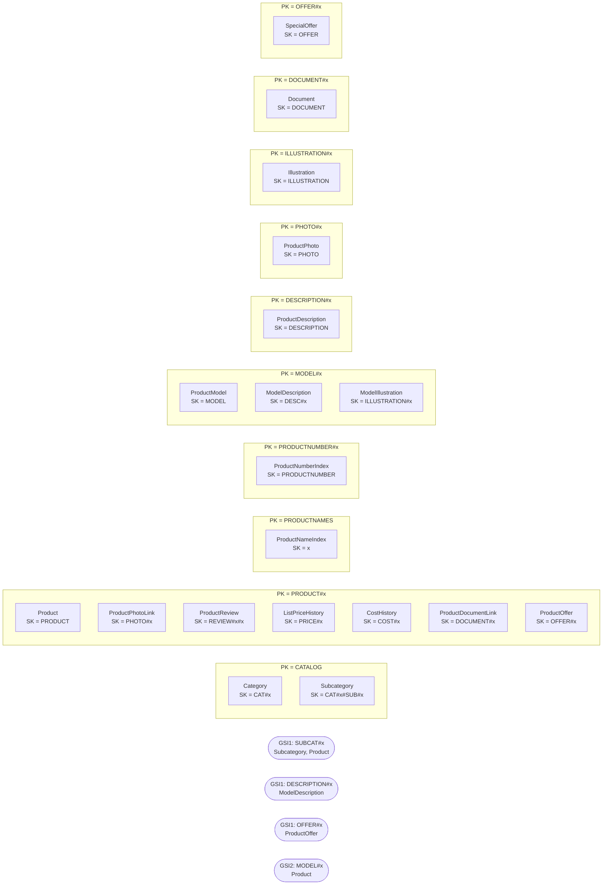

# Catalog — `aw-catalog`

Generated by `scripts/design/table_docs.py` from `design/mapping/mapping.yaml`, `access-pattern-keys.yaml` and sample items read back from DynamoDB Local. Method: docs/design/dynamodb-playbook.md (The DynamoDB Book ch. 7, 9, 11–14, 16; cited by chapter only).

**Table settings:** on-demand, PITR, streams NEW_AND_OLD_IMAGES, TTL attribute `ttl`, GSIs: GSI1, GSI2 (projection ALL). Items loaded: **5,215**.

## Entity chart

| Entity | Source | PK | SK | GSI1PK / GSI1SK | GSI2PK / GSI2SK | Items |
|---|---|---|---|---|---|---|
| Category | Production.ProductCategory | `CATALOG` | `CAT#{ProductCategoryID:04d}` |  |  | 4 |
| Subcategory | Production.ProductSubcategory | `CATALOG` | `CAT#{ProductCategoryID:04d}#SUB#{ProductSubcategoryID:04d}` | `SUBCAT#{ProductSubcategoryID:04d} / #META` |  | 37 |
| Product | Production.Product | `PRODUCT#{ProductID:06d}` | `PRODUCT` | `SUBCAT#{ProductSubcategoryID:04d} / PRODUCT#{x_active}#{x_name_lower}#{ProductID:06d} (sparse)` | `MODEL#{ProductModelID:04d} / PRODUCT#{ProductID:06d} (sparse)` | 504 |
| ProductNameIndex (derived) | Production.Product | `PRODUCTNAMES` | `{x_name_lower}` |  |  | 504 |
| ProductNumberIndex (derived) | Production.Product | `PRODUCTNUMBER#{ProductNumber}` | `PRODUCTNUMBER` |  |  | 504 |
| ProductModel | Production.ProductModel | `MODEL#{ProductModelID:04d}` | `MODEL` |  |  | 128 |
| ProductDescription | Production.ProductDescription | `DESCRIPTION#{ProductDescriptionID:05d}` | `DESCRIPTION` |  |  | 762 |
| ModelDescription | Production.ProductModelProductDescriptionCulture | `MODEL#{ProductModelID:04d}` | `DESC#{CultureID:trim}` | `DESCRIPTION#{ProductDescriptionID:05d} / MODEL#{ProductModelID:04d}#{CultureID:trim}` |  | 762 |
| ProductPhoto | Production.ProductPhoto | `PHOTO#{ProductPhotoID:04d}` | `PHOTO` |  |  | 101 |
| ProductPhotoLink | Production.ProductProductPhoto | `PRODUCT#{ProductID:06d}` | `PHOTO#{ProductPhotoID:04d}` |  |  | 504 |
| ProductReview | Production.ProductReview | `PRODUCT#{ProductID:06d}` | `REVIEW#{ReviewDate:iso}#{ProductReviewID:05d}` |  |  | 4 |
| ListPriceHistory | Production.ProductListPriceHistory | `PRODUCT#{ProductID:06d}` | `PRICE#{StartDate:iso}` |  |  | 395 |
| CostHistory | Production.ProductCostHistory | `PRODUCT#{ProductID:06d}` | `COST#{StartDate:iso}` |  |  | 395 |
| Illustration | Production.Illustration | `ILLUSTRATION#{IllustrationID:04d}` | `ILLUSTRATION` |  |  | 5 |
| ModelIllustration | Production.ProductModelIllustration | `MODEL#{ProductModelID:04d}` | `ILLUSTRATION#{IllustrationID:04d}` |  |  | 7 |
| Document | Production.Document | `DOCUMENT#{x_node}` | `DOCUMENT` |  |  | 13 |
| ProductDocumentLink | Production.ProductDocument | `PRODUCT#{ProductID:06d}` | `DOCUMENT#{x_node}` |  |  | 32 |
| SpecialOffer | Sales.SpecialOffer | `OFFER#{SpecialOfferID:03d}` | `OFFER` |  |  | 16 |
| ProductOffer | Sales.SpecialOfferProduct | `PRODUCT#{ProductID:06d}` | `OFFER#{SpecialOfferID:03d}` | `OFFER#{SpecialOfferID:03d} / PRODUCT#{ProductID:06d}` |  | 538 |

## Item collections



## Denormalized / snapshot copies

| Attributes | On items from | Copied from | Owner of refresh | Refresh |
|---|---|---|---|---|
| category_name | Production.ProductSubcategory | Production.ProductCategory | Catalog | catalog stream on category rename |
| subcategory_name, category_id, category_name, model_name | Production.Product | Production.ProductSubcategory/ProductCategory/ProductModel | Catalog | catalog stream |
| stock_qty | Production.Product | Production.ProductInventory | Inventory & Manufacturing | inventory stream publishes total per product |
| description | Production.ProductModelProductDescriptionCulture | Production.ProductDescription | Catalog | catalog stream: on DESCRIPTION change, Query GSI1 DESCRIPTION#id and update copies |
| offer_description, discount_pct, offer_type, offer_category, offer_start, offer_end, min_qty, max_qty | Sales.SpecialOfferProduct | Sales.SpecialOffer | Catalog | catalog stream: on OFFER change, Query GSI1 OFFER#id |

## Access patterns → key conditions

| ID | Question | Operation(s) | Consistency | Notes / compromise |
|---|---|---|---|---|
| CAT-01 | What product categories (and their subcategories) can I shop? | `Query PK = 'CATALOG'` | eventual | 4 Category + 37 Subcategory items in one item collection, sorted CAT#c then CAT#c#SUB#s |
| CAT-02 | Show / create / edit / delete a category or subcategory | `Query PK = 'CATALOG' AND begins_with(SK, 'CAT#<cat:04d>')  (category + its subcategories)`<br>`Query GSI1 GSI1PK = 'SUBCAT#<sub:04d>' AND GSI1SK = '#META'  (subcategory by id)`<br>`PutItem/UpdateItem/DeleteItem (ConditionExpression attribute_exists(PK)); delete guarded by app check: Query GSI1 SUBCAT#<sub> begins_with PRODUCT# Limit 1` | strong after write |  |
| CAT-03 | Which products are in this subcategory that I can buy now? | `Query GSI1 GSI1PK = 'SUBCAT#<sub:04d>' AND begins_with(GSI1SK, 'PRODUCT#A#')` | eventual | name asc (key order); price sort client-side (<= 43 items per subcategory); **Compromise:** price sort and color/size filter done client-side |
| CAT-04 | Show me everything about this product | `Query PK = 'PRODUCT#<p:06d>'  (product, photos, reviews, price/cost history, offers, documents)`<br>`GetItem PK = 'MODEL#<m:04d>', SK = 'DESC#<culture>'` | eventual | 2 requests; stock_qty is a copied attribute on the product item |
| CAT-05 | Find a product by its product number (SKU) | `GetItem PK = 'PRODUCTNUMBER#<number>', SK = 'PRODUCTNUMBER'`<br>`GetItem PK = 'PRODUCT#<id:06d>', SK = 'PRODUCT'` | eventual |  |
| CAT-06 | List all products (admin grid) | `Query PK = 'PRODUCTNAMES' (paged, Limit + ExclusiveStartKey)` | eventual |  |
| CAT-07 | Create / update / retire a product | `TransactWriteItems: Put product (ConditionExpression attribute_not_exists(PK) for create / ver = :v for update) + Put PRODUCTNAMES/<name> (attribute_not_exists) + Put PRODUCTNUMBER#<n> (attribute_not_exists) [+ Delete old name/number items on rename] [+ Put PRICE#<date> history on price change]` | strong (conditional write for uniqueness) |  |
| CAT-08 | What products belong to this model, and what is the model's catalog description/instructions? | `Query PK = 'MODEL#<m:04d>'  (model, 6 culture descriptions, illustrations)`<br>`Query GSI2 GSI2PK = 'MODEL#<m:04d>' AND begins_with(GSI2SK, 'PRODUCT#')  (variants)` | eventual |  |
| CAT-09 | What was this product's list price / standard cost on a given date? | `Query PK = 'PRODUCT#<p:06d>' AND SK BETWEEN 'PRICE#' AND 'PRICE#<dateIso>', ScanIndexForward=false, Limit=1 (then check end_date)`<br>`same with COST#` | eventual |  |
| CAT-10 | Which special offers apply to this product today? | `Query PK = 'PRODUCT#<p:06d>' AND begins_with(SK, 'OFFER#')` | eventual | client-side offer_start <= today <= offer_end (<= 5 offers/product) |
| CAT-11 | Show / add reviews for a product | `Query PK = 'PRODUCT#<p:06d>' AND begins_with(SK, 'REVIEW#'), ScanIndexForward=false`<br>`PutItem SK = 'REVIEW#<isoDate>#<reviewId>'` | eventual |  |
| CAT-12 | Search products by free text (name, description, color) | `Query PK = 'PRODUCTNAMES' AND begins_with(SK, '<lower(prefix)>')` | eventual | **Compromise:** prefix only (D2); single partition of 504 small items - cache it in the app |
| CAT-13 | Show the culture-specific description (en, fr, es, ...) | `GetItem PK = 'MODEL#<m:04d>', SK = 'DESC#<culture>'` | eventual |  |

## Sample items (read back from DynamoDB Local)

Partition `PRODUCT#000771` (first 6 items):

```json
[
 {
  "end_date": "2012-05-29T00:00:00",
  "ver": 1,
  "src_pk": "ProductID=771,StartDate=2011-05-31T00:00:00",
  "src": "sql",
  "src_table": "Production.ProductCostHistory",
  "modified_date": "2012-05-29T00:00:00",
  "type": "CostHistory",
  "updated_at": "2026-10-11T21:47:21Z",
  "product_id": 771,
  "SK": "COST#2011-05-31T00:00:00",
  "src_lsn": "0x00000000000000000000",
  "PK": "PRODUCT#000771",
  "standard_cost": 1912.1544,
  "start_date": "2011-05-31T00:00:00"
 },
 {
  "ver": 1,
  "special_offer_id": 1,
  "src_pk": "SpecialOfferID=1,ProductID=771",
  "discount_pct": 0,
  "src": "sql",
  "min_qty": 0,
  "offer_start": "2011-05-01T00:00:00",
  "src_table": "Sales.SpecialOfferProduct",
  "modified_date": "2011-04-01T00:00:00",
  "type": "ProductOffer",
  "rowguid": "f9a22c63-1ca7-48e4-870b-cedf4ba0f00b",
  "offer_description": "No Discount",
  "offer_end": "2014-11-30T00:00:00",
  "GSI1PK": "OFFER#001",
  "updated_at": "2026-10-11T21:47:31Z",
  "product_id": 771,
  "GSI1SK": "PRODUCT#000771",
  "SK": "OFFER#001",
  "src_lsn": "0x00000000000000000000",
  "PK": "PRODUCT#000771",
  "offer_category": "No Discount",
  "offer_type": "No Discount"
 },
 {
  "ver": 1,
  "special_offer_id": 7,
  "src_pk": "SpecialOfferID=7,ProductID=771",
  "discount_pct": 0.35,
  "src": "sql",
  "min_qty": 0,
  "offer_start": "2012-04-13T00:00:00",
  "src_table": "Sales.SpecialOfferProduct",
  "modified_date": "2012-03-14T00:00:00",
  "type": "ProductOffer",
  "rowguid": "ee509f88-cf3e-4cd7-acae-e68c4b924e66",
  "offer_description": "Mountain-100 Clearance Sale",
  "offer_end": "2012-05-29T00:00:00",
  "GSI1PK": "OFFER#007",
  "updated_at": "2026-10-11T21:47:32Z",
  "product_id": 771,
  "GSI1SK": "PRODUCT#000771",
  "SK": "OFFER#007",
  "src_lsn": "0x00000000000000000000",
  "PK": "PRODUCT#000771",
  "offer_category": "Reseller",
  "offer_type": "Discontinued Product"
 },
 {
  "product_photo_id": 128,
  "ver": 1,
  "src_pk": "ProductID=771,ProductPhotoID=128",
  "src": "sql",
  "src_table": "Production.ProductProductPhoto",
  "modified_date": "2011-05-01T00:00:00",
  "type": "ProductPhotoLink",
  "thumbnail_file_name": "superlight_silver_small.gif",
  "updated_at": "2026-10-11T21:47:21Z",
  "product_id": 771,
  "SK": "PHOTO#0128",
  "src_lsn": "0x00000000000000000000",
  "PK": "PRODUCT#000771",
  "primary": true
 },
 {
  "end_date": "2012-05-29T00:00:00",
  "ver": 1,
  "src_pk": "ProductID=771,StartDate=2011-05-31T00:00:00",
  "src": "sql",
  "src_table": "Production.ProductListPriceHistory",
  "list_price": 3399.99,
  "modified_date": "2012-05-29T00:00:00",
  "type": "ListPriceHistory",
  "updated_at": "2026-10-11T21:47:20Z",
  "product_id": 771,
  "SK": "PRICE#2011-05-31T00:00:00",
  "src_lsn": "0x00000000000000000000",
  "PK": "PRODUCT#000771",
  "start_date": "2011-05-31T00:00:00"
 },
 {
  "category_name": "Bikes",
  "color": "Silver",
  "src_pk": "ProductID=771",
  "safety_stock_level": 100,
  "product_model_id": 19,
  "subcategory_name": "Mountain Bikes",
  "src_table": "Production.Product",
  "type": "Product",
  "rowguid": "ca74b54e-fc30-4464-8b83-019bfd1b2dbb",
  "product_number": "BK-M82S-38",
  "size_unit_measure_code": "CM",
  "category_id": 1,
  "model_name": "Mountain-100",
  "updated_at": "2026-10-11T21:48:25Z",
  "GSI2SK": "PRODUCT#000771",
  "product_id": 771,
  "weight_unit_measure_code": "LB",
  "stock_qty": 149,
  "GSI1SK": "PRODUCT#X#mountain-100 silver, 38#000771",
  "days_to_manufacture": 4,
  "SK": "PRODUCT",
  "class": "H",
  "ver": 1,
  "product_subcategory_id": 1,
  "sell_start_date": "2011-05-31T00:00:00",
  "src": "sql",
  "make_flag": true,
  "weight": 20.35,
  "active": "X",
  "list_price": 3399.99,
  "GSI2PK": "MODEL#0019",
  "reorder_point": 75,
  "modified_date": "2014-02-08T10:01:36",
  "product_line": "M",
  "size": "38",
  "GSI1PK": "SUBCAT#0001",
  "name": "Mountain-100 Silver, 38",
  "src_lsn": "0x00000000000000000000",
  "finished_goods_flag": true,
  "style": "U",
  "PK": "PRODUCT#000771",
  "standard_cost": 1912.1544,
  "sell_end_date": "2012-05-29T00:00:00"
 }
]
```

Partition `MODEL#0019` (first 6 items):

```json
[
 {
  "ver": 1,
  "src_pk": "ProductModelID=19,ProductDescriptionID=1367,CultureID=ar",
  "src": "sql",
  "product_model_id": 19,
  "product_description_id": 1367,
  "description": "دراجة سباقات مخصصة للقيادة في الجبال من أعلى طراز. تتضمن خيارات تحسين الأداء ...",
  "src_table": "Production.ProductModelProductDescriptionCulture",
  "modified_date": "2013-04-30T00:00:00",
  "type": "ModelDescription",
  "culture_id": "ar",
  "GSI1PK": "DESCRIPTION#01367",
  "updated_at": "2026-10-11T21:47:20Z",
  "GSI1SK": "MODEL#0019#ar",
  "SK": "DESC#ar",
  "src_lsn": "0x00000000000000000000",
  "PK": "MODEL#0019"
 },
 {
  "ver": 1,
  "src_pk": "ProductModelID=19,ProductDescriptionID=168,CultureID=en",
  "src": "sql",
  "product_model_id": 19,
  "product_description_id": 168,
  "description": "Top-of-the-line competition mountain bike. Performance-enhancing options incl...",
  "src_table": "Production.ProductModelProductDescriptionCulture",
  "modified_date": "2013-04-30T00:00:00",
  "type": "ModelDescription",
  "culture_id": "en",
  "GSI1PK": "DESCRIPTION#00168",
  "updated_at": "2026-10-11T21:47:20Z",
  "GSI1SK": "MODEL#0019#en",
  "SK": "DESC#en",
  "src_lsn": "0x00000000000000000000",
  "PK": "MODEL#0019"
 },
 {
  "ver": 1,
  "src_pk": "ProductModelID=19,ProductDescriptionID=1491,CultureID=fr",
  "src": "sql",
  "product_model_id": 19,
  "product_description_id": 1491,
  "description": "VTT de compétition haut de gamme. Plusieurs options d'amélioration des perfor...",
  "src_table": "Production.ProductModelProductDescriptionCulture",
  "modified_date": "2013-04-30T00:00:00",
  "type": "ModelDescription",
  "culture_id": "fr",
  "GSI1PK": "DESCRIPTION#01491",
  "updated_at": "2026-10-11T21:47:21Z",
  "GSI1SK": "MODEL#0019#fr",
  "SK": "DESC#fr",
  "src_lsn": "0x00000000000000000000",
  "PK": "MODEL#0019"
 },
 {
  "ver": 1,
  "src_pk": "ProductModelID=19,ProductDescriptionID=1735,CultureID=he",
  "src": "sql",
  "product_model_id": 19,
  "product_description_id": 1735,
  "description": "אופני הרים תחרותיים מהשורה הראשונה. אפשרויות לשיפור ביצועים הכוללות HL Frame ...",
  "src_table": "Production.ProductModelProductDescriptionCulture",
  "modified_date": "2013-04-30T00:00:00",
  "type": "ModelDescription",
  "culture_id": "he",
  "GSI1PK": "DESCRIPTION#01735",
  "updated_at": "2026-10-11T21:47:21Z",
  "GSI1SK": "MODEL#0019#he",
  "SK": "DESC#he",
  "src_lsn": "0x00000000000000000000",
  "PK": "MODEL#0019"
 },
 {
  "ver": 1,
  "src_pk": "ProductModelID=19,ProductDescriptionID=1613,CultureID=th",
  "src": "sql",
  "product_model_id": 19,
  "product_description_id": 1613,
  "description": "สุดยอดจักรยานภูเขาสำหรับการแข่งขัน สมบูรณ์แบบด้วยองค์ประกอบสำหรับประสิทธิภาพส...",
  "src_table": "Production.ProductModelProductDescriptionCulture",
  "modified_date": "2013-04-30T00:00:00",
  "type": "ModelDescription",
  "culture_id": "th",
  "GSI1PK": "DESCRIPTION#01613",
  "updated_at": "2026-10-11T21:47:21Z",
  "GSI1SK": "MODEL#0019#th",
  "SK": "DESC#th",
  "src_lsn": "0x00000000000000000000",
  "PK": "MODEL#0019"
 },
 {
  "ver": 1,
  "src_pk": "ProductModelID=19,ProductDescriptionID=1862,CultureID=zh-cht",
  "src": "sql",
  "product_model_id": 19,
  "product_description_id": 1862,
  "description": "高档竞赛山地车。性能得到进一步增强，包括创新的 HL 车架、极其平稳的前悬架以及适用于所有地形的出色牵引力。",
  "src_table": "Production.ProductModelProductDescriptionCulture",
  "modified_date": "2013-04-30T00:00:00",
  "type": "ModelDescription",
  "culture_id": "zh-cht",
  "GSI1PK": "DESCRIPTION#01862",
  "updated_at": "2026-10-11T21:47:22Z",
  "GSI1SK": "MODEL#0019#zh-cht",
  "SK": "DESC#zh-cht",
  "src_lsn": "0x00000000000000000000",
  "PK": "MODEL#0019"
 }
]
```

## Trade-offs

- Product page = 2 requests (product collection + model description by culture) instead of copying 6 culture descriptions onto every product (fan-out on description edits).
- Name-prefix search and the admin product list share one PRODUCTNAMES partition (504 small items, cacheable) instead of a third GSI; the same items enforce name uniqueness.
- Price sort and colour/size filters on category pages are done client-side (<= 43 products per subcategory).
- Photos are separate items (binary up to ~26 KB) so the product query stays small; links carry the file name.
- stock_qty is a copied attribute owned by Inventory (eventually consistent).

