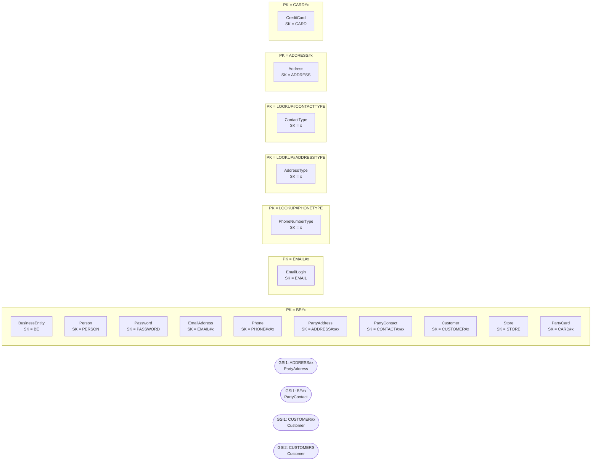

# Customer & Party — `aw-customer`

Generated by `scripts/design/table_docs.py` from `design/mapping/mapping.yaml`, `access-pattern-keys.yaml` and sample items read back from DynamoDB Local. Method: docs/design/dynamodb-playbook.md (The DynamoDB Book ch. 7, 9, 11–14, 16; cited by chapter only).

**Table settings:** on-demand, PITR, streams NEW_AND_OLD_IMAGES, TTL attribute `ttl`, GSIs: GSI1, GSI2 (projection ALL). Items loaded: **219,560**.

## Entity chart

| Entity | Source | PK | SK | GSI1PK / GSI1SK | GSI2PK / GSI2SK | Items |
|---|---|---|---|---|---|---|
| BusinessEntity | Person.BusinessEntity | `BE#{BusinessEntityID:06d}` | `BE` |  |  | 20,777 |
| Person | Person.Person | `BE#{BusinessEntityID:06d}` | `PERSON` |  |  | 19,972 |
| Password | Person.Password | `BE#{BusinessEntityID:06d}` | `PASSWORD` |  |  | 19,972 |
| EmailAddress | Person.EmailAddress | `BE#{BusinessEntityID:06d}` | `EMAIL#{EmailAddressID:06d}` |  |  | 19,972 |
| EmailLogin (derived) | Person.EmailAddress | `EMAIL#{x_email_lower}` | `EMAIL` |  |  | 19,972 |
| Phone | Person.PersonPhone | `BE#{BusinessEntityID:06d}` | `PHONE#{PhoneNumberTypeID:02d}#{PhoneNumber}` |  |  | 19,972 |
| PhoneNumberType | Person.PhoneNumberType | `LOOKUP#PHONETYPE` | `{PhoneNumberTypeID:02d}` |  |  | 3 |
| AddressType | Person.AddressType | `LOOKUP#ADDRESSTYPE` | `{AddressTypeID:02d}` |  |  | 6 |
| ContactType | Person.ContactType | `LOOKUP#CONTACTTYPE` | `{ContactTypeID:02d}` |  |  | 20 |
| Address | Person.Address | `ADDRESS#{AddressID:06d}` | `ADDRESS` |  |  | 19,614 |
| PartyAddress | Person.BusinessEntityAddress | `BE#{BusinessEntityID:06d}` | `ADDRESS#{AddressTypeID:02d}#{AddressID:06d}` | `ADDRESS#{AddressID:06d} / BE#{BusinessEntityID:06d}` |  | 19,614 |
| PartyContact | Person.BusinessEntityContact | `BE#{BusinessEntityID:06d}` | `CONTACT#{PersonID:06d}#{ContactTypeID:02d}` | `BE#{PersonID:06d} / CONTACTOF#{BusinessEntityID:06d}#{ContactTypeID:02d}` |  | 909 |
| Customer | Sales.Customer | `BE#{x_owner}` | `CUSTOMER#{CustomerID:06d}` | `CUSTOMER#{CustomerID:06d} / CUSTOMER` | `CUSTOMERS / {x_sort_name}#{CustomerID:06d}` | 19,820 |
| Store | Sales.Store | `BE#{BusinessEntityID:06d}` | `STORE` |  |  | 701 |
| CreditCard | Sales.CreditCard | `CARD#{CreditCardID:06d}` | `CARD` |  |  | 19,118 |
| PartyCard | Sales.PersonCreditCard | `BE#{BusinessEntityID:06d}` | `CARD#{CreditCardID:06d}` |  |  | 19,118 |

## Item collections



## Denormalized / snapshot copies

| Attributes | On items from | Copied from | Owner of refresh | Refresh |
|---|---|---|---|---|
| address_line1, address_line2, city, state_province_code, postal_code, country_region_code | Person.BusinessEntityAddress | Person.Address | Customer & Party | customer stream: on ADDRESS change, Query GSI1 ADDRESS#id and update links (+ Purchasing vendor copies) |
| display_name, store_name, territory_name | Sales.Customer | Person.Person/Sales.Store/Sales.SalesTerritory | Customer & Party | customer stream (person/store rename); Sales events (territory rename) |

## Access patterns → key conditions

| ID | Question | Operation(s) | Consistency | Notes / compromise |
|---|---|---|---|---|
| CUS-01 | Log me in with my email and password | `GetItem PK = 'EMAIL#<lower(email)>', SK = 'EMAIL' ConsistentRead=true`<br>`Query PK = 'BE#<be:06d>' ConsistentRead=true (PERSON, PASSWORD, CUSTOMER#...)` | strong (D8) |  |
| CUS-02 | Show my profile: name, emails, phones, addresses, saved cards (masked) | `Query GSI1 GSI1PK = 'CUSTOMER#<c:06d>'  -> customer item (PK = BE#owner)`<br>`Query PK = 'BE#<owner>'  (person/store, emails, phones, addresses, cards)` | eventual |  |
| CUS-03 | Which addresses / cards can I use at checkout? | `Query PK = 'BE#<owner>' AND begins_with(SK, 'ADDRESS#')`<br>`Query PK = 'BE#<owner>' AND begins_with(SK, 'CARD#')`<br>`store contacts: same on BE#<store_id>` | eventual |  |
| CUS-04 | Register / update / delete a customer (unique account number and email) | `TransactWriteItems: Put BE#<id>/PERSON + Put BE#<id>/CUSTOMER#<c> + Put EMAIL#<email> (attribute_not_exists(PK)) [+ Put EMAIL#n, PASSWORD]` | strong; conditional (uniqueness) |  |
| CUS-05 | List customers (admin grid), paged | `Query GSI2 GSI2PK = 'CUSTOMERS' (paged, sorted by last name)` | eventual | **Compromise:** single GSI partition for an admin grid of 19,820 items (low traffic) |
| CUS-06 | Find a customer by account number | `AccountNumber 'AW<10 digits>' -> CustomerID (computed column, deterministic)`<br>`Query GSI1 GSI1PK = 'CUSTOMER#<c:06d>'` | eventual |  |
| CUS-07 | Show a store with its contacts, addresses and demographics | `Query PK = 'BE#<store:06d>'  (STORE + ADDRESS# + CONTACT#)` | eventual |  |
| CUS-08 | Show a person's demographics | `GetItem PK = 'BE#<p:06d>', SK = 'PERSON' ProjectionExpression demographics` | eventual |  |
| CUS-09 | Add / update my address, email, phone or card | `TransactWriteItems in partition BE#<id>: Put/Delete ADDRESS#/PHONE#/EMAIL#/CARD# items (+ EMAIL#<email> marker swap for email changes)` | eventual |  |
| CUS-11 | Contact info for any business entity (person, store, vendor contact, employee) | `Query PK = 'BE#<id:06d>'` | eventual | **Compromise:** vendor/employee job data lives in Purchasing/HR; this returns the party data only |

## Sample items (read back from DynamoDB Local)

Partition `BE#000293` (first 6 items):

```json
[
 {
  "ver": 1,
  "src_pk": "BusinessEntityID=293",
  "updated_at": "2026-10-11T21:48:01Z",
  "src": "sql",
  "SK": "BE",
  "src_lsn": "0x00000000000000000000",
  "src_table": "Person.BusinessEntity",
  "PK": "BE#000293",
  "business_entity_id": 293,
  "modified_date": "2017-12-13T13:21:02",
  "type": "BusinessEntity",
  "rowguid": "8be2fa2f-670c-4358-bd68-29610f966f58"
 },
 {
  "ver": 1,
  "src_pk": "BusinessEntityID=293,CreditCardID=17038",
  "src": "sql",
  "card_last4": "9047",
  "exp_month": 5,
  "src_table": "Sales.PersonCreditCard",
  "exp_year": 2008,
  "modified_date": "2013-07-31T00:00:00",
  "card_type": "Distinguish",
  "type": "PartyCard",
  "updated_at": "2026-10-11T21:48:10Z",
  "SK": "CARD#017038",
  "src_lsn": "0x00000000000000000000",
  "credit_card_id": 17038,
  "PK": "BE#000293",
  "business_entity_id": 293
 },
 {
  "store_id": 294,
  "account_number": "AW00029485",
  "ver": 1,
  "src_pk": "CustomerID=29485",
  "src": "sql",
  "territory_name": "Southwest",
  "src_table": "Sales.Customer",
  "GSI2PK": "CUSTOMERS",
  "modified_date": "2014-09-12T11:15:07",
  "display_name": "Catherine Abel",
  "type": "Customer",
  "rowguid": "392ae773-d7ec-48ac-b8d0-6e65b770285c",
  "GSI1PK": "CUSTOMER#029485",
  "updated_at": "2026-10-11T21:49:48Z",
  "GSI2SK": "ABEL, CATHERINE#029485",
  "GSI1SK": "CUSTOMER",
  "SK": "CUSTOMER#029485",
  "src_lsn": "0x00000000000000000000",
  "store_name": "Professional Sales and Service",
  "PK": "BE#000293",
  "customer_id": 29485,
  "territory_id": 4,
  "person_id": 293
 },
 {
  "ver": 1,
  "src_pk": "BusinessEntityID=293,EmailAddressID=292",
  "src": "sql",
  "src_table": "Person.EmailAddress",
  "modified_date": "2015-04-15T16:33:33",
  "type": "EmailAddress",
  "rowguid": "e1a54fd8-dfa8-401a-a9b0-2f0b6b2f2278",
  "email_address": "catherine0@adventure-works.com",
  "updated_at": "2026-10-11T21:48:21Z",
  "email_address_id": 292,
  "SK": "EMAIL#000292",
  "src_lsn": "0x00000000000000000000",
  "PK": "BE#000293",
  "business_entity_id": 293
 },
 {
  "ver": 1,
  "src_pk": "BusinessEntityID=293",
  "src": "sql",
  "src_table": "Person.Password",
  "modified_date": "2015-04-15T16:33:33",
  "type": "Password",
  "rowguid": "674933f4-15ec-4133-8924-1e21d7fd6aaf",
  "password_salt": "rpyd5Tw=",
  "updated_at": "2026-10-11T21:49:20Z",
  "password_hash": "zh3goJUbYsPv92k4bVZuJtlLHwuvpQtu6uNcjkKSdF8=",
  "SK": "PASSWORD",
  "src_lsn": "0x00000000000000000000",
  "PK": "BE#000293",
  "business_entity_id": 293
 },
 {
  "ver": 1,
  "name_style": false,
  "additional_contact_info": "<AdditionalContactInfo xmlns=\"http://schemas.microsoft.com/sqlserver/2004/07/...",
  "src_pk": "BusinessEntityID=293",
  "src": "sql",
  "person_type": "SC",
  "last_name": "Abel",
  "src_table": "Person.Person",
  "title": "Ms.",
  "middle_name": "R.",
  "modified_date": "2015-04-15T16:33:33",
  "type": "Person",
  "rowguid": "d54e0552-c226-4c22-af3b-762ca854cdd3",
  "updated_at": "2026-10-11T21:50:06Z",
  "SK": "PERSON",
  "src_lsn": "0x00000000000000000000",
  "email_promotion": 1,
  "PK": "BE#000293",
  "business_entity_id": 293,
  "first_name": "Catherine",
  "demographics": {
   "total_purchase_ytd": "-3943.7544"
  }
 }
]
```

Partition `EMAIL#catherine0@adventure-works.com` (first 1 items):

```json
[
 {
  "ver": 1,
  "src_pk": "BusinessEntityID=293,EmailAddressID=292",
  "updated_at": "2026-10-11T21:48:21Z",
  "src": "sql",
  "email_address_id": 292,
  "SK": "EMAIL",
  "src_lsn": "0x00000000000000000000",
  "src_table": "Person.EmailAddress",
  "PK": "EMAIL#catherine0@adventure-works.com",
  "business_entity_id": 293,
  "type": "EmailLogin",
  "derived": true
 }
]
```

## Trade-offs

- Customers live in their person's (or store's) BE# partition, so login = 1 strong GetItem + 1 strong Query; lookup by CustomerID goes through GSI1 (eventual).
- Email uniqueness and login use EMAIL#<email> marker items (strongly consistent) rather than a GSI.
- The admin customer list is one GSI2 partition (19,820 items, low traffic). Territory lists moved to Redshift (D7).
- Full card numbers are NOT migrated (only type, last 4, expiry) - see open question.
- Address copies on party links are refreshed by the customer stream via GSI1 ADDRESS#id.

