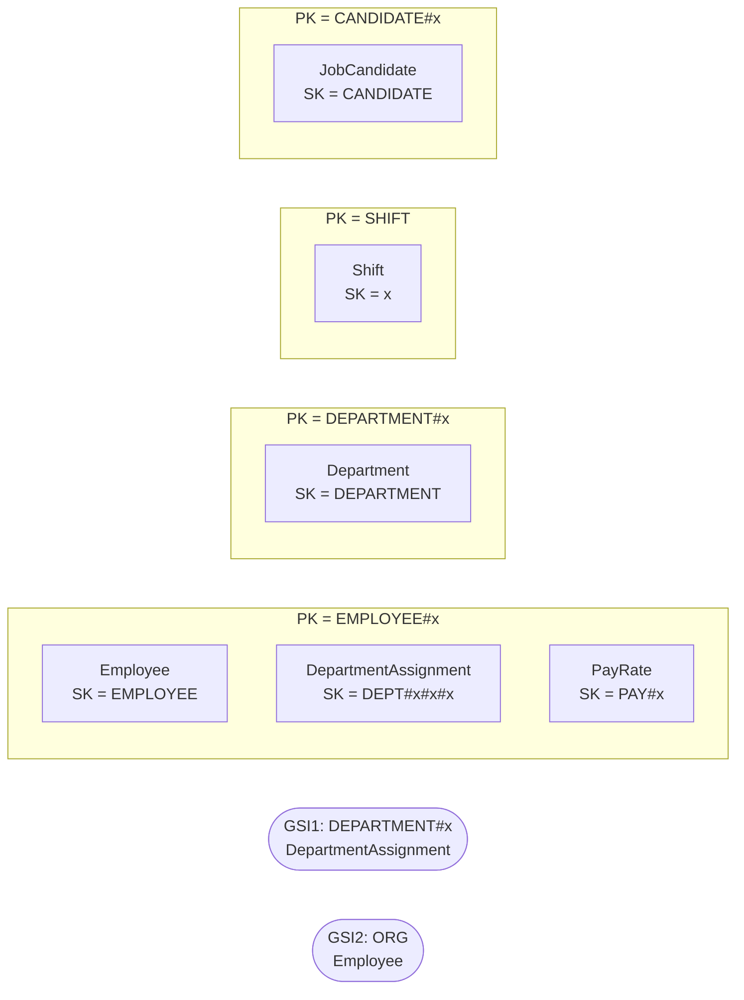

# HR — `aw-hr`

Generated by `scripts/design/table_docs.py` from `design/mapping/mapping.yaml`, `access-pattern-keys.yaml` and sample items read back from DynamoDB Local. Method: docs/design/dynamodb-playbook.md (The DynamoDB Book ch. 7, 9, 11–14, 16; cited by chapter only).

**Table settings:** on-demand, PITR, streams NEW_AND_OLD_IMAGES, TTL attribute `ttl`, GSIs: GSI1, GSI2 (projection ALL). Items loaded: **934**.

## Entity chart

| Entity | Source | PK | SK | GSI1PK / GSI1SK | GSI2PK / GSI2SK | Items |
|---|---|---|---|---|---|---|
| Employee | HumanResources.Employee | `EMPLOYEE#{BusinessEntityID:06d}` | `EMPLOYEE` |  | `ORG / {x_org_path}` | 290 |
| DepartmentAssignment | HumanResources.EmployeeDepartmentHistory | `EMPLOYEE#{BusinessEntityID:06d}` | `DEPT#{StartDate:iso}#{DepartmentID:02d}#{ShiftID}` | `DEPARTMENT#{DepartmentID:02d} / EMPLOYEE#{BusinessEntityID:06d} (sparse)` |  | 296 |
| PayRate | HumanResources.EmployeePayHistory | `EMPLOYEE#{BusinessEntityID:06d}` | `PAY#{RateChangeDate:iso}` |  |  | 316 |
| Department | HumanResources.Department | `DEPARTMENT#{DepartmentID:02d}` | `DEPARTMENT` |  |  | 16 |
| Shift | HumanResources.Shift | `SHIFT` | `{ShiftID}` |  |  | 3 |
| JobCandidate | HumanResources.JobCandidate | `CANDIDATE#{JobCandidateID:03d}` | `CANDIDATE` |  |  | 13 |

## Item collections



## Denormalized / snapshot copies

| Attributes | On items from | Copied from | Owner of refresh | Refresh |
|---|---|---|---|---|
| first_name, last_name | HumanResources.Employee | Person.Person | HR | customer stream event PersonChanged -> HR updates its copy |

## Access patterns → key conditions

| ID | Question | Operation(s) | Consistency | Notes / compromise |
|---|---|---|---|---|
| HR-01 | Show an employee with current department, shift, job title and pay | `Query PK = 'EMPLOYEE#<e:06d>'  (EMPLOYEE, DEPT#..., PAY#...; current = DEPT# with no end_date, latest PAY#)` | strong for pay edits |  |
| HR-02 | Show an employee's department and pay history | `Query PK = 'EMPLOYEE#<e:06d>' AND begins_with(SK, 'DEPT#') / begins_with(SK, 'PAY#'), ScanIndexForward=false` | eventual |  |
| HR-03 | Who reports to this manager (all levels) / what is this employee's management chain? | `Query GSI2 GSI2PK = 'ORG' AND begins_with(GSI2SK, '<manager org_path>')  (whole subtree)`<br>`chain: Query GSI2 GSI2PK = 'ORG' AND GSI2SK = '<ancestor path>' per level` | eventual |  |
| HR-04 | Who is currently in this department? | `Query GSI1 GSI1PK = 'DEPARTMENT#<d:02d>'` | eventual | sparse: only current assignments (end_date null) |
| HR-05 | Update hire info, login, personal info | `UpdateItem PK='EMPLOYEE#<e>', SK='EMPLOYEE' SET ... ConditionExpression ver = :v` | strong |  |

## Sample items (read back from DynamoDB Local)

Partition `EMPLOYEE#000004` (first 6 items):

```json
[
 {
  "end_date": "2010-05-30T00:00:00",
  "ver": 1,
  "src_pk": "BusinessEntityID=4,StartDate=2007-12-05T00:00:00,DepartmentID=1,ShiftID=1",
  "department_id": 1,
  "src": "sql",
  "department_name": "Engineering",
  "shift_name": "Day",
  "src_table": "HumanResources.EmployeeDepartmentHistory",
  "modified_date": "2010-05-28T00:00:00",
  "type": "DepartmentAssignment",
  "updated_at": "2026-10-11T21:47:20Z",
  "shift_id": 1,
  "SK": "DEPT#2007-12-05T00:00:00#01#1",
  "src_lsn": "0x00000000000000000000",
  "PK": "EMPLOYEE#000004",
  "business_entity_id": 4,
  "start_date": "2007-12-05T00:00:00"
 },
 {
  "ver": 1,
  "src_pk": "BusinessEntityID=4,StartDate=2010-05-31T00:00:00,DepartmentID=2,ShiftID=1",
  "department_id": 2,
  "src": "sql",
  "department_name": "Tool Design",
  "shift_name": "Day",
  "src_table": "HumanResources.EmployeeDepartmentHistory",
  "modified_date": "2010-05-30T00:00:00",
  "type": "DepartmentAssignment",
  "GSI1PK": "DEPARTMENT#02",
  "updated_at": "2026-10-11T21:47:20Z",
  "shift_id": 1,
  "GSI1SK": "EMPLOYEE#000004",
  "SK": "DEPT#2010-05-31T00:00:00#02#1",
  "src_lsn": "0x00000000000000000000",
  "PK": "EMPLOYEE#000004",
  "business_entity_id": 4,
  "start_date": "2010-05-31T00:00:00"
 },
 {
  "vacation_hours": 48,
  "sick_leave_hours": 80,
  "organization_level": 3,
  "gender": "M",
  "src_pk": "BusinessEntityID=4",
  "birth_date": "1974-12-23T00:00:00",
  "src_table": "HumanResources.Employee",
  "type": "Employee",
  "rowguid": "59747955-87b8-443f-8ed4-f8ad3afdf3a9",
  "updated_at": "2026-10-11T21:47:33Z",
  "national_id_number": "112457891",
  "GSI2SK": "/1/1/1/",
  "SK": "EMPLOYEE",
  "business_entity_id": 4,
  "job_title": "Senior Tool Designer",
  "first_name": "Rob",
  "login_id": "adventure-works\\rob0",
  "ver": 1,
  "src": "sql",
  "salaried_flag": false,
  "last_name": "Walters",
  "hire_date": "2007-12-05T00:00:00",
  "GSI2PK": "ORG",
  "modified_date": "2014-06-30T00:00:00",
  "marital_status": "S",
  "current_flag": true,
  "src_lsn": "0x00000000000000000000",
  "org_path": "/1/1/1/",
  "PK": "EMPLOYEE#000004"
 },
 {
  "ver": 1,
  "src_pk": "BusinessEntityID=4,RateChangeDate=2007-12-05T00:00:00",
  "src": "sql",
  "pay_frequency": 2,
  "src_table": "HumanResources.EmployeePayHistory",
  "modified_date": "2007-11-21T00:00:00",
  "type": "PayRate",
  "rate_change_date": "2007-12-05T00:00:00",
  "updated_at": "2026-10-11T21:47:20Z",
  "rate": 8.62,
  "SK": "PAY#2007-12-05T00:00:00",
  "src_lsn": "0x00000000000000000000",
  "PK": "EMPLOYEE#000004",
  "business_entity_id": 4
 },
 {
  "ver": 1,
  "src_pk": "BusinessEntityID=4,RateChangeDate=2010-05-31T00:00:00",
  "src": "sql",
  "pay_frequency": 2,
  "src_table": "HumanResources.EmployeePayHistory",
  "modified_date": "2010-05-16T00:00:00",
  "type": "PayRate",
  "rate_change_date": "2010-05-31T00:00:00",
  "updated_at": "2026-10-11T21:47:20Z",
  "rate": 23.72,
  "SK": "PAY#2010-05-31T00:00:00",
  "src_lsn": "0x00000000000000000000",
  "PK": "EMPLOYEE#000004",
  "business_entity_id": 4
 },
 {
  "ver": 1,
  "src_pk": "BusinessEntityID=4,RateChangeDate=2011-12-15T00:00:00",
  "src": "sql",
  "pay_frequency": 2,
  "src_table": "HumanResources.EmployeePayHistory",
  "modified_date": "2011-12-01T00:00:00",
  "type": "PayRate",
  "rate_change_date": "2011-12-15T00:00:00",
  "updated_at": "2026-10-11T21:47:20Z",
  "rate": 29.8462,
  "SK": "PAY#2011-12-15T00:00:00",
  "src_lsn": "0x00000000000000000000",
  "PK": "EMPLOYEE#000004",
  "business_entity_id": 4
 }
]
```

## Trade-offs

- Org chart uses the hierarchyid path string as GSI2 sort key (single 'ORG' partition of 290 items); subtree = begins_with, chain = one Query per ancestor.
- Current department membership is a sparse GSI1 (end_date absent).
- Pay and national ID stay in this table only; customer-managed KMS key + separate IAM.

