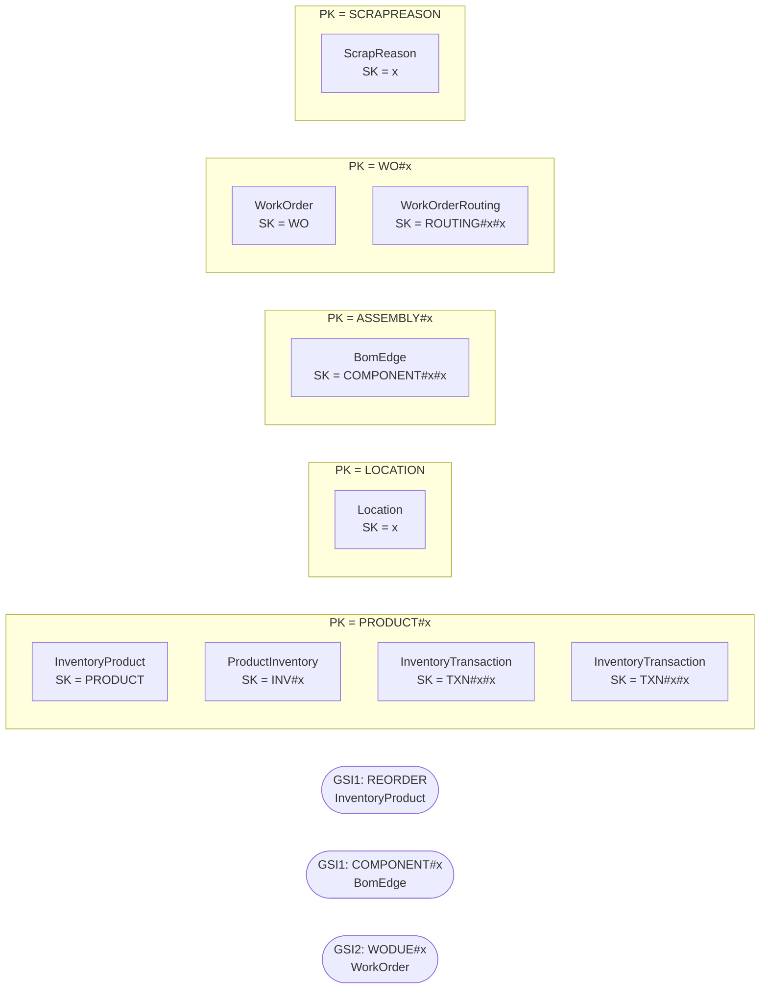

# Inventory & Manufacturing — `aw-inventory`

Generated by `scripts/design/table_docs.py` from `design/mapping/mapping.yaml`, `access-pattern-keys.yaml` and sample items read back from DynamoDB Local. Method: docs/design/dynamodb-playbook.md (The DynamoDB Book ch. 7, 9, 11–14, 16; cited by chapter only).

**Table settings:** on-demand, PITR, streams NEW_AND_OLD_IMAGES, TTL attribute `ttl`, GSIs: GSI1, GSI2 (projection ALL). Items loaded: **346,700**.

## Entity chart

| Entity | Source | PK | SK | GSI1PK / GSI1SK | GSI2PK / GSI2SK | Items |
|---|---|---|---|---|---|---|
| InventoryProduct (copy of Catalog) | Production.Product | `PRODUCT#{ProductID:06d}` | `PRODUCT` | `REORDER / PRODUCT#{ProductID:06d} (sparse)` |  | 504 |
| Location | Production.Location | `LOCATION` | `{LocationID:03d}` |  |  | 14 |
| ProductInventory | Production.ProductInventory | `PRODUCT#{ProductID:06d}` | `INV#{LocationID:03d}` |  |  | 1,069 |
| InventoryTransaction | Production.TransactionHistory | `PRODUCT#{ProductID:06d}` | `TXN#{TransactionDate:iso}#{TransactionID:06d}` |  |  | 202,696 |
| InventoryTransaction | Production.TransactionHistoryArchive | `PRODUCT#{ProductID:06d}` | `TXN#{TransactionDate:iso}#{TransactionID:06d}` |  |  | 202,696 |
| BomEdge | Production.BillOfMaterials | `ASSEMBLY#{x_assembly}` | `COMPONENT#{ComponentID:06d}#{StartDate:iso}` | `COMPONENT#{ComponentID:06d} / ASSEMBLY#{x_assembly}#{StartDate:iso}` |  | 2,679 |
| WorkOrder | Production.WorkOrder | `WO#{WorkOrderID:06d}` | `WO` |  | `WODUE#{DueDate:ym} / {DueDate:iso}#{WorkOrderID:06d}` | 72,591 |
| WorkOrderRouting | Production.WorkOrderRouting | `WO#{WorkOrderID:06d}` | `ROUTING#{OperationSequence:03d}#{LocationID:03d}` |  |  | 67,131 |
| ScrapReason | Production.ScrapReason | `SCRAPREASON` | `{ScrapReasonID:03d}` |  |  | 16 |

## Item collections



## Denormalized / snapshot copies

| Attributes | On items from | Copied from | Owner of refresh | Refresh |
|---|---|---|---|---|
| subcategory_name, category_id, category_name, model_name | Production.Product | Production.ProductSubcategory/ProductCategory/ProductModel | Catalog | catalog stream |
| stock_qty | Production.Product | Production.ProductInventory | Inventory & Manufacturing | inventory stream publishes total per product |
| whole item (InventoryProduct) | Production.Product | Catalog | Catalog | Catalog stream |

## Access patterns → key conditions

| ID | Question | Operation(s) | Consistency | Notes / compromise |
|---|---|---|---|---|
| INV-01 | How many units of this product are on hand, per location and in total? | `Query PK = 'PRODUCT#<p:06d>' AND SK <= 'PRODUCT'  (INV#<loc> items + PRODUCT copy with stock_qty)` | eventual |  |
| INV-02 | Which products are below their reorder point / safety stock? | `Query GSI1 GSI1PK = 'REORDER'` | eventual | sparse: only products with stock_qty < reorder_point carry GSI1 keys |
| INV-03 | Record a stock movement and list movements for a product over a date range | `Query PK = 'PRODUCT#<p:06d>' AND SK BETWEEN 'TXN#<fromIso>' AND 'TXN#<toIso>~', ScanIndexForward=false`<br>`PutItem TXN#<iso>#<id> + UpdateItem ADD quantity on INV#<loc> (TransactWrite)` | eventual |  |
| INV-04 | Explode the bill of materials for an assembly (all levels, as of a date) | `Query PK = 'ASSEMBLY#<a:06d>' (repeat per level for children; filter start_date <= d < end_date client-side)` | eventual | **Compromise:** multi-level explosion = one Query per assembly per level (max depth 4) |
| INV-05 | Where is this component used? | `Query GSI1 GSI1PK = 'COMPONENT#<c:06d>' (repeat upwards per level)` | eventual |  |
| INV-06 | Which work orders are open / due, and what are a work order's routing steps? | `Query GSI2 GSI2PK = 'WODUE#<yyyy-mm>' AND GSI2SK BETWEEN '<fromIso>' AND '<toIso>~' (one query per month in range)`<br>`FilterExpression attribute_not_exists(end_date) for open only`<br>`Query PK = 'WO#<id:06d>' (work order + routings)` | eventual | **Compromise:** date range spanning months = one Query per month bucket; 'open' is a filter (all historical WOs are closed) |

## Sample items (read back from DynamoDB Local)

Partition `PRODUCT#000001` (first 6 items):

```json
[
 {
  "ver": 1,
  "quantity": 408,
  "src_pk": "ProductID=1,LocationID=1",
  "src": "sql",
  "bin": 1,
  "src_table": "Production.ProductInventory",
  "modified_date": "2014-08-08T00:00:00",
  "type": "ProductInventory",
  "location_id": 1,
  "rowguid": "47a24246-6c43-48eb-968f-025738a8a410",
  "shelf": "A",
  "location_name": "Tool Crib",
  "updated_at": "2026-10-11T21:47:23Z",
  "product_id": 1,
  "SK": "INV#001",
  "src_lsn": "0x00000000000000000000",
  "PK": "PRODUCT#000001"
 },
 {
  "ver": 1,
  "quantity": 324,
  "src_pk": "ProductID=1,LocationID=6",
  "src": "sql",
  "bin": 5,
  "src_table": "Production.ProductInventory",
  "modified_date": "2014-08-08T00:00:00",
  "type": "ProductInventory",
  "location_id": 6,
  "rowguid": "d4544d7d-caf5-46b3-ab22-5718dcc26b5e",
  "shelf": "B",
  "location_name": "Miscellaneous Storage",
  "updated_at": "2026-10-11T21:47:23Z",
  "product_id": 1,
  "SK": "INV#006",
  "src_lsn": "0x00000000000000000000",
  "PK": "PRODUCT#000001"
 },
 {
  "ver": 1,
  "quantity": 353,
  "src_pk": "ProductID=1,LocationID=50",
  "src": "sql",
  "bin": 5,
  "src_table": "Production.ProductInventory",
  "modified_date": "2014-08-08T00:00:00",
  "type": "ProductInventory",
  "location_id": 50,
  "rowguid": "bff7dc60-96a8-43ca-81a7-d6d2ed3000a8",
  "shelf": "A",
  "location_name": "Subassembly",
  "updated_at": "2026-10-11T21:47:23Z",
  "product_id": 1,
  "SK": "INV#050",
  "src_lsn": "0x00000000000000000000",
  "PK": "PRODUCT#000001"
 },
 {
  "ver": 1,
  "src_pk": "ProductID=1",
  "safety_stock_level": 1000,
  "src": "sql",
  "src_table": "Production.Product",
  "reorder_point": 750,
  "type": "InventoryProduct",
  "product_number": "AR-5381",
  "updated_at": "2026-10-11T21:48:24Z",
  "product_id": 1,
  "stock_qty": 1085,
  "name": "Adjustable Race",
  "SK": "PRODUCT",
  "src_lsn": "0x00000000000000000000",
  "PK": "PRODUCT#000001"
 },
 {
  "transaction_id": 1,
  "transaction_date": "2011-04-16T00:00:00",
  "ver": 1,
  "quantity": 4,
  "src_pk": "TransactionID=1",
  "src": "sql",
  "reference_order_line_id": 1,
  "src_table": "Production.TransactionHistoryArchive",
  "transaction_type": "P",
  "modified_date": "2011-04-16T00:00:00",
  "type": "InventoryTransaction",
  "archived": true,
  "updated_at": "2026-10-11T21:47:20Z",
  "actual_cost": 50.26,
  "reference_order_id": 1,
  "product_id": 1,
  "SK": "TXN#2011-04-16T00:00:00#000001",
  "src_lsn": "0x00000000000000000000",
  "PK": "PRODUCT#000001"
 },
 {
  "transaction_id": 18332,
  "transaction_date": "2012-02-09T00:00:00",
  "ver": 1,
  "quantity": 3,
  "src_pk": "TransactionID=18332",
  "src": "sql",
  "reference_order_line_id": 1,
  "src_table": "Production.TransactionHistoryArchive",
  "transaction_type": "P",
  "modified_date": "2012-02-09T00:00:00",
  "type": "InventoryTransaction",
  "archived": true,
  "updated_at": "2026-10-11T21:47:56Z",
  "actual_cost": 50.2635,
  "reference_order_id": 80,
  "product_id": 1,
  "SK": "TXN#2012-02-09T00:00:00#018332",
  "src_lsn": "0x00000000000000000000",
  "PK": "PRODUCT#000001"
 }
]
```

Partition `ASSEMBLY#000800` (first 6 items):

```json
[
 {
  "component_id": 518,
  "ver": 1,
  "src_pk": "BillOfMaterialsID=1354",
  "product_assembly_id": 800,
  "src": "sql",
  "unit_measure_code": "EA",
  "component_name": "ML Road Seat Assembly",
  "src_table": "Production.BillOfMaterials",
  "bomlevel": 1,
  "modified_date": "2010-05-26T00:00:00",
  "type": "BomEdge",
  "per_assembly_qty": 1,
  "GSI1PK": "COMPONENT#000518",
  "updated_at": "2026-10-11T21:47:30Z",
  "GSI1SK": "ASSEMBLY#000800#2010-06-09T00:00:00",
  "SK": "COMPONENT#000518#2010-06-09T00:00:00",
  "src_lsn": "0x00000000000000000000",
  "PK": "ASSEMBLY#000800",
  "bill_of_materials_id": 1354,
  "start_date": "2010-06-09T00:00:00"
 },
 {
  "component_id": 806,
  "ver": 1,
  "src_pk": "BillOfMaterialsID=862",
  "product_assembly_id": 800,
  "src": "sql",
  "unit_measure_code": "EA",
  "component_name": "ML Headset",
  "src_table": "Production.BillOfMaterials",
  "bomlevel": 1,
  "modified_date": "2010-05-12T00:00:00",
  "type": "BomEdge",
  "per_assembly_qty": 1,
  "GSI1PK": "COMPONENT#000806",
  "updated_at": "2026-10-11T21:47:30Z",
  "GSI1SK": "ASSEMBLY#000800#2010-05-26T00:00:00",
  "SK": "COMPONENT#000806#2010-05-26T00:00:00",
  "src_lsn": "0x00000000000000000000",
  "PK": "ASSEMBLY#000800",
  "bill_of_materials_id": 862,
  "start_date": "2010-05-26T00:00:00"
 },
 {
  "component_id": 812,
  "ver": 1,
  "src_pk": "BillOfMaterialsID=2081",
  "product_assembly_id": 800,
  "src": "sql",
  "unit_measure_code": "EA",
  "component_name": "ML Road Handlebars",
  "src_table": "Production.BillOfMaterials",
  "bomlevel": 1,
  "modified_date": "2010-06-24T00:00:00",
  "type": "BomEdge",
  "per_assembly_qty": 1,
  "GSI1PK": "COMPONENT#000812",
  "updated_at": "2026-10-11T21:47:30Z",
  "GSI1SK": "ASSEMBLY#000800#2010-07-08T00:00:00",
  "SK": "COMPONENT#000812#2010-07-08T00:00:00",
  "src_lsn": "0x00000000000000000000",
  "PK": "ASSEMBLY#000800",
  "bill_of_materials_id": 2081,
  "start_date": "2010-07-08T00:00:00"
 },
 {
  "component_id": 819,
  "ver": 1,
  "src_pk": "BillOfMaterialsID=2794",
  "product_assembly_id": 800,
  "src": "sql",
  "unit_measure_code": "EA",
  "component_name": "ML Road Front Wheel",
  "src_table": "Production.BillOfMaterials",
  "bomlevel": 1,
  "modified_date": "2010-09-01T00:00:00",
  "type": "BomEdge",
  "per_assembly_qty": 1,
  "GSI1PK": "COMPONENT#000819",
  "updated_at": "2026-10-11T21:47:30Z",
  "GSI1SK": "ASSEMBLY#000800#2010-09-15T00:00:00",
  "SK": "COMPONENT#000819#2010-09-15T00:00:00",
  "src_lsn": "0x00000000000000000000",
  "PK": "ASSEMBLY#000800",
  "bill_of_materials_id": 2794,
  "start_date": "2010-09-15T00:00:00"
 },
 {
  "component_id": 827,
  "ver": 1,
  "src_pk": "BillOfMaterialsID=922",
  "product_assembly_id": 800,
  "src": "sql",
  "unit_measure_code": "EA",
  "component_name": "ML Road Rear Wheel",
  "src_table": "Production.BillOfMaterials",
  "bomlevel": 1,
  "modified_date": "2010-05-12T00:00:00",
  "type": "BomEdge",
  "per_assembly_qty": 1,
  "GSI1PK": "COMPONENT#000827",
  "updated_at": "2026-10-11T21:47:30Z",
  "GSI1SK": "ASSEMBLY#000800#2010-05-26T00:00:00",
  "SK": "COMPONENT#000827#2010-05-26T00:00:00",
  "src_lsn": "0x00000000000000000000",
  "PK": "ASSEMBLY#000800",
  "bill_of_materials_id": 922,
  "start_date": "2010-05-26T00:00:00"
 },
 {
  "component_id": 835,
  "ver": 1,
  "src_pk": "BillOfMaterialsID=3262",
  "product_assembly_id": 800,
  "src": "sql",
  "unit_measure_code": "EA",
  "component_name": "ML Road Frame-W - Yellow, 44",
  "src_table": "Production.BillOfMaterials",
  "bomlevel": 1,
  "modified_date": "2010-12-09T00:00:00",
  "type": "BomEdge",
  "per_assembly_qty": 1,
  "GSI1PK": "COMPONENT#000835",
  "updated_at": "2026-10-11T21:47:30Z",
  "GSI1SK": "ASSEMBLY#000800#2010-12-23T00:00:00",
  "SK": "COMPONENT#000835#2010-12-23T00:00:00",
  "src_lsn": "0x00000000000000000000",
  "PK": "ASSEMBLY#000800",
  "bill_of_materials_id": 3262,
  "start_date": "2010-12-23T00:00:00"
 }
]
```

## Trade-offs

- Inventory transactions (current + archive, ~202k) live in the product partition, sorted by date; the hottest product has a few thousand items - fine without LSIs (no 10 GB collection limit).
- BOM explosion / where-used are iterative (one Query per assembly per level, max depth 4) rather than a materialized tree.
- Work orders by due date are bucketed per month (WODUE#yyyy-mm); a range across months = one Query per month. 'Open' is a filter: all 72,591 historical WOs are closed.
- REORDER is a sparse GSI1 partition maintained when stock_qty changes.

