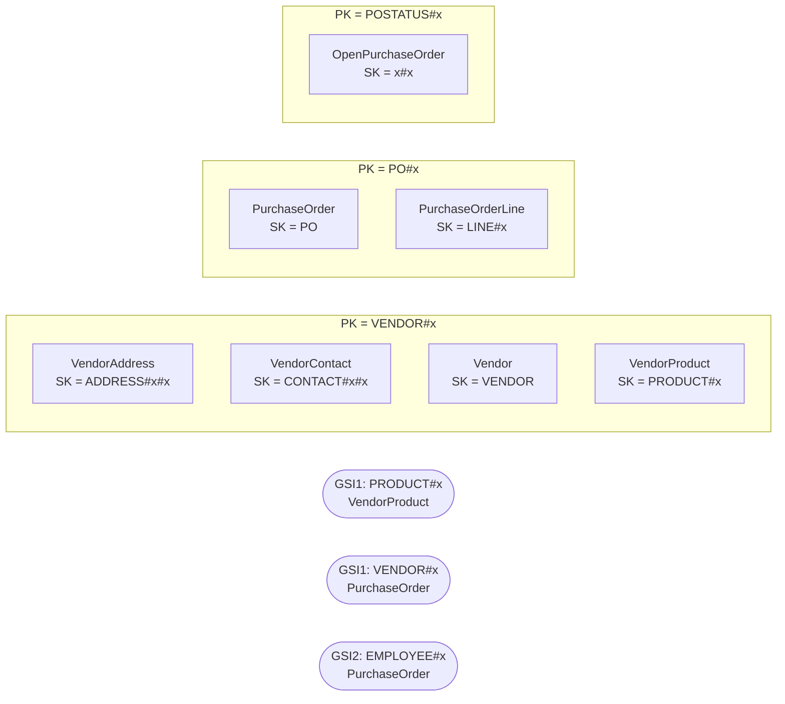

# Purchasing — `aw-purchasing`

Generated by `scripts/design/table_docs.py` from `design/mapping/mapping.yaml`, `access-pattern-keys.yaml` and sample items read back from DynamoDB Local. Method: docs/design/dynamodb-playbook.md (The DynamoDB Book ch. 7, 9, 11–14, 16; cited by chapter only).

**Table settings:** on-demand, PITR, streams NEW_AND_OLD_IMAGES, TTL attribute `ttl`, GSIs: GSI1, GSI2 (projection ALL). Items loaded: **13,918**.

## Entity chart

| Entity | Source | PK | SK | GSI1PK / GSI1SK | GSI2PK / GSI2SK | Items |
|---|---|---|---|---|---|---|
| VendorAddress (copy of Customer & Party) | Person.BusinessEntityAddress | `VENDOR#{BusinessEntityID:06d}` | `ADDRESS#{AddressTypeID:02d}#{AddressID:06d}` |  |  | 104 |
| VendorContact (copy of Customer & Party) | Person.BusinessEntityContact | `VENDOR#{BusinessEntityID:06d}` | `CONTACT#{PersonID:06d}#{ContactTypeID:02d}` |  |  | 156 |
| Vendor | Purchasing.Vendor | `VENDOR#{BusinessEntityID:06d}` | `VENDOR` |  |  | 104 |
| VendorProduct | Purchasing.ProductVendor | `VENDOR#{BusinessEntityID:06d}` | `PRODUCT#{ProductID:06d}` | `PRODUCT#{ProductID:06d} / VENDOR#{BusinessEntityID:06d}` |  | 460 |
| PurchaseOrder | Purchasing.PurchaseOrderHeader | `PO#{PurchaseOrderID:06d}` | `PO` | `VENDOR#{VendorID:06d} / PO#{OrderDate:iso}#{PurchaseOrderID:06d}` | `EMPLOYEE#{EmployeeID:06d} / PO#{OrderDate:iso}#{PurchaseOrderID:06d}` | 4,012 |
| OpenPurchaseOrder (derived) | Purchasing.PurchaseOrderHeader | `POSTATUS#{Status}` | `{OrderDate:iso}#{PurchaseOrderID:06d}` |  |  | 237 |
| PurchaseOrderLine | Purchasing.PurchaseOrderDetail | `PO#{PurchaseOrderID:06d}` | `LINE#{PurchaseOrderDetailID:06d}` |  |  | 8,845 |

## Item collections



## Denormalized / snapshot copies

| Attributes | On items from | Copied from | Owner of refresh | Refresh |
|---|---|---|---|---|
| address_line1, address_line2, city, state_province_code, postal_code, country_region_code | Person.BusinessEntityAddress | Person.Address | Customer & Party | customer stream: on ADDRESS change, Query GSI1 ADDRESS#id and update links (+ Purchasing vendor copies) |
| whole item (VendorAddress) | Person.BusinessEntityAddress | Customer & Party | Customer & Party | Customer & Party stream |
| whole item (VendorContact) | Person.BusinessEntityContact | Customer & Party | Customer & Party | Customer & Party stream |

## Access patterns → key conditions

| ID | Question | Operation(s) | Consistency | Notes / compromise |
|---|---|---|---|---|
| PUR-01 | Show a vendor with addresses and contacts | `Query PK = 'VENDOR#<v:06d>' AND SK < 'PRODUCT#'  (VENDOR, ADDRESS#, CONTACT#)` | eventual |  |
| PUR-02 | Who can supply this product, at what price and lead time? | `Query GSI1 GSI1PK = 'PRODUCT#<p:06d>' AND begins_with(GSI1SK, 'VENDOR#')` | eventual |  |
| PUR-03 | What does this vendor supply? | `Query PK = 'VENDOR#<v:06d>' AND begins_with(SK, 'PRODUCT#')` | eventual |  |
| PUR-04 | Create a purchase order and show it with its lines | `TransactWriteItems Put PO + LINE#n items (+ POSTATUS# marker)`<br>`Query PK = 'PO#<id:06d>'` | strong (totals maintained in same transaction) |  |
| PUR-05 | Purchase orders for a vendor, newest first, optionally by status | `Query GSI1 GSI1PK = 'VENDOR#<v:06d>' AND begins_with(GSI1SK, 'PO#'), ScanIndexForward=false [FilterExpression status = :s]` | eventual |  |
| PUR-06 | Purchase orders raised by an employee | `Query GSI2 GSI2PK = 'EMPLOYEE#<e:06d>' AND begins_with(GSI2SK, 'PO#'), ScanIndexForward=false` | eventual |  |
| PUR-07 | Open purchase orders (pending/approved) to receive | `Query PK = 'POSTATUS#1'  and  Query PK = 'POSTATUS#2'` | eventual |  |

## Sample items (read back from DynamoDB Local)

Partition `VENDOR#001492` (first 6 items):

```json
[
 {
  "ver": 1,
  "address_type": "Main Office",
  "src_pk": "BusinessEntityID=1492,AddressID=309,AddressTypeID=3",
  "city": "Bellingham",
  "src": "sql",
  "state_province_code": "WA",
  "address_id": 309,
  "address_type_id": 3,
  "country_region_code": "US",
  "src_table": "Person.BusinessEntityAddress",
  "modified_date": "2011-12-23T00:00:00",
  "type": "VendorAddress",
  "rowguid": "995576cd-c7e8-431d-9e10-f7e30c10cbc4",
  "updated_at": "2026-10-11T21:47:32Z",
  "address_line1": "28 San Marino Ct.",
  "SK": "ADDRESS#03#000309",
  "src_lsn": "0x00000000000000000000",
  "PK": "VENDOR#001492",
  "business_entity_id": 1492,
  "postal_code": "98225"
 },
 {
  "contact_name": "Paula Moberly",
  "ver": 1,
  "src_pk": "BusinessEntityID=1492,PersonID=1491,ContactTypeID=18",
  "src": "sql",
  "src_table": "Person.BusinessEntityContact",
  "modified_date": "2011-12-23T00:00:00",
  "type": "VendorContact",
  "rowguid": "9e368cd5-e5b6-43b4-a006-31d018d7c8e7",
  "contact_type": "Sales Associate",
  "updated_at": "2026-10-11T21:47:24Z",
  "contact_type_id": 18,
  "SK": "CONTACT#001491#18",
  "src_lsn": "0x00000000000000000000",
  "PK": "VENDOR#001492",
  "business_entity_id": 1492,
  "person_id": 1491
 },
 {
  "contact_name": "Charlene Wojcik",
  "ver": 1,
  "src_pk": "BusinessEntityID=1492,PersonID=2054,ContactTypeID=19",
  "src": "sql",
  "src_table": "Person.BusinessEntityContact",
  "modified_date": "2011-12-23T00:00:00",
  "type": "VendorContact",
  "rowguid": "22623211-6454-4ba4-a646-3e2aa135bf5b",
  "contact_type": "Sales Manager",
  "updated_at": "2026-10-11T21:47:25Z",
  "contact_type_id": 19,
  "SK": "CONTACT#002054#19",
  "src_lsn": "0x00000000000000000000",
  "PK": "VENDOR#001492",
  "business_entity_id": 1492,
  "person_id": 2054
 },
 {
  "contact_name": "Jo Zimmerman",
  "ver": 1,
  "src_pk": "BusinessEntityID=1492,PersonID=2080,ContactTypeID=17",
  "src": "sql",
  "src_table": "Person.BusinessEntityContact",
  "modified_date": "2011-12-23T00:00:00",
  "type": "VendorContact",
  "rowguid": "4610e212-3efe-4c82-a377-8c3906fb8c8d",
  "contact_type": "Sales Agent",
  "updated_at": "2026-10-11T21:47:25Z",
  "contact_type_id": 17,
  "SK": "CONTACT#002080#17",
  "src_lsn": "0x00000000000000000000",
  "PK": "VENDOR#001492",
  "business_entity_id": 1492,
  "person_id": 2080
 },
 {
  "min_order_qty": 1,
  "ver": 1,
  "standard_price": 45.26,
  "src_pk": "ProductID=422,BusinessEntityID=1492",
  "src": "sql",
  "unit_measure_code": "CTN",
  "vendor_name": "Australia Bike Retailer",
  "src_table": "Purchasing.ProductVendor",
  "modified_date": "2011-08-12T00:00:00",
  "type": "VendorProduct",
  "product_name": "Thin-Jam Lock Nut 9",
  "product_number": "LJ-1213",
  "last_receipt_date": "2011-08-12T00:00:00",
  "GSI1PK": "PRODUCT#000422",
  "updated_at": "2026-10-11T21:47:33Z",
  "last_receipt_cost": 47.523,
  "max_order_qty": 5,
  "product_id": 422,
  "GSI1SK": "VENDOR#001492",
  "SK": "PRODUCT#000422",
  "src_lsn": "0x00000000000000000000",
  "PK": "VENDOR#001492",
  "business_entity_id": 1492,
  "average_lead_time": 17
 },
 {
  "min_order_qty": 1,
  "ver": 1,
  "standard_price": 43.26,
  "src_pk": "ProductID=423,BusinessEntityID=1492",
  "src": "sql",
  "unit_measure_code": "CTN",
  "vendor_name": "Australia Bike Retailer",
  "src_table": "Purchasing.ProductVendor",
  "modified_date": "2011-08-12T00:00:00",
  "type": "VendorProduct",
  "product_name": "Thin-Jam Lock Nut 10",
  "product_number": "LJ-1220",
  "last_receipt_date": "2011-08-12T00:00:00",
  "GSI1PK": "PRODUCT#000423",
  "updated_at": "2026-10-11T21:47:33Z",
  "last_receipt_cost": 45.423,
  "max_order_qty": 5,
  "product_id": 423,
  "GSI1SK": "VENDOR#001492",
  "SK": "PRODUCT#000423",
  "src_lsn": "0x00000000000000000000",
  "PK": "VENDOR#001492",
  "business_entity_id": 1492,
  "average_lead_time": 17
 }
]
```

## Trade-offs

- Vendor addresses and contacts are copies of Customer & Party items (vendor BEs), refreshed by the customer stream.
- Open POs use derived POSTATUS#<s> items (237 today) instead of a third GSI.
- Vendor<->product many-to-many: edge items in the vendor partition + inverted GSI1 on product.

