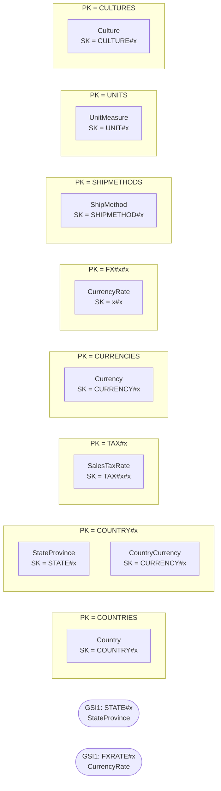

# Reference — `aw-reference`

Generated by `scripts/design/table_docs.py` from `design/mapping/mapping.yaml`, `access-pattern-keys.yaml` and sample items read back from DynamoDB Local. Method: docs/design/dynamodb-playbook.md (The DynamoDB Book ch. 7, 9, 11–14, 16; cited by chapter only).

**Table settings:** on-demand, PITR, streams NEW_AND_OLD_IMAGES, TTL attribute `ttl`, GSIs: GSI1 (projection ALL). Items loaded: **14,245**.

## Entity chart

| Entity | Source | PK | SK | GSI1PK / GSI1SK | GSI2PK / GSI2SK | Items |
|---|---|---|---|---|---|---|
| Country | Person.CountryRegion | `COUNTRIES` | `COUNTRY#{CountryRegionCode}` |  |  | 238 |
| StateProvince | Person.StateProvince | `COUNTRY#{CountryRegionCode}` | `STATE#{StateProvinceCode:trim}` | `STATE#{StateProvinceID:03d} / STATE` |  | 181 |
| SalesTaxRate | Sales.SalesTaxRate | `TAX#{StateProvinceID:03d}` | `TAX#{TaxType}#{SalesTaxRateID:03d}` |  |  | 29 |
| Currency | Sales.Currency | `CURRENCIES` | `CURRENCY#{CurrencyCode}` |  |  | 105 |
| CountryCurrency | Sales.CountryRegionCurrency | `COUNTRY#{CountryRegionCode}` | `CURRENCY#{CurrencyCode}` |  |  | 109 |
| CurrencyRate | Sales.CurrencyRate | `FX#{FromCurrencyCode}#{ToCurrencyCode}` | `{CurrencyRateDate:iso}#{CurrencyRateID:05d}` | `FXRATE#{CurrencyRateID:05d} / FXRATE` |  | 13,532 |
| ShipMethod | Purchasing.ShipMethod | `SHIPMETHODS` | `SHIPMETHOD#{ShipMethodID:02d}` |  |  | 5 |
| UnitMeasure | Production.UnitMeasure | `UNITS` | `UNIT#{UnitMeasureCode:trim}` |  |  | 38 |
| Culture | Production.Culture | `CULTURES` | `CULTURE#{CultureID:trim}` |  |  | 8 |

## Item collections



## Access patterns → key conditions

| ID | Question | Operation(s) | Consistency | Notes / compromise |
|---|---|---|---|---|
| REF-01 | List countries, and states/provinces for a country | `Query PK = 'COUNTRIES'`<br>`Query PK = 'COUNTRY#<code>' AND begins_with(SK, 'STATE#')` | eventual |  |
| REF-02 | What sales tax applies to a ship-to state? | `Query PK = 'TAX#<stateProvinceId:03d>'` | eventual |  |
| REF-03 | What was the exchange rate between two currencies on a date? | `Query PK = 'FX#<from>#<to>' AND SK <= '<dateIso>~', ScanIndexForward=false, Limit=1` | eventual |  |
| REF-04 | Which ship methods are available and what do they cost? | `Query PK = 'SHIPMETHODS'` | eventual |  |
| REF-05 | List currencies, units of measure, cultures | `Query PK = 'CURRENCIES' / 'UNITS' / 'CULTURES'` | eventual |  |

## Sample items (read back from DynamoDB Local)

Partition `COUNTRY#CA` (first 6 items):

```json
[
 {
  "ver": 1,
  "src_pk": "CountryRegionCode=CA,CurrencyCode=CAD",
  "updated_at": "2026-10-11T21:47:25Z",
  "src": "sql",
  "SK": "CURRENCY#CAD",
  "src_lsn": "0x00000000000000000000",
  "country_region_code": "CA",
  "src_table": "Sales.CountryRegionCurrency",
  "PK": "COUNTRY#CA",
  "modified_date": "2014-02-08T10:17:21",
  "type": "CountryCurrency",
  "currency_code": "CAD"
 },
 {
  "ver": 1,
  "src_pk": "StateProvinceID=1",
  "src": "sql",
  "state_province_code": "AB",
  "country_region_code": "CA",
  "src_table": "Person.StateProvince",
  "modified_date": "2014-02-08T10:17:21",
  "type": "StateProvince",
  "rowguid": "298c2880-ab1c-4982-a5ad-a36eb4ba0d34",
  "GSI1PK": "STATE#001",
  "updated_at": "2026-10-11T21:48:19Z",
  "is_only_state_province_flag": false,
  "GSI1SK": "STATE",
  "name": "Alberta",
  "country_name": "Canada",
  "SK": "STATE#AB",
  "src_lsn": "0x00000000000000000000",
  "state_province_id": 1,
  "PK": "COUNTRY#CA",
  "territory_id": 6
 },
 {
  "ver": 1,
  "src_pk": "StateProvinceID=7",
  "src": "sql",
  "state_province_code": "BC",
  "country_region_code": "CA",
  "src_table": "Person.StateProvince",
  "modified_date": "2014-02-08T10:17:21",
  "type": "StateProvince",
  "rowguid": "d27fcc6e-bb99-438b-ba86-285ceeb2fa53",
  "GSI1PK": "STATE#007",
  "updated_at": "2026-10-11T21:48:19Z",
  "is_only_state_province_flag": false,
  "GSI1SK": "STATE",
  "name": "British Columbia",
  "country_name": "Canada",
  "SK": "STATE#BC",
  "src_lsn": "0x00000000000000000000",
  "state_province_id": 7,
  "PK": "COUNTRY#CA",
  "territory_id": 6
 },
 {
  "ver": 1,
  "src_pk": "StateProvinceID=29",
  "src": "sql",
  "state_province_code": "LB",
  "country_region_code": "CA",
  "src_table": "Person.StateProvince",
  "modified_date": "2014-02-08T10:17:21",
  "type": "StateProvince",
  "rowguid": "9847c998-a7bf-4a66-bbac-75939b092cc0",
  "GSI1PK": "STATE#029",
  "updated_at": "2026-10-11T21:48:19Z",
  "is_only_state_province_flag": false,
  "GSI1SK": "STATE",
  "name": "Labrador",
  "country_name": "Canada",
  "SK": "STATE#LB",
  "src_lsn": "0x00000000000000000000",
  "state_province_id": 29,
  "PK": "COUNTRY#CA",
  "territory_id": 6
 },
 {
  "ver": 1,
  "src_pk": "StateProvinceID=31",
  "src": "sql",
  "state_province_code": "MB",
  "country_region_code": "CA",
  "src_table": "Person.StateProvince",
  "modified_date": "2014-02-08T10:17:21",
  "type": "StateProvince",
  "rowguid": "0ff23b5d-1e18-40f8-a886-9960ed699049",
  "GSI1PK": "STATE#031",
  "updated_at": "2026-10-11T21:48:19Z",
  "is_only_state_province_flag": false,
  "GSI1SK": "STATE",
  "name": "Manitoba",
  "country_name": "Canada",
  "SK": "STATE#MB",
  "src_lsn": "0x00000000000000000000",
  "state_province_id": 31,
  "PK": "COUNTRY#CA",
  "territory_id": 6
 },
 {
  "ver": 1,
  "src_pk": "StateProvinceID=41",
  "src": "sql",
  "state_province_code": "NB",
  "country_region_code": "CA",
  "src_table": "Person.StateProvince",
  "modified_date": "2014-02-08T10:17:21",
  "type": "StateProvince",
  "rowguid": "c28c848f-ae86-4859-9e7e-0190d6c22700",
  "GSI1PK": "STATE#041",
  "updated_at": "2026-10-11T21:48:19Z",
  "is_only_state_province_flag": false,
  "GSI1SK": "STATE",
  "name": "Brunswick",
  "country_name": "Canada",
  "SK": "STATE#NB",
  "src_lsn": "0x00000000000000000000",
  "state_province_id": 41,
  "PK": "COUNTRY#CA",
  "territory_id": 6
 }
]
```

## Trade-offs

- Small lists are single partitions (COUNTRIES, CURRENCIES, SHIPMETHODS, UNITS, CULTURES) - read once and cached.
- FX rates are partitioned per currency pair and sorted by date (latest-on-or-before = Limit 1 descending).
- GSI1 resolves StateProvinceID / CurrencyRateID for CDC enrichment.

