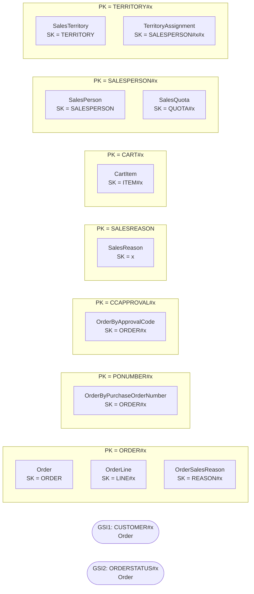

# Sales — `aw-sales`

Generated by `scripts/design/table_docs.py` from `design/mapping/mapping.yaml`, `access-pattern-keys.yaml` and sample items read back from DynamoDB Local. Method: docs/design/dynamodb-playbook.md (The DynamoDB Book ch. 7, 9, 11–14, 16; cited by chapter only).

**Table settings:** on-demand, PITR, streams NEW_AND_OLD_IMAGES, TTL attribute `ttl`, GSIs: GSI1, GSI2 (projection ALL). Items loaded: **214,789**.

## Entity chart

| Entity | Source | PK | SK | GSI1PK / GSI1SK | GSI2PK / GSI2SK | Items |
|---|---|---|---|---|---|---|
| Order | Sales.SalesOrderHeader | `ORDER#{SalesOrderID:010d}` | `ORDER` | `CUSTOMER#{CustomerID:06d} / ORDER#{OrderDate:iso}#{SalesOrderID:010d}` | `ORDERSTATUS#{Status} / {OrderDate:iso}#{SalesOrderID:010d} (sparse)` | 31,465 |
| OrderByPurchaseOrderNumber (derived) | Sales.SalesOrderHeader | `PONUMBER#{PurchaseOrderNumber}` | `ORDER#{SalesOrderID:010d}` |  |  | 3,806 |
| OrderByApprovalCode (derived) | Sales.SalesOrderHeader | `CCAPPROVAL#{CreditCardApprovalCode}` | `ORDER#{SalesOrderID:010d}` |  |  | 30,334 |
| OrderLine | Sales.SalesOrderDetail | `ORDER#{SalesOrderID:010d}` | `LINE#{SalesOrderDetailID:07d}` |  |  | 121,317 |
| OrderSalesReason | Sales.SalesOrderHeaderSalesReason | `ORDER#{SalesOrderID:010d}` | `REASON#{SalesReasonID:02d}` |  |  | 27,647 |
| SalesReason | Sales.SalesReason | `SALESREASON` | `{SalesReasonID:02d}` |  |  | 10 |
| CartItem | Sales.ShoppingCartItem | `CART#{ShoppingCartID:trim}` | `ITEM#{ProductID:06d}` |  |  | 3 |
| SalesPerson | Sales.SalesPerson | `SALESPERSON#{BusinessEntityID:06d}` | `SALESPERSON` |  |  | 17 |
| SalesQuota | Sales.SalesPersonQuotaHistory | `SALESPERSON#{BusinessEntityID:06d}` | `QUOTA#{QuotaDate:iso}` |  |  | 163 |
| SalesTerritory | Sales.SalesTerritory | `TERRITORY#{TerritoryID:02d}` | `TERRITORY` |  |  | 10 |
| TerritoryAssignment | Sales.SalesTerritoryHistory | `TERRITORY#{TerritoryID:02d}` | `SALESPERSON#{StartDate:iso}#{BusinessEntityID:06d}` |  |  | 17 |

## Item collections



## Denormalized / snapshot copies

| Attributes | On items from | Copied from | Owner of refresh | Refresh |
|---|---|---|---|---|
| customer_account_number, customer_name, store_name | Sales.SalesOrderHeader | Sales.Customer/Person.Person/Sales.Store | Sales | immutable at order time (CDC transform enriches from aw-customer) |
| ship_to_*, bill_to_* | Sales.SalesOrderHeader | Person.Address | Sales | immutable: address as at order time |
| ship_method_name, currency_from, currency_to, currency_average_rate | Sales.SalesOrderHeader | Reference | Sales | immutable |
| card_type, card_last4 | Sales.SalesOrderHeader | Sales.CreditCard | Sales | immutable; full card number never copied |
| product_name, product_number | Sales.SalesOrderDetail | Production.Product | Sales | immutable at order time (CDC transform enriches from aw-catalog) |

## Access patterns → key conditions

| ID | Question | Operation(s) | Consistency | Notes / compromise |
|---|---|---|---|---|
| SAL-01 | Add / change / remove an item in my cart, and show my cart | `Query PK = 'CART#<customerId>' ConsistentRead=true`<br>`PutItem/UpdateItem ITEM#<p:06d> (ttl = now + 7d)`<br>`DeleteItem` | strong (D8) |  |
| SAL-02 | Check out: turn my cart into an order (header + lines) with tax, freight, totals | `UpdateItem PK='COUNTER', SK='ORDER' ADD next_id :1 ReturnValues=UPDATED_NEW -> id >= 1,000,000,000 (D5)`<br>`TransactWriteItems: Put ORDER (attribute_not_exists(PK)) + Put LINE#n ... + Delete CART items (<= 100 actions)` | strong; atomic (transaction) | **Compromise:** orders with > ~95 lines + cart rows exceed the 100-action transaction limit -> split cart cleanup out of the transaction |
| SAL-03 | Show my order history, newest first | `Query GSI1 GSI1PK = 'CUSTOMER#<c:06d>' AND begins_with(GSI1SK, 'ORDER#'), ScanIndexForward=false` | eventual (read-after-checkout uses SAL-04 strong, D8) | **Compromise:** header only (no lines) in the list; GSI is eventually consistent - the app merges the just-placed order from SAL-04 |
| SAL-04 | Show one order with its lines (and sales reasons) | `Query PK = 'ORDER#<id:010d>' (ConsistentRead=true right after checkout)`<br>`SalesOrderNumber 'SO<n>' / 'SO-DDB-<n>' -> id = n` | strong right after checkout (D8), else eventual |  |
| SAL-05 | Which orders are in status X (e.g. in process / to ship) by date? | `Query GSI2 GSI2PK = 'ORDERSTATUS#<s>' AND GSI2SK BETWEEN '<fromIso>' AND '<toIso>~'` | eventual | sparse: statuses 1-3 only; historical orders are all 5 (shipped) |
| SAL-06 | Ship / cancel / revise an order | `UpdateItem PK='ORDER#<id>', SK='ORDER' SET status, ship_date, revision_number = revision_number + 1, ver = ver + 1 [REMOVE GSI2PK, GSI2SK when leaving status 1-3] ConditionExpression ver = :v AND status = :expected` | strong; conditional on current status/revision |  |
| SAL-07 | Orders for a store / reseller over a date range | `Query GSI1 GSI1PK = 'CUSTOMER#<storeCustomerId:06d>' AND GSI1SK BETWEEN 'ORDER#<fromIso>' AND 'ORDER#<toIso>~'` | eventual |  |
| SAL-10 | Sales person profile with quota history and YTD/last-year sales | `Query PK = 'SALESPERSON#<id:06d>'  (sales person + QUOTA# items)` | eventual |  |
| SAL-12 | Which sales people cover a territory (now and historically)? | `Query PK = 'TERRITORY#<t:02d>' AND begins_with(SK, 'SALESPERSON#')` | eventual |  |
| SAL-13 | Find an order by purchase order number or card approval code | `Query PK = 'PONUMBER#<po>'  or  Query PK = 'CCAPPROVAL#<code>'`<br>`then Query PK = 'ORDER#<id>'` | eventual |  |

## Sample items (read back from DynamoDB Local)

Partition `ORDER#0000043659` (first 6 items):

```json
[
 {
  "ver": 1,
  "special_offer_id": 1,
  "src_pk": "SalesOrderID=43659,SalesOrderDetailID=1",
  "src": "sql",
  "unit_price_discount": 0,
  "src_table": "Sales.SalesOrderDetail",
  "order_qty": 1,
  "unit_price": 2024.994,
  "modified_date": "2011-05-31T00:00:00",
  "type": "OrderLine",
  "carrier_tracking_number": "4911-403C-98",
  "product_name": "Mountain-100 Black, 42",
  "line_total": 2024.994,
  "rowguid": "b207c96d-d9e6-402b-8470-2cc176c42283",
  "product_number": "BK-M82B-42",
  "sales_order_detail_id": 1,
  "updated_at": "2026-10-11T21:47:37Z",
  "sales_order_id": 43659,
  "product_id": 776,
  "SK": "LINE#0000001",
  "src_lsn": "0x00000000000000000000",
  "PK": "ORDER#0000043659"
 },
 {
  "ver": 1,
  "special_offer_id": 1,
  "src_pk": "SalesOrderID=43659,SalesOrderDetailID=2",
  "src": "sql",
  "unit_price_discount": 0,
  "src_table": "Sales.SalesOrderDetail",
  "order_qty": 3,
  "unit_price": 2024.994,
  "modified_date": "2011-05-31T00:00:00",
  "type": "OrderLine",
  "carrier_tracking_number": "4911-403C-98",
  "product_name": "Mountain-100 Black, 44",
  "line_total": 6074.982,
  "rowguid": "7abb600d-1e77-41be-9fe5-b9142cfc08fa",
  "product_number": "BK-M82B-44",
  "sales_order_detail_id": 2,
  "updated_at": "2026-10-11T21:47:37Z",
  "sales_order_id": 43659,
  "product_id": 777,
  "SK": "LINE#0000002",
  "src_lsn": "0x00000000000000000000",
  "PK": "ORDER#0000043659"
 },
 {
  "ver": 1,
  "special_offer_id": 1,
  "src_pk": "SalesOrderID=43659,SalesOrderDetailID=3",
  "src": "sql",
  "unit_price_discount": 0,
  "src_table": "Sales.SalesOrderDetail",
  "order_qty": 1,
  "unit_price": 2024.994,
  "modified_date": "2011-05-31T00:00:00",
  "type": "OrderLine",
  "carrier_tracking_number": "4911-403C-98",
  "product_name": "Mountain-100 Black, 48",
  "line_total": 2024.994,
  "rowguid": "475cf8c6-49f6-486e-b0ad-afc6a50cdd2f",
  "product_number": "BK-M82B-48",
  "sales_order_detail_id": 3,
  "updated_at": "2026-10-11T21:47:37Z",
  "sales_order_id": 43659,
  "product_id": 778,
  "SK": "LINE#0000003",
  "src_lsn": "0x00000000000000000000",
  "PK": "ORDER#0000043659"
 },
 {
  "ver": 1,
  "special_offer_id": 1,
  "src_pk": "SalesOrderID=43659,SalesOrderDetailID=4",
  "src": "sql",
  "unit_price_discount": 0,
  "src_table": "Sales.SalesOrderDetail",
  "order_qty": 1,
  "unit_price": 2039.994,
  "modified_date": "2011-05-31T00:00:00",
  "type": "OrderLine",
  "carrier_tracking_number": "4911-403C-98",
  "product_name": "Mountain-100 Silver, 38",
  "line_total": 2039.994,
  "rowguid": "04c4de91-5815-45d6-8670-f462719fbce3",
  "product_number": "BK-M82S-38",
  "sales_order_detail_id": 4,
  "updated_at": "2026-10-11T21:47:37Z",
  "sales_order_id": 43659,
  "product_id": 771,
  "SK": "LINE#0000004",
  "src_lsn": "0x00000000000000000000",
  "PK": "ORDER#0000043659"
 },
 {
  "ver": 1,
  "special_offer_id": 1,
  "src_pk": "SalesOrderID=43659,SalesOrderDetailID=5",
  "src": "sql",
  "unit_price_discount": 0,
  "src_table": "Sales.SalesOrderDetail",
  "order_qty": 1,
  "unit_price": 2039.994,
  "modified_date": "2011-05-31T00:00:00",
  "type": "OrderLine",
  "carrier_tracking_number": "4911-403C-98",
  "product_name": "Mountain-100 Silver, 42",
  "line_total": 2039.994,
  "rowguid": "5a74c7d2-e641-438e-a7ac-37bf23280301",
  "product_number": "BK-M82S-42",
  "sales_order_detail_id": 5,
  "updated_at": "2026-10-11T21:47:37Z",
  "sales_order_id": 43659,
  "product_id": 772,
  "SK": "LINE#0000005",
  "src_lsn": "0x00000000000000000000",
  "PK": "ORDER#0000043659"
 },
 {
  "ver": 1,
  "special_offer_id": 1,
  "src_pk": "SalesOrderID=43659,SalesOrderDetailID=6",
  "src": "sql",
  "unit_price_discount": 0,
  "src_table": "Sales.SalesOrderDetail",
  "order_qty": 2,
  "unit_price": 2039.994,
  "modified_date": "2011-05-31T00:00:00",
  "type": "OrderLine",
  "carrier_tracking_number": "4911-403C-98",
  "product_name": "Mountain-100 Silver, 44",
  "line_total": 4079.988,
  "rowguid": "ce472532-a4c0-45ba-816e-eefd3fd848b3",
  "product_number": "BK-M82S-44",
  "sales_order_detail_id": 6,
  "updated_at": "2026-10-11T21:47:37Z",
  "sales_order_id": 43659,
  "product_id": 773,
  "SK": "LINE#0000006",
  "src_lsn": "0x00000000000000000000",
  "PK": "ORDER#0000043659"
 }
]
```

## Trade-offs

- Order history (GSI1) returns headers only; lines come from the order's own partition (SAL-04).
- GSI1 is eventually consistent; right after checkout the app reads the order partition with ConsistentRead (D8) and merges it into the list.
- Status index is sparse (statuses 1-3 only); shipping an order removes GSI2 keys in the same UpdateItem.
- PO-number and approval-code lookups are derived items (2 extra items per order at most) instead of extra GSIs.
- Checkout transaction limit (100 actions) caps an order at ~95 lines when cart cleanup is in the same transaction.
- Order lines carry immutable product snapshots; addresses/customer/card on the header are as-at-order-time copies.

