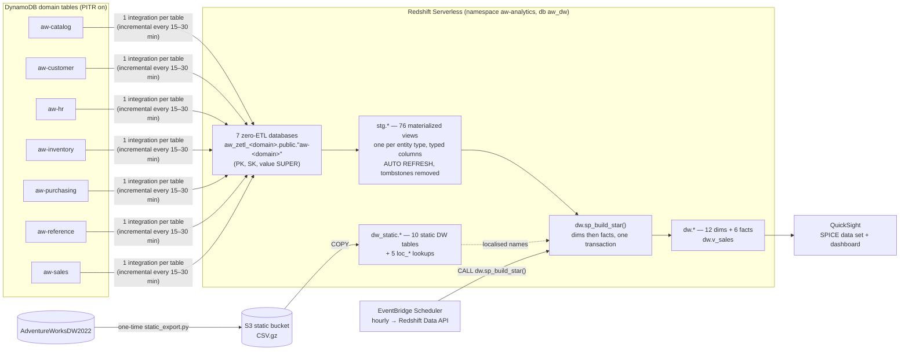
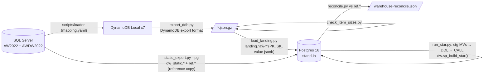

# Phase 6 – Analytics: DynamoDB zero-ETL → Redshift Serverless → AdventureWorksDW star schema → QuickSight

**Status: as built and verified locally** (CI workflow `warehouse`). Nothing has been deployed to AWS; the Terraform, Redshift
SQL and QuickSight definition are code only. Decisions: [ADR 0007](../adr/0007-zero-etl-redshift-star-schema.md).
Lineage input: [dw-lineage.md](../discovery/dw-lineage.md) · mapping: `design/mapping/mapping.yaml` (`dw_lineage`, now with `target`).

## Architecture (as built)

Layers:

| Layer | Where | Code | Notes |
|---|---|---|---|
| Landing | `aw_zetl_<domain>` databases (one per DynamoDB table / integration) | `infra/modules/warehouse/zero_etl.tf`, `warehouse/sql/redshift/00_setup.sql` | Read-only; `"PK"`, `"SK"`, `value` SUPER in DynamoDB JSON (`{"attr": {"S": …}}`) |
| Staging | `aw_dw.stg` | `warehouse/sql/redshift/10_staging_views.sql` (**generated** by `warehouse/gen_staging.py` from `mapping.json`) | One MV per entity type, `WHERE type = '<Entity>' AND deleted IS NOT true`; xml_map demographics flattened to `demo_*` |
| Star | `aw_dw.dw` | `warehouse/sql/star/01_ddl.sql`, `02_dims.sql`, `03_facts.sql`, `04_views.sql`; procedure `20_build_procedure.sql` (generated) | **Portable SQL**: the same files run on Redshift and on the Postgres stand-in |
| Static | `aw_dw.dw_static` | `05_static_ddl.sql` + `redshift/40_static_copy.sql` (generated by `warehouse/local/static_export.py --ddl`) | Decision 3; loaded once from S3 |
| Physical | Redshift only | `warehouse/sql/redshift/30_physical.sql` | DISTKEY/SORTKEY/DISTSTYLE ALL |
| Schedule | EventBridge Scheduler → Redshift Data API | `infra/modules/warehouse/schedule.tf` | `rate(1 hour)`; zero-ETL lag is 15–30 min |
| BI | QuickSight | `infra/modules/warehouse/quicksight.tf`, `aws/warehouse/quicksight/dashboard.json` + `deploy.sh` | Optional (needs a QuickSight principal) |

### Why the shared layer is portable
Only the staging layer knows the dialect (`value."attr"."N"::varchar` on Redshift vs `value->'attr'->>'N'` on Postgres); it is
generated for both from the same mapping. Everything above it is restricted to SQL that behaves the same on both engines
(`tests/warehouse/test_static.py` rejects `::`, `DATEADD`, `generate_series`, `FILTER`, `TRUNCATE`, `IDENTITY`, `MERGE`, `QUALIFY`,
`LISTAGG`, … in those files), and the build is one PL/pgSQL procedure valid on both — CI creates and `CALL`s the exact
procedure Redshift would run.

## Local verification path (CI job `warehouse-e2e`)

`scripts/warehouse-up.sh` runs the whole chain against an already loaded DynamoDB Local (`scripts/design-validate.sh`).
Memory: Postgres runs with `-m 1500m`; CI stops the 7 DynamoDB Local JVMs right after the export (`STOP_DDB_AFTER_EXPORT=1`).
Run time on the box: export ≈ 1.5 min, landing load ≈ 1.5 min, staging MVs 6–10 s, `sp_build_star()` ≈ 4 s, reconcile 2 s.

Tests (`tests/warehouse`): portable-SQL lint; generated SQL in sync; QuickSight definition validated against the botocore
QuickSight `CreateDashboard` model and against the data-set columns; `terraform fmt/validate` (no credentials);
idempotent rebuild; a DynamoDB-native order (`src=ddb`, `SO-DDB-…`) flows into `fact_internet_sales` and a tombstoned
line (`deleted=true`) drops out; static carry-over row counts; FactSurveyResponse still joins DimCustomer.

## What the star schema covers

| AdventureWorksDW2022 | Redshift (as built) | Rows rebuilt / DW | Key |
|---|---|---|---|
| DimDate | `dw.dim_date` (generated) | 3,652 / 3,652 | `date_key` YYYYMMDD |
| DimCustomer | `dw.dim_customer` | 18,484 / 18,484 | `customer_key` = CustomerID (same as DW) |
| DimGeography | `dw.dim_geography` | 650 / 655 | row_number over country/state/city/postal |
| DimReseller | `dw.dim_reseller` | 701 / 701 | row_number by store; `store_id` lineage column |
| DimProduct (SCD2) | `dw.dim_product` | 606 / 606 | row_number by ProductID, version start; `product_id` lineage column |
| DimProductCategory / Subcategory | `dw.dim_product_category` / `_subcategory` | 4 / 4, 37 / 37 | = OLTP id (same as DW) |
| DimPromotion | `dw.dim_promotion` | 16 / 16 | = SpecialOfferID (same as DW) |
| DimSalesTerritory | `dw.dim_sales_territory` | 11 / 11 | = TerritoryID, NA = 11 (same as DW) |
| DimEmployee (SCD2) | `dw.dim_employee` | 296 / 296 | row_number by employee, assignment start; `business_entity_id` lineage column |
| DimCurrency | `dw.dim_currency` | 105 / 105 | row_number by code |
| DimSalesReason | `dw.dim_sales_reason` | 10 / 10 | = SalesReasonID |
| FactInternetSales | `dw.fact_internet_sales` | 60,398 / 60,398 | order number + line |
| FactResellerSales | `dw.fact_reseller_sales` | 60,919 / 60,855 | order number + line |
| FactInternetSalesReason | `dw.fact_internet_sales_reason` | 64,515 / 64,515 | |
| FactSalesQuota | `dw.fact_sales_quota` | 163 / 163 | |
| FactCurrencyRate | `dw.fact_currency_rate` | 13,532 / 14,264 | currency + day |
| FactProductInventory | `dw.fact_product_inventory` | 417,365 / 776,286 | product version + day |
| FactFinance, DimAccount, DimOrganization, DimDepartmentGroup, DimScenario, FactCallCenter, FactSurveyResponse, FactAdditionalInternationalProductDescription, NewFactCurrencyRate, ProspectiveBuyer | `dw_static.*` (static, verbatim, snake_case columns) | equal (39,409 / 99 / 14 / 7 / 3 / 120 / 2,727 / 15,168 / 50 / 2,059) | DW keys |
| localised names (category, subcategory, promotion, country, product) | `dw_static.loc_*` joined in by the build | 4 / 37 / 16 / 6 / 504 | business key |
| vDMPrep, vTargetMail, … (data-mining views) | not rebuilt; `dw.v_sales` (both channels, denormalised) feeds QuickSight | | |

Not carried: binary columns (`DimProduct.LargePhoto`, `DimEmployee.EmployeePhoto`, `DimSalesTerritory.SalesTerritoryImage`),
`DimCustomer` Spanish/French education/occupation, `DimProduct` descriptions other than en/fr, `DimReseller` order-frequency
columns, `DimGeography.IpAddressLocator` (no source in the replicated items).

## Reconciliation (local, 2026-10-12, against AdventureWorksDW2022)

Facts are matched on `(SalesOrderNumber, SalesOrderLineNumber)` — AdventureWorksDW2022 ships shifted dates, so dates are not a join key.
The gate (`reconcile.py`, fails CI) is: equal row counts except the known differences below, every DW internet/reseller line
rebuilt, equal quantity/sales/extended amounts, matching product version, standard cost, customer/reseller/employee,
territory, promotion and currency on every matched line, DimDate attributes identical from 2011 on, all 64,515 sales-reason
rows matched, final inventory balance = on-hand quantity.

| Check | Result |
|---|---|
| FactInternetSales | 60,398 = 60,398 lines, all matched. SalesAmount 29,358,677.2207, OrderQuantity 60,398, TaxAmt 2,348,694.2301, Freight 733,969.6091, TotalProductCost 17,277,793.5757 — **identical to the DW**. Product version, standard cost, customer, territory, promotion, currency match on 60,398/60,398 |
| FactResellerSales | 60,919 rebuilt vs 60,855; all 60,855 DW lines matched, 64 extra OLTP lines (newer orders). On matched lines SalesAmount 80,450,596.9823, OrderQuantity 214,378, ExtendedAmount, TotalProductCost **identical**; product/cost/reseller/employee/territory/promotion/currency 60,855/60,855. TaxAmt/Freight +21.74 % (see below) |
| FactInternetSalesReason | 64,515/64,515 matched |
| FactSalesQuota | 163 = 163, SalesAmountQuota 95,714,000 = 95,714,000 |
| FactCurrencyRate | 13,532 vs 14,264; same 14 currencies |
| FactProductInventory | 417,365 rows, 595 products; final balance = on-hand for every product; 166,623 rows with negative balances (sample-data history is not self-consistent) |
| DimCustomer | 18,484 key + alternate key, name, e-mail, education, geography (city+postal) all 18,484/18,484; birth date 0 (DW values are synthetic) |
| DimReseller | 701/701 on alternate key, name, business type, annual sales |
| DimProduct | 606/606 on alternate key + version; list price 604, dealer price 604, standard cost 595, status 606 |
| DimEmployee | 296/296 on national id + version; territory 296, parent 293, department 290 |
| DimDate | identical on every attribute from 2011-01-01; 2,191 fiscal-year differences before 2011 (DW convention changes in 2011) |
| Other dims | currency 105, promotion 16, territory 11, sales reason 10, category 4, subcategory 37 — key + name all match (currency matched by code; DW currency keys are not alphabetical) |

**Known differences** (documented in `reconcile.py` `KNOWN`, not gated):
- *Reseller TaxAmt/Freight*: the DW applies a flat 8 % tax / 2.5 % freight to SalesAmount. The rebuild allocates the real order-header TaxAmt/Freight by line share (for internet orders both give the same result). Decision R-1 below.
- *DimGeography 650 vs 655*: the rebuild keeps only geographies that a customer home or reseller main-office address points at.
- *FactCurrencyRate*: the DW has 732 synthesised rate-days that are not in Sales.CurrencyRate.
- *FactProductInventory*: the DW synthesises 606 product versions × 1,281 days; the rebuild has one row per product and day from the product's first movement to the last movement date.
- *DimCustomer* birth date / yearly income / date first purchase: taken from `Person.Demographics`; yearly income is the floor of the band (`25001-50000` → 25001).
- *DimDate fiscal year*: FY named by its start year (FY2012 = Jul 2012–Jun 2013), the DW's rule from 2011 on.

## Source-to-target mapping (as built)

Notation: `entity.attr` = column of `stg.<entity>` (= the DynamoDB attribute of that entity type). Full SQL in `warehouse/sql/star`.

### Dimensions
| Target column(s) | Source | Rule |
|---|---|---|
| **dim_date** all | – | generated 2005-01-01…2014-12-31; `day_number_of_week` 1 = Sunday; week 1 contains 1 Jan, weeks start Sunday; English/Spanish/French names by CASE; fiscal quarter `((m+5)%12)/3+1`, fiscal year = start year |
| **dim_customer**.customer_key, customer_alternate_key | customer.customer_id, customer.account_number | `WHERE customer.store_id IS NULL` |
| title, first/middle/last_name, suffix, name_style | person.* (`person.business_entity_id = customer.person_id`) | |
| birth_date, marital_status, gender, total_children, number_children_at_home, english_education, english_occupation, house_owner_flag, number_cars_owned, date_first_purchase, commute_distance | person.demo_* (Demographics xml_map) | dates: first 10 chars; `yearly_income` = band floor ('greater than 150000' → 150000) |
| email_address | email_address (lowest email_address_id) | |
| phone | phone (lowest type, number) | |
| address_line1/2, geography_key | party_address (Home first) → address → dim_geography (city, state code, postal, country) | |
| **dim_geography** city, state_province_code/name, country_region_code, postal_code | address.* | distinct over customer Home + store Main Office addresses |
| english_country_region_name / spanish / french | country.name / dw_static.loc_country | |
| sales_territory_key | state_province.territory_id | |
| **dim_reseller** reseller_alternate_key | customer.account_number of the store's customer (`customer.store_id = store.business_entity_id`, lowest customer_id) | |
| reseller_name, business_type, number_employees, product_line, annual_sales, annual_revenue, bank_name, year_opened | store.name, store.demo_* | business type BM/BS/OS → Value Added Reseller / Specialty Bike Shop / Warehouse; product_line = specialty |
| address_line1/2, geography_key | party_address (Main Office first) → address → dim_geography | |
| store_id | store.business_entity_id | lineage column (fact lookup) |
| **dim_product** one row per version | list_price_history (product without history: one row from product.sell_start_date) | key = row_number by product_id, start_date |
| product_alternate_key, english_product_name, color, size, weight, class, style, product_line, units, safety_stock_level, reorder_point, days_to_manufacture, finished_goods_flag, model_name, product_subcategory_key | product.* | |
| list_price / dealer_price | version list_price / list × 0.6 | finished goods only |
| standard_cost | cost_history with the same start date, else current product.standard_cost (0 → NULL) for the open version | |
| start_date, end_date, status | version dates; status 'Current' when end_date is null | |
| english/french_description | model_description culture en / fr | |
| spanish/french_product_name | dw_static.loc_product_name | static |
| **dim_product_category / subcategory** | category / subcategory + dw_static.loc_* | key = OLTP id |
| **dim_promotion** | special_offer (+ loc_promotion); english_promotion_type = special_offer.sql_type (Type column) | key = SpecialOfferID |
| **dim_sales_territory** | sales_territory (+ country name); `"group"` → sales_territory_group | + NA row 11/0 |
| **dim_employee** one row per department_assignment | employee.*, department_assignment.department_name/start/end | key = row_number by employee, start |
| parent_employee_key / parent_…_alternate_key | current version of the employee whose org_path = this org_path minus last segment | |
| middle_name, name_style / email / phone | person / email_address / phone of the employee | |
| base_rate, pay_frequency | latest pay_rate | |
| sales_territory_key, sales_person_flag | sales_person.territory_id (else 11), exists in sales_person | |
| **dim_currency** | currency.currency_code, name | key = row_number by code |
| **dim_sales_reason** | sales_reason.* | key = id |

### Facts
| Target | Source | Rule |
|---|---|---|
| **fact_internet_sales** / **fact_reseller_sales** grain | order ⨝ order_line | `online_order_flag` true / false |
| sales_order_number, sales_order_line_number, revision_number, carrier_tracking_number, customer_po_number, order/due/ship_date (+ `_key`) | order.*, order_line.* | line number = row_number by sales_order_detail_id within the order |
| product_key | dim_product version with the latest start ≤ order date (else first version) | |
| product_standard_cost, total_product_cost | cost_history at order date (else product.standard_cost) × qty | |
| order_quantity, unit_price, unit_price_discount_pct | order_line.order_qty, unit_price, unit_price_discount | |
| extended_amount, discount_amount, sales_amount | qty × unit_price, × discount, order_line.line_total | |
| tax_amt, freight | order.tax_amt / order.freight × line_total / sub_total | |
| customer_key (internet) | order.customer_id | |
| reseller_key, employee_key (reseller) | dim_reseller via customer.store_id; current dim_employee of order.sales_person_id | |
| promotion_key, sales_territory_key, currency_key | order_line.special_offer_id, order.territory_id, dim_currency of order.currency_to (else USD) | |
| **fact_internet_sales_reason** | order_sales_reason ⨝ internet lines | (order number, line number, reason) |
| **fact_sales_quota** | sales_quota; employee_key = current version | key = row_number |
| **fact_currency_rate** | currency_rate (to-currency; last rate per day) | |
| **fact_product_inventory** | inventory_transaction (P/W = in, S = out) per product and day; grid from first movement to the last movement date; balance = on-hand (product_inventory) − total net + running net | product_key = version at that day; unit_cost = version standard cost |

## Deploying on AWS (runbook — not executed)
1. Source tables: created by `infra/modules/dynamodb` (Phase 7) with PITR and the W-1 keys (AWS-owned / CMK with Redshift grant). The whole stack is deployed by `infra/live` — see docs/aws-setup.md.
2. `scripts/aws/tf.sh <env> apply` (the warehouse is the `module.warehouse` of `infra/live`: namespace, workgroup with `enable_case_sensitive_identifier`, usage limit, resource policies, 7 integrations, static bucket, scheduler, optional QuickSight).
3. In `aw_dw` as admin: `00_setup.sql` (fill integration ids from `SVV_INTEGRATION`), `10_staging_views.sql`, `star/01_ddl.sql`, `star/05_static_ddl.sql`.
4. `python warehouse/local/static_export.py --out /tmp/aw-static`, `aws s3 cp /tmp/aw-static s3://<static_bucket>/static/ --recursive --exclude 'ref.*'`, then `40_static_copy.sql` (fill bucket/role).
5. `30_physical.sql`, `star/20_build_procedure.sql`, `CALL dw.sp_build_star();`, `star/04_views.sql`; the schedule takes over.
6. QuickSight (showcase only, W-4): set `enable_quicksight = true` and `quicksight_principal_arn`, apply, then `aws/warehouse/quicksight/deploy.sh`.

## Verified only on real AWS
- The SUPER navigation/casts in the generated Redshift staging (`value."a"."N"::varchar` → `CAST(… AS decimal)`), and `COALESCE` over SUPER.
- `CREATE MATERIALIZED VIEW … AUTO REFRESH YES` on 3-part names into zero-ETL databases (cross-database MV, incremental refresh).
- Whether the zero-ETL `value` column also repeats PK/SK (the build only reads them from the key columns, so either works).
- `INSERT … WITH … SELECT`, `CREATE TABLE AS`/`DROP TABLE` and `CAST(DATE '…' + n AS date)` inside the Redshift procedure; runtime and RPU cost.
- Terraform apply: `aws_redshift_integration` + resource policies, KMS grants for CMK-encrypted tables, Scheduler → Data API permissions.
- The 64 KB per-attribute limit: largest today is `Document.document` at 62,141 bytes (95 %); `TRUNCATECOLUMNS` is set on `aw_zetl_catalog`.
- QuickSight rendering of `dashboard.json` (validated only against the API model), SPICE incremental refresh.
- Zero-ETL replication lag (15–30 min) end-to-end with the CDC pipeline.

## Changes from initial design
The starting point was `dw-lineage.md` (phase 1), the phase-6 row of PLAN.md and the brief "zero-ETL → SUPER → MVs or stored procedures".

| # | Initial | As built | Why |
|---|---|---|---|
| 1 | One zero-ETL landing database | **7 databases**, `aw_zetl_<domain>`, one per table | A DynamoDB integration has exactly one source table and its own target database |
| 2 | Staging as (late-binding) views | **Materialized views** `stg.*`, `AUTO REFRESH YES`, generated from mapping.json | Plain views re-navigated jsonb/SUPER on every join (first local build: 7.5 min for dims; with MVs + ANALYZE: 0.3 s). On Redshift, MVs over zero-ETL tables refresh incrementally |
| 3 | "MVs or stored procedures" for the star | **One stored procedure** `dw.sp_build_star()` (DELETE + INSERT), scheduled hourly | SCD2 window functions and multi-table dependencies do not refresh incrementally as MVs; one transaction keeps dims and facts consistent. DELETE instead of TRUNCATE (TRUNCATE commits inside Redshift procedures) |
| 4 | Redshift-specific SQL | **Portable SQL** layer + generated dialect-specific staging | Lets CI run the exact build procedure on Postgres |
| 5 | Static carry-over list (10 tables + localised names of geography/category/subcategory/promotion) | + **`loc_product_name`** (Spanish/French product names) | No OLTP source for them either |
| 6 | FactProductInventory = DW grain (606 versions × all days) | Per product from first movement to the last movement date; balance anchored to on-hand | The DW grain is synthetic; the rebuild reflects the replicated movements |
| 7 | FactResellerSales tax/freight = DW | Real header TaxAmt/Freight allocated by line share | DW uses flat 8 %/2.5 %; decision R-1 |
| 8 | DimDate fiscal year as DW | FY named by start year throughout | DW changes its rule in 2011 (date-shift artefact); all OLTP dates are 2011+ |
| 9 | Surrogate keys preserved "where needed" | CustomerID, SpecialOfferID, TerritoryID, category/subcategory/reason ids kept; others deterministic row_number. Lineage columns `product_id`, `store_id`, `business_entity_id` added | Deterministic rebuilds; FactSurveyResponse joins DimCustomer |
| 10 | Data-mining views rebuilt if needed | Not rebuilt; `dw.v_sales` for QuickSight | QuickSight needs one wide sales view |
| 11 | P3-2: AWS-managed KMS key on 5 tables | AWS-owned key on 5 tables; CMKs on aw-hr/aw-customer with a Redshift key-policy grant | Zero-ETL does not support AWS-managed keys — decision W-1 (accepted) |
| 12 | – | Binary/image columns and some localised attribute columns not carried | Not in the replicated items / not needed for BI |
| 13 | – | `TRUNCATECOLUMNS` on `aw_zetl_catalog`, CI size pre-flight | Product documents are at 95 % of the 64 KB attribute limit |

## Decisions (accepted by John 2026-10-12, ADR 0007)
- **W-1 KMS** — AWS-owned keys for the 5 non-sensitive tables; CMKs kept on aw-hr/aw-customer with a key-policy grant for Redshift zero-ETL (ADR 0004 P3-2 amended; `infra/modules/dynamodb`).
- **R-1 Reseller tax/freight** — real order totals allocated by line share (as built).
- **W-2 Schedule** — hourly `CALL dw.sp_build_star()`.
- **W-3 FactProductInventory grain** — as built (movement span).
- **W-4 QuickSight** — Enterprise only for the showcase; `enable_quicksight` toggle in Terraform (default off).
