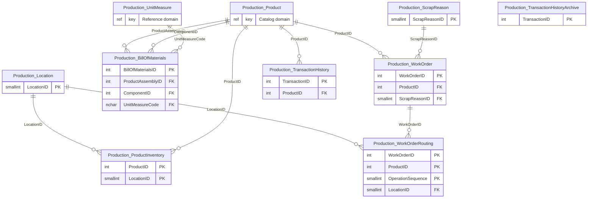
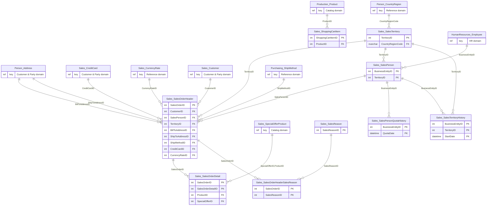
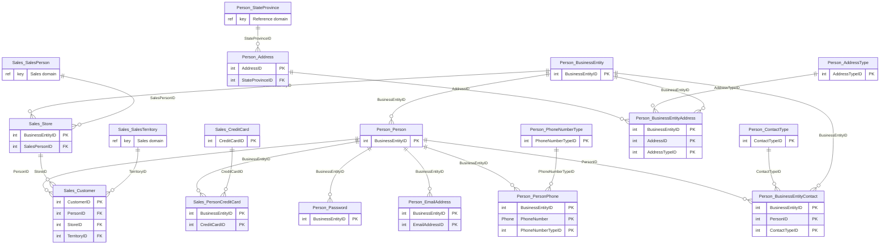
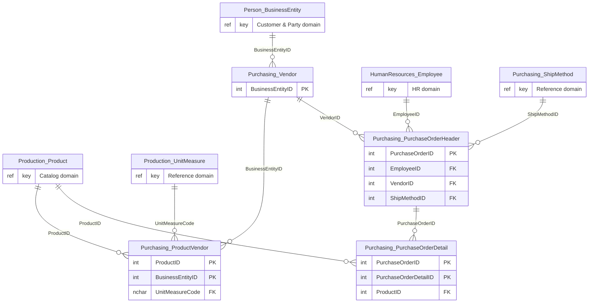
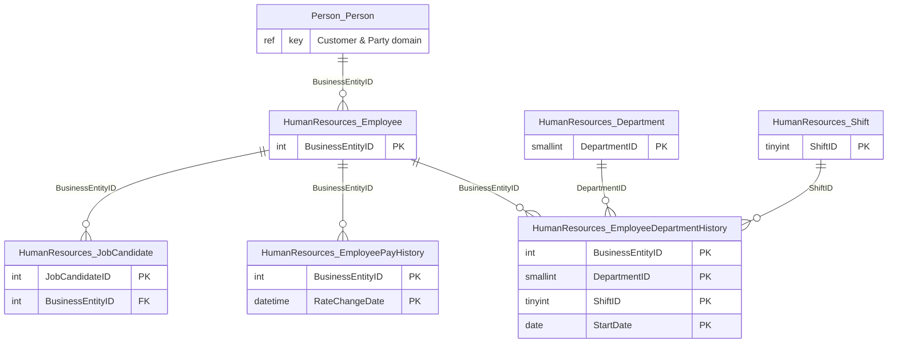
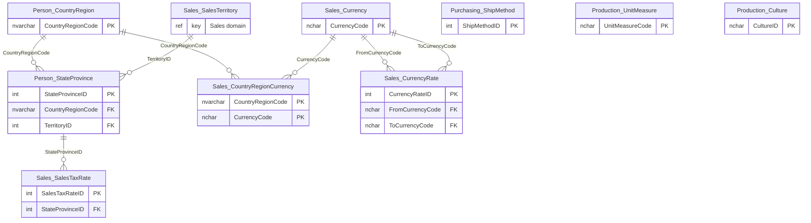

# Domain diagrams (generated)

Generated by `scripts/discovery/domains.py` from `schema.json` + `domains.json`. Entities from other domains appear with only their key, marking a cross-domain reference.

## Catalog → `aw-catalog`

_What we sell and how it is described/priced. Read-heavy, shopper-facing, changes rarely._

```mermaid
erDiagram
  Production_Product {
    int ProductID PK
    nchar SizeUnitMeasureCode FK
    nchar WeightUnitMeasureCode FK
    int ProductSubcategoryID FK
    int ProductModelID FK
  }
  Production_UnitMeasure ||--o{ Production_Product : "SizeUnitMeasureCode"
  Production_UnitMeasure ||--o{ Production_Product : "WeightUnitMeasureCode"
  Production_ProductModel ||--o{ Production_Product : "ProductModelID"
  Production_ProductSubcategory ||--o{ Production_Product : "ProductSubcategoryID"
  Production_ProductCategory {
    int ProductCategoryID PK
  }
  Production_ProductSubcategory {
    int ProductSubcategoryID PK
    int ProductCategoryID FK
  }
  Production_ProductCategory ||--o{ Production_ProductSubcategory : "ProductCategoryID"
  Production_ProductModel {
    int ProductModelID PK
  }
  Production_ProductDescription {
    int ProductDescriptionID PK
  }
  Production_ProductModelProductDescriptionCulture {
    int ProductModelID PK
    int ProductDescriptionID PK
    nchar CultureID PK
  }
  Production_ProductDescription ||--o{ Production_ProductModelProductDescriptionCulture : "ProductDescriptionID"
  Production_Culture ||--o{ Production_ProductModelProductDescriptionCulture : "CultureID"
  Production_ProductModel ||--o{ Production_ProductModelProductDescriptionCulture : "ProductModelID"
  Production_ProductPhoto {
    int ProductPhotoID PK
  }
  Production_ProductProductPhoto {
    int ProductID PK
    int ProductPhotoID PK
  }
  Production_Product ||--o{ Production_ProductProductPhoto : "ProductID"
  Production_ProductPhoto ||--o{ Production_ProductProductPhoto : "ProductPhotoID"
  Production_ProductReview {
    int ProductReviewID PK
    int ProductID FK
  }
  Production_Product ||--o{ Production_ProductReview : "ProductID"
  Production_ProductListPriceHistory {
    int ProductID PK
    datetime StartDate PK
  }
  Production_Product ||--o{ Production_ProductListPriceHistory : "ProductID"
  Production_ProductCostHistory {
    int ProductID PK
    datetime StartDate PK
  }
  Production_Product ||--o{ Production_ProductCostHistory : "ProductID"
  Production_Illustration {
    int IllustrationID PK
  }
  Production_ProductModelIllustration {
    int ProductModelID PK
    int IllustrationID PK
  }
  Production_ProductModel ||--o{ Production_ProductModelIllustration : "ProductModelID"
  Production_Illustration ||--o{ Production_ProductModelIllustration : "IllustrationID"
  Production_Document {
    hierarchyid DocumentNode PK
    int Owner FK
  }
  HumanResources_Employee ||--o{ Production_Document : "Owner"
  Production_ProductDocument {
    int ProductID PK
    hierarchyid DocumentNode PK
  }
  Production_Product ||--o{ Production_ProductDocument : "ProductID"
  Production_Document ||--o{ Production_ProductDocument : "DocumentNode"
  Sales_SpecialOffer {
    int SpecialOfferID PK
  }
  Sales_SpecialOfferProduct {
    int SpecialOfferID PK
    int ProductID PK
  }
  Production_Product ||--o{ Sales_SpecialOfferProduct : "ProductID"
  Sales_SpecialOffer ||--o{ Sales_SpecialOfferProduct : "SpecialOfferID"
  HumanResources_Employee {
    ref key "HR domain"
  }
  Production_Culture {
    ref key "Reference domain"
  }
  Production_UnitMeasure {
    ref key "Reference domain"
  }
```

## Inventory & Manufacturing → `aw-inventory`

_Stock levels, BOM and shop-floor work orders. Write-heavy, operational, not shopper-facing except stock check._

## Sales → `aw-sales`

_Orders, carts and the sales organisation (sales people, territories, quotas). Highest write volume; target of the live CDC demo._

## Customer & Party → `aw-customer`

_Everyone we know: persons, stores (B2B customers), contacts, addresses, emails, phones, payment cards, logins. Supports login/profile and is the 'who' for Sales/Purchasing/HR._

## Purchasing → `aw-purchasing`

_Vendors, what they supply, purchase orders. Independent lifecycle from sales._

## HR → `aw-hr`

_Employees, org, pay, shifts, candidates. Sensitive data (pay, national ID) isolated in its own table/IAM boundary._

## Reference → `aw-reference`

_Small shared lookup data used by several domains (geo, currency/FX, tax, ship methods, units, cultures). Read-mostly, cached in apps, copied into consumers where needed._

## Cross-domain foreign keys (31)

| From (domain) | Column(s) | To (domain) |
|---|---|---|
| Production.Product (Catalog) | SizeUnitMeasureCode | Production.UnitMeasure (Reference) |
| Production.Product (Catalog) | WeightUnitMeasureCode | Production.UnitMeasure (Reference) |
| Production.ProductModelProductDescriptionCulture (Catalog) | CultureID | Production.Culture (Reference) |
| Production.Document (Catalog) | Owner | HumanResources.Employee (HR) |
| Production.ProductInventory (Inventory & Manufacturing) | ProductID | Production.Product (Catalog) |
| Production.BillOfMaterials (Inventory & Manufacturing) | ProductAssemblyID | Production.Product (Catalog) |
| Production.BillOfMaterials (Inventory & Manufacturing) | ComponentID | Production.Product (Catalog) |
| Production.BillOfMaterials (Inventory & Manufacturing) | UnitMeasureCode | Production.UnitMeasure (Reference) |
| Production.WorkOrder (Inventory & Manufacturing) | ProductID | Production.Product (Catalog) |
| Production.TransactionHistory (Inventory & Manufacturing) | ProductID | Production.Product (Catalog) |
| Sales.SalesOrderHeader (Sales) | BillToAddressID | Person.Address (Customer & Party) |
| Sales.SalesOrderHeader (Sales) | ShipToAddressID | Person.Address (Customer & Party) |
| Sales.SalesOrderHeader (Sales) | CreditCardID | Sales.CreditCard (Customer & Party) |
| Sales.SalesOrderHeader (Sales) | CurrencyRateID | Sales.CurrencyRate (Reference) |
| Sales.SalesOrderHeader (Sales) | CustomerID | Sales.Customer (Customer & Party) |
| Sales.SalesOrderHeader (Sales) | ShipMethodID | Purchasing.ShipMethod (Reference) |
| Sales.SalesOrderDetail (Sales) | SpecialOfferID,ProductID | Sales.SpecialOfferProduct (Catalog) |
| Sales.ShoppingCartItem (Sales) | ProductID | Production.Product (Catalog) |
| Sales.SalesPerson (Sales) | BusinessEntityID | HumanResources.Employee (HR) |
| Sales.SalesTerritory (Sales) | CountryRegionCode | Person.CountryRegion (Reference) |
| Sales.Customer (Customer & Party) | TerritoryID | Sales.SalesTerritory (Sales) |
| Sales.Store (Customer & Party) | SalesPersonID | Sales.SalesPerson (Sales) |
| Person.Address (Customer & Party) | StateProvinceID | Person.StateProvince (Reference) |
| Purchasing.Vendor (Purchasing) | BusinessEntityID | Person.BusinessEntity (Customer & Party) |
| Purchasing.ProductVendor (Purchasing) | ProductID | Production.Product (Catalog) |
| Purchasing.ProductVendor (Purchasing) | UnitMeasureCode | Production.UnitMeasure (Reference) |
| Purchasing.PurchaseOrderHeader (Purchasing) | EmployeeID | HumanResources.Employee (HR) |
| Purchasing.PurchaseOrderHeader (Purchasing) | ShipMethodID | Purchasing.ShipMethod (Reference) |
| Purchasing.PurchaseOrderDetail (Purchasing) | ProductID | Production.Product (Catalog) |
| HumanResources.Employee (HR) | BusinessEntityID | Person.Person (Customer & Party) |
| Person.StateProvince (Reference) | TerritoryID | Sales.SalesTerritory (Sales) |
