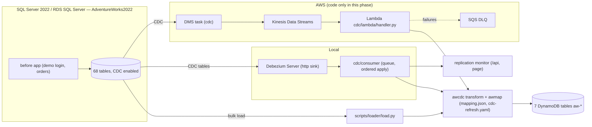

# Phase 4 — Migration and CDC (SQL Server → DynamoDB)

One transform library, two transports. The mapping (`design/mapping/mapping.json`, generated from `mapping.yaml`) drives
the bulk loader, the local Debezium consumer and the AWS Lambda, so all three produce identical items.



## The transform (`cdc/awcdc/transform.py`)
| Concern | How |
|---|---|
| Event shape | `Change(table, op c/u/d/r, position, before, after, commit_ts_ms)`; `from_debezium()` and `from_dms()` normalise both transports. |
| Ordering / idempotency | `src_lsn` on every item; `PutItem ... ConditionExpression attribute_not_exists(PK) OR src_lsn < :position`. Replays and older events are skipped. Position = SQL Server LSN `0x` + 20 hex (Debezium `change_lsn`); DMS uses `AR_H_CHANGE_SEQ` (added as a column by the task) as `0x` + 30 hex. Bulk load uses `0x000…0`, below every real position. |
| Row building (P4-1) | `design/mapping/cdc-enrichment.yaml`, same on both transports. **image** (38 tables): the event's full row image is the row. **lookup** (15): image + `GetItem` of the parent item for copied attributes (e.g. order line → `PRODUCT#…` name/number) + computed columns re-implemented (`LineTotal`, `StockedQty`, `card_last4`, …; CDC images never carry computed columns). **sql** (15: Product, Document, ProductDocument, BillOfMaterials, SalesOrderHeader, SalesPerson, SalesTerritoryHistory, Customer, Store, PersonCreditCard, Address, BusinessEntityAddress, BusinessEntityContact, PurchaseOrderHeader, Employee): re-read through `source_sql`. A missing parent falls back to SQL if available. `CDC_ENRICHMENT=sql` forces SQL everywhere; `CDC_SQL_ENABLED=false` (Lambda) runs without SQL. |
| Same items as bulk load | `tests/cdc/test_identity.py`: all 68 tables via SQL, and every image/lookup table **without SQL access** (lookups served from bulk-loaded parents), against the loader's own `mapping.yaml`. |
| Deletes | D10 tombstones: keys kept, GSI keys dropped, `deleted=true`, `deleted_at`, **`ttl` = capture time + 7 days** (P3-4). Keys of a deleted row are computed by running `source_sql` with the base table replaced by the before-image (computed columns recomputed, hierarchyid/geography from bytes; joins become LEFT JOINs because parents may be gone in the same transaction). |
| Multi-item rows | one row → N items (e.g. Product → product, name index, number index); all written with the same position. On update, items whose key moved (e.g. new PO number) get a tombstone for the old key. |
| Snapshot copies (P4-2, P4-3) | Refreshes run inside the CDC transform. `design/mapping/cdc-refresh.yaml`: when a parent changes, dependent rows are re-read and their items updated in place (`UpdateItem`, `attribute_exists(PK) AND attribute_not_exists(deleted)`, `src_lsn` untouched so the copy never blocks the row's own later change). Owner per rule as in the Phase 3 design. Copied attributes whose source became NULL are removed (`REMOVE`). Immutable order-time snapshots (order lines, header addresses/card) are never refreshed. |

## Local path
```bash
scripts/before-up.sh        # SQL Server + demo app (CDC on all 68 tables)
scripts/cdc-up.sh           # DynamoDB Local x7, consumer (paused), Debezium streaming, bulk load, resume
open http://localhost:8090/ # replication monitor
AW_E2E=1 DDB_MULTI=1 python -m pytest tests/cdc/test_e2e.py
DDB_MULTI=1 python scripts/reconcile.py
```
**No gap, no duplicates:** Debezium starts first with `snapshot.mode=no_data`, i.e. it streams every change committed after
it starts. The consumer accepts and durably queues those events but does not apply them until the bulk load is done.
Changes that the bulk load already read are then re-applied with a higher position (same content, idempotent); changes it
missed are applied. Nothing is lost because capture started before the load read anything; nothing is double-applied
because every write is conditional on position.

Consumer details: SQLite inbox (WAL) → single applier thread in arrival order (Debezium delivers in LSN order). Errors
retry 3×, then the event goes to the `dlq` state (`GET /api/dlq`) and processing continues. Restart-safe: Debezium offsets
and the inbox persist.

## AWS path (code + config; no AWS calls in this phase)
- `aws/dms/`: `sqlserver-source-endpoint.json` (RDS, `msdb.dbo.rds_cdc_enable_db` + per-table enable), `kinesis-endpoint.json`
  (JSON, include transaction details, partition by schema.table + PK), `table-mappings.json` (68 selection rules + an
  `add-column ar_h_change_seq = $AR_H_CHANGE_SEQ` per table), `task-settings.json` (before images on), `replication-task.json`
  (`MigrationType=cdc`, `CdcStartPosition` = LSN captured just before the bulk load).
- `cdc/lambda/handler.py`: Kinesis batch → `from_dms` → transform. `ReportBatchItemFailures`: stops at the first failing
  record and reports it, so it and everything after it in the shard are retried in order. Event source mapping (phase 7):
  `BisectBatchOnFunctionError`, `MaximumRetryAttempts=5`, on-failure destination SQS DLQ, `ParallelizationFactor=1`.
- **Idempotency note:** Lambda/Kinesis are at-least-once. Every write is conditional on position, so duplicates and DLQ
  replays are harmless and an old replay can never overwrite newer state. Refresh updates are idempotent by content.
- Enrichment: DMS messages carry full after images (`data`) and full before images (`before-image`, `ColumnFilter=all`); SQL read access (RDS read replica, VPC Lambda, Secrets Manager) only for the 15 sql-mode tables and snapshot refreshes.
- Packaging: `cdc/lambda/build.sh` → `dist/aw-cdc-lambda.zip` (handler, awcdc, awmap, sqlsrc, mapping.json,
  cdc-refresh.yaml, pymssql, pyyaml; Python 3.12 x86_64) for the phase 7 Terraform `aws_lambda_function`.
- Bulk load on AWS: same loader against RDS → DynamoDB (or S3 export + `ImportTable` for a cold start), with the DMS
  CDC start position taken before the load starts, the same handoff as locally.

## Replication monitor
`cdc/consumer/consumer.py` serves `GET /api/status` (queue, DLQ, last position, lag last/p50/max), `GET /api/changes`
(per change: SQL row → DynamoDB items/tombstones, copies refreshed, lag) and the page `cdc/monitor/index.html`
(self-contained component `#aw-replication-monitor[data-api]`, reused by the Phase 8 Data Mapping tab).

## Runbook
| Situation | Action |
|---|---|
| Start from scratch | `scripts/cdc-up.sh` (recreates DynamoDB Local, Debezium offsets and the inbox). |
| Consumer restarted | just restart `cdc/consumer/consumer.py`; it continues from its inbox. Debezium retries the HTTP sink. |
| Debezium restarted | offsets in the `debezium-data` volume; it resumes from its last committed LSN. |
| DLQ not empty | `GET /api/dlq`; fix the cause and re-POST the bodies to `/events` (positions keep it idempotent). |
| Check consistency | `scripts/reconcile.py` (counts + checksums per source table, orphans and tombstones per DynamoDB table). |
| CDC retention (P4-4) | 7 days: `EXEC sys.sp_cdc_change_job @job_type = N'cleanup', @retention = 10080` (local: 02-enable-cdc.sql; RDS: same statement after `msdb.dbo.rds_cdc_enable_db`, see `aws/dms/sqlserver-source-endpoint.json`; phase 7 Terraform runs it before creating the DMS task). A consumer down longer than 7 days needs a re-load. |

## Cutover story (D4)
1. Today: the old app writes SQL; CDC keeps DynamoDB current (one way). Redshift zero-ETL reads DynamoDB.
2. Phase 5: the .NET 10 app runs side by side, reads DynamoDB, writes native orders directly (`src='ddb'`, ids ≥ 10^9,
   `SO-DDB-` numbers) so they cannot collide with CDC-replicated SQL orders.
3. Cutover: route shoppers to the new app, put the old app read-only, let CDC drain (monitor shows queue 0, lag ~0),
   run `reconcile.py`, stop DMS/Debezium. SQL stays as an archive; no reverse replication.

## Measured (local, this box)
See the PR description and `docs/migration/results.json` (end-to-end insert/delete latency, consumer lag, reconciliation).
